# Aprendizado não supervisionado


```{r}
#| include: false
library(ggplot2)
library(dplyr)
library(tidyr)
library(patchwork)

azul <- "#263568"
azul2 <- "#2C7FB8"

tema_slide <- theme_minimal(base_size = 15) +
  theme(panel.grid.minor = element_blank(),
        plot.title = element_text(face = "bold"),
        legend.position = "top")

set.seed(335)
n <- 220
z1 <- rnorm(n,sd=2.2)
z2 <- rnorm(n,sd=.55)
theta <- pi/5
R <- matrix(c(cos(theta),-sin(theta),sin(theta),cos(theta)),2,2)
X <- cbind(z1,z2) %*% t(R)
dados_pca <- data.frame(x1=X[,1],x2=X[,2])
pca_fit <- prcomp(dados_pca,center=TRUE,scale.=FALSE)
centro <- colMeans(dados_pca)
v1 <- pca_fit$rotation[,1]
v2 <- pca_fit$rotation[,2]
```


<!-- # Redução de Dimensionalidade -->

<!-- ## Podemos representar os mesmos dados utilizando menos informação? -->


<!-- Imagine uma base de dados contendo centenas ou milhares de variáveis. -->


<!-- ::: columns -->

<!-- :::: {.column width="50%"} -->


<!-- O objetivo da redução de dimensionalidade é construir uma nova representação que: -->

<!-- - preserve a maior quantidade possível de informação; -->
<!-- - elimine redundâncias; -->
<!-- - facilite a visualização e a interpretação dos dados. -->

<!-- :::: -->

<!-- :::: {.column width="50%"} -->

<!-- 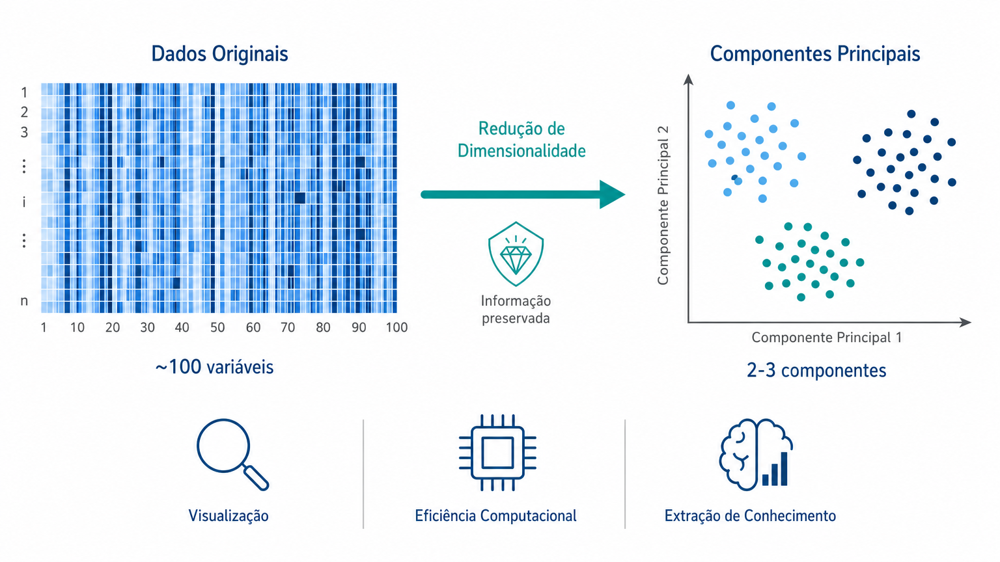{width=100%} -->

<!-- :::: -->

<!-- ::: -->

<!-- ## Podemos representar os mesmos dados utilizando menos informação? -->


<!-- > **Ideia central:** substituir um conjunto de muitas variáveis por um número menor de componentes que preservem a estrutura essencial dos dados. -->


<!-- ## O que significa reduzir a dimensionalidade? -->

<!-- Reduzir a dimensionalidade **não significa perder informação**, mas encontrar uma representação mais compacta dos dados. -->

<!-- ::: columns -->

<!-- :::: {.column} -->

<!-- ### Antes -->

<!-- - Muitas variáveis -->
<!-- - Alta redundância -->
<!-- - Difícil interpretação -->
<!-- - Alto custo computacional -->

<!-- :::: -->

<!-- :::: {.column} -->

<!-- ### Depois -->

<!-- - Poucos componentes -->
<!-- - Informação concentrada -->
<!-- - Visualização facilitada -->
<!-- - Modelos mais simples -->

<!-- :::: -->

<!-- ::: -->

<!-- > O objetivo é representar os dados em um espaço de menor dimensão preservando, tanto quanto possível, sua estrutura original. -->


<!-- ## Por que reduzir a dimensionalidade? -->

<!-- A redução da dimensionalidade traz diversos benefícios para a análise de dados.<br><br> -->

<!-- - 📊 Facilita a visualização de dados de alta dimensão. -->
<!-- - ⚡ Reduz o custo computacional de armazenamento e processamento. -->
<!-- - 📉 Elimina redundâncias entre variáveis. -->
<!-- - 🔍 Atenua o efeito do ruído nos dados. -->
<!-- - 🤖 Pode melhorar o desempenho de algoritmos de aprendizado de máquina. -->

<!-- > Quanto maior o número de variáveis, maior tende a ser a complexidade da análise. -->


<!-- ## A maldição da dimensionalidade -->

<!-- À medida que o número de variáveis aumenta, -->

<!-- - o volume do espaço cresce exponencialmente; -->
<!-- - os dados tornam-se cada vez mais esparsos; -->
<!-- - distâncias entre observações tornam-se menos informativas; -->
<!-- - aumenta a dificuldade para identificar padrões. -->

<!-- <br> -->

<!-- > Esse fenômeno é conhecido como **Maldição da Dimensionalidade** (*Curse of Dimensionality*). -->


<!-- --- -->

<!-- 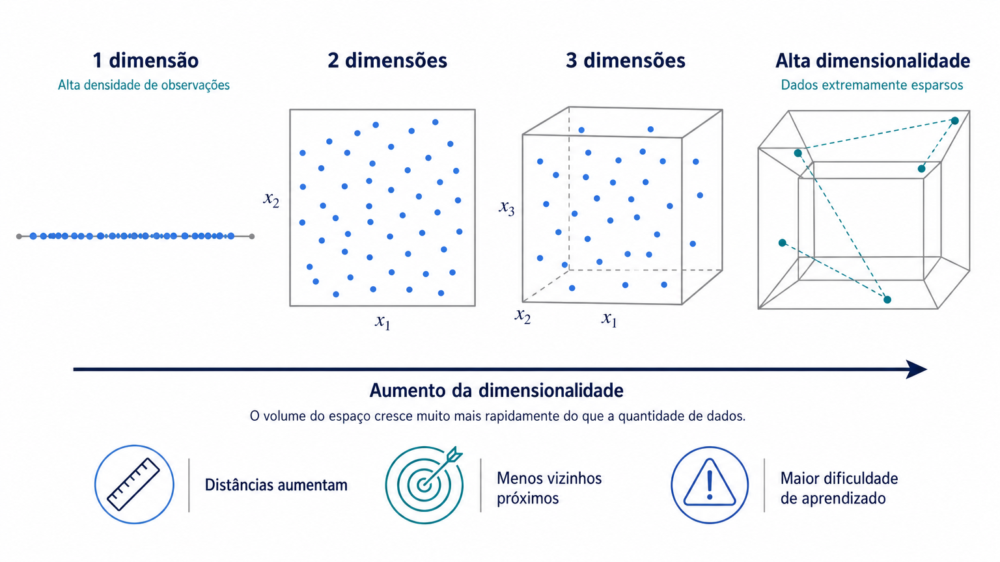{width=100%} -->


<!-- ## Existem duas estratégias principais -->

<!-- A redução da dimensionalidade pode ser realizada por duas abordagens distintas. -->

<!-- | Estratégia | Ideia | -->
<!-- |:-----------|:------| -->
<!-- | **Mudança de representação** | Construir novas variáveis a partir das originais. | -->
<!-- | **Seleção de variáveis** | Escolher apenas um subconjunto das variáveis existentes. | -->

<!-- Nesta aula estudaremos principalmente os métodos baseados em **mudança de representação**. -->


<!-- ## Qual é a ideia do PCA? -->

<!-- 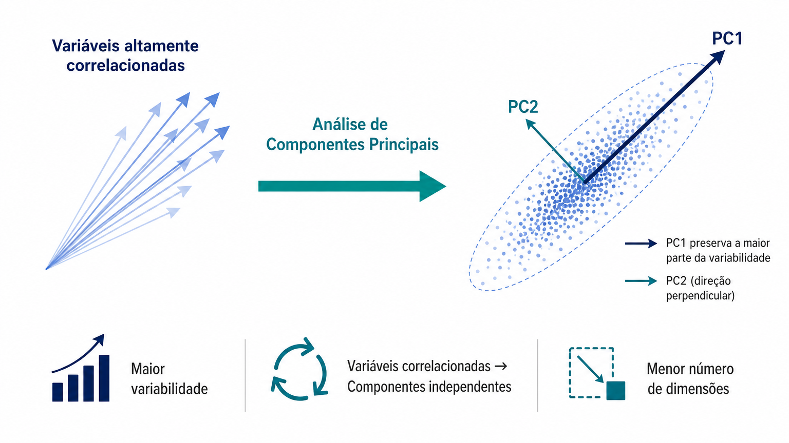{width=100%} -->


<!-- ## Qual problema o PCA resolve? -->

<!-- 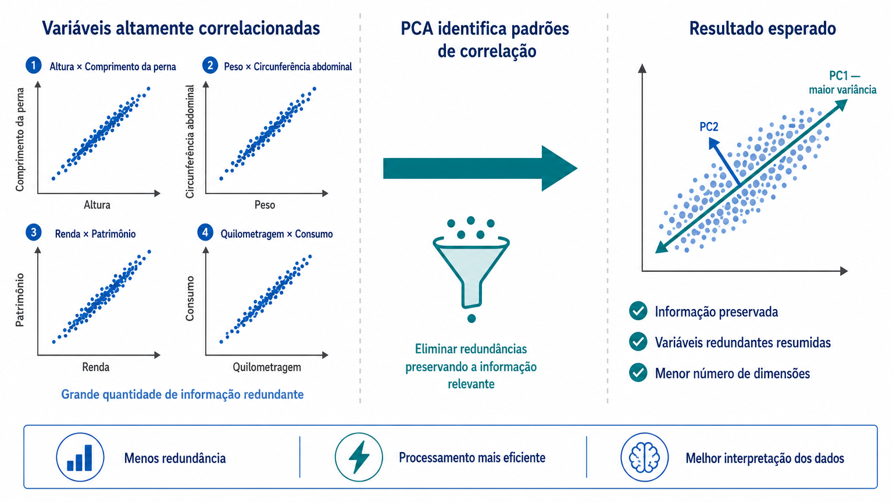{width=100%} -->


<!-- ## Como o PCA resolve esse problema? -->

<!-- 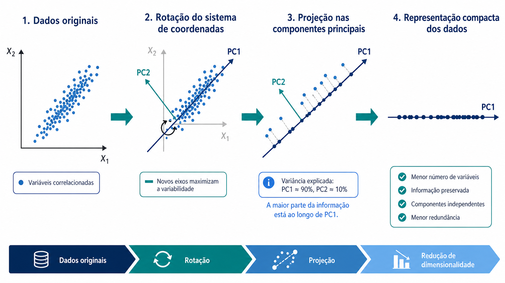{width=100%} -->


<!-- ## O que é uma componente principal? -->

<!-- Uma componente principal é uma **combinação linear** das variáveis originais. -->

<!-- $$ -->
<!-- PC_j = -->
<!-- a_{1j}X_1+ -->
<!-- a_{2j}X_2+\cdots+ -->
<!-- a_{pj}X_p -->
<!-- $$ -->

<!-- onde: -->

<!-- - $a_{ij}$ são os pesos (loadings); -->
<!-- - cada componente representa uma nova direção no espaço dos dados; -->
<!-- - as componentes são ortogonais entre si. -->


<!-- ## Objetivo do PCA -->

<!-- Encontrar uma sequência de componentes ortogonais que: -->

<!-- - expliquem a maior parte da variabilidade dos dados; -->
<!-- - sejam não correlacionadas entre si; -->
<!-- - utilizem o menor número possível de componentes. -->


<!-- ## Primeira componente principal -->

<!-- A primeira componente ($PC_1$) é a direção que maximiza a variância projetada dos dados. -->

<!-- $$ -->
<!-- PC_1 -->
<!-- = -->
<!-- \arg\max_{\|a\|=1} -->
<!-- Var(Xa) -->
<!-- $$ -->

<!-- Ela representa a direção de maior variabilidade existente na base de dados. -->


<!-- ## Segunda componente principal -->

<!-- A segunda componente ($PC_2$): -->

<!-- - maximiza a variabilidade remanescente; -->
<!-- - é ortogonal à primeira componente. -->

<!-- $$ -->
<!-- PC_2 \perp PC_1 -->
<!-- $$ -->

<!-- Cada nova componente explica uma parcela cada vez menor da variabilidade. -->


<!-- ## Variância da projeção -->

<!-- Projetando os dados na direção $a$, -->

<!-- $$ -->
<!-- z=\mathbf a^\top \mathbf{x} -->
<!-- $$ -->

<!-- a variância projetada é -->

<!-- $$ -->
<!-- Var(z) -->
<!-- = -->
<!-- \mathbf a^\top \boldsymbol{S}\mathbf a, -->
<!-- $$ -->

<!-- onde $\boldsymbol{S}$ é a matriz de covariâncias amostral de $\mathbf{x}$. -->

<!-- O PCA procura a direção que maximiza essa variância. -->


<!-- ## Problema de otimização -->

<!-- Encontrar -->

<!-- $$ -->
<!-- \max_{\mathbf a} \mathbf a^\top \boldsymbol{S} \mathbf a -->
<!-- $$ -->

<!-- sujeito a -->

<!-- $$ -->
<!-- \mathbf a^\top \mathbf a}=1 -->
<!-- $$ -->

<!-- A restrição impede que a variância seja aumentada apenas multiplicando o vetor por uma constante. -->

<!-- ::: {.callout-important} -->
<!-- ## importante -->
<!-- O PCA é, portanto, um problema clássico de otimização com restrição. -->
<!-- ::: -->


<!-- ## Solução: multiplicadores de Lagrange -->


<!-- Para incorporar a restrição, constrói-se a função Lagrangiana -->

<!-- $$ -->
<!-- \mathcal L(\mathbf a,\lambda) -->
<!-- = -->
<!-- \mathbf a^\top \boldsymbol{S}\mathbf a -->
<!-- - -->
<!-- \lambda -->
<!-- (\mathbf a^\top\mathbf a-1) -->
<!-- $$ -->

<!-- Derivando em relação a $\mathbf a$, -->

<!-- $$ -->
<!-- \frac{\partial\mathcal L}{\partial\mathbf a} -->
<!-- = -->
<!-- 2\boldsymbol{S}\mathbf a -->
<!-- - -->
<!-- 2\lambda\mathbf a -->
<!-- = -->
<!-- 0 -->
<!-- $$ -->

<!-- Dividindo ambos os lados por $2$, -->

<!-- $$ -->
<!-- \boldsymbol{S}\mathbf a=\lambda\mathbf a -->
<!-- $$ -->


<!-- ## Surge um problema de autovalores -->

<!-- A condição ótima obtida é -->

<!-- $$ -->
<!-- \boldsymbol{S}\mathbf a=\lambda\mathbf a, -->
<!-- $$ -->

<!-- que corresponde exatamente ao problema clássico de **autovalores e autovetores**. -->

<!-- Assim, -->

<!-- - $\mathbf a$ é um **autovetor** da matriz de covariâncias; -->
<!-- - $\lambda$ é o **autovalor** associado. -->


<!-- ## Surge um problema de autovalores -->


<!-- O **primeiro componente principal** é o autovetor associado ao **maior autovalor**, pois essa direção maximiza a variância dos dados projetados.<br><br> -->

<!-- ::: {.callout-tip} -->
<!-- ## Observação -->
<!-- Os componentes seguintes são obtidos pelos demais autovetores, sempre ortogonais entre si e ordenados pelos respectivos autovalores. -->
<!-- ::: -->


<!-- | Autovalor   | Componente | Variância explicada | -->
<!-- | ----------- | ---------- | ------------------- | -->
<!-- | $\lambda_1$ | PC1        | Maior               | -->
<!-- | $\lambda_2$ | PC2        | Segunda maior       | -->
<!-- | $\lambda_3$ | PC3        | ...                 | -->


<!-- ## Interpretação alternativa do PCA -->

<!-- Até agora interpretamos o PCA como um problema de -->

<!-- - maximização da variância; -->
<!-- - autovalores e autovetores da matriz de covariâncias. -->

<!-- Existe, porém, outra interpretação igualmente importante. -->

<!-- ::: {.callout-note} -->
<!-- ## Nota -->
<!-- O PCA também pode ser visto como um problema de representação geométrica, cujo objetivo é preservar ao máximo as distâncias entre as observações após a redução de dimensionalidade. -->
<!-- ::: -->


<!-- ## Interpretação alternativa do PCA -->


<!-- 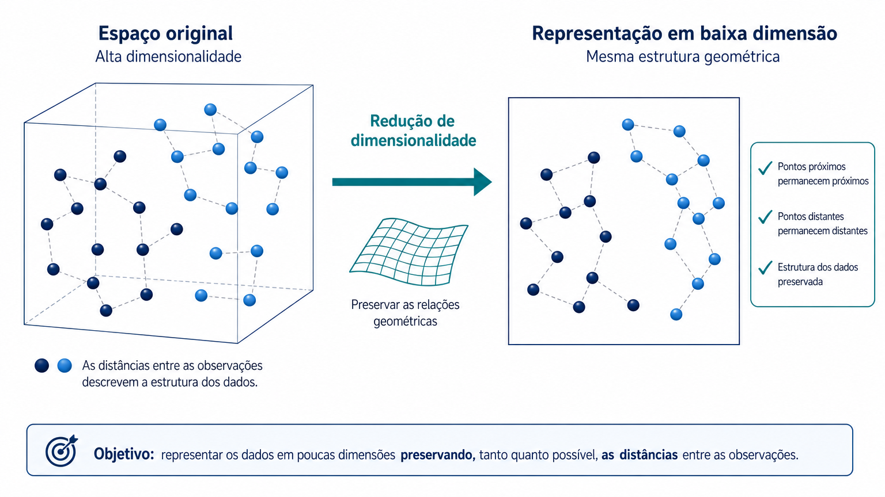{width=100%} -->


<!-- ## Escalonamento Multidimensional (MDS) -->

<!-- O Escalonamento Multidimensional (MDS) procura representar um conjunto de objetos em um espaço de menor dimensão preservando suas distâncias originais. -->

<!-- O problema consiste em encontrar coordenadas -->

<!-- $$ -->
<!-- z_1,\ldots,z_n -->
<!-- $$ -->

<!-- tais que -->

<!-- $$ -->
<!-- d(z_i,z_j)\approx d(x_i,x_j), -->
<!-- $$ -->

<!-- para todos os pares de observações. -->


<!-- ## Escalonamento Multidimensional (MDS) -->


<!-- > Enquanto o PCA utiliza diretamente as variáveis, o MDS utiliza apenas a matriz de distâncias entre as observações. -->


<!-- Quando as distâncias utilizadas são as distâncias Euclidianas, -->

<!-- $$ -->
<!-- d_{ij} -->
<!-- = -->
<!-- \left\| -->
<!-- x_i-x_j -->
<!-- \right\|, -->
<!-- $$ -->

<!-- o Escalonamento Multidimensional Clássico produz exatamente a mesma representação obtida pelo PCA (desconsiderando rotações e reflexões). -->


<!-- ## Escalonamento Multidimensional (MDS) -->

<!-- Assim, -->

<!-- - PCA maximiza a variância das projeções; -->
<!-- - MDS preserva as distâncias entre observações; -->

<!-- mas ambos conduzem às mesmas coordenadas quando as distâncias são Euclidianas. -->


<!-- ## A conexão matemática -->

<!-- A matriz de distâncias Euclidianas contém implicitamente a informação sobre a matriz de covariâncias. -->

<!-- Após um procedimento denominado **centralização dupla**, obtém-se -->

<!-- $$ -->
<!-- B -->
<!-- = -->
<!-- -\frac12 -->
<!-- JD^2J, -->
<!-- $$ -->

<!-- em que -->

<!-- - $D$ é a matriz de distâncias; -->
<!-- - $J=I-\frac1n\mathbf{11}^\top$ é a matriz de centralização. -->

<!-- A matriz $B$ possui os mesmos autovetores utilizados pelo PCA. -->


<!-- --- -->

<!-- 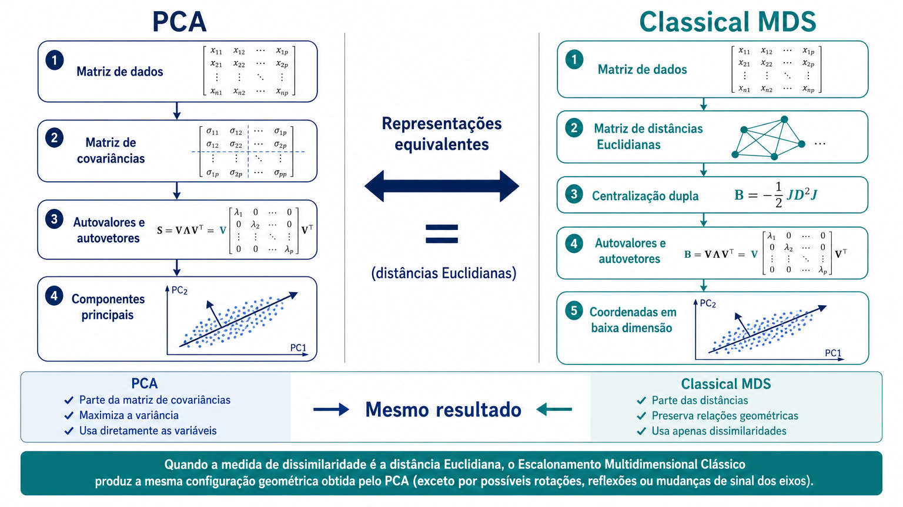{width=100%} -->


<!-- ## PCA × MDS -->

<!-- | PCA | MDS | -->
<!-- |------|------| -->
<!-- | Utiliza a matriz de dados | Utiliza apenas a matriz de distâncias | -->
<!-- | Requer variáveis quantitativas | Pode utilizar qualquer medida de dissimilaridade | -->
<!-- | Maximiza a variância | Preserva distâncias | -->
<!-- | Mais eficiente computacionalmente | Mais flexível | -->

<!-- ::: {.callout-important} -->
<!-- ## Importante -->
<!-- O PCA pode ser interpretado como um caso particular do Escalonamento Multidimensional Clássico. -->
<!-- ::: -->


## Aprendizado não supervisionado

Até agora, utilizamos uma resposta $Y$ para orientar o aprendizado

Em aprendizado não supervisionado, observamos apenas

$$
\boxed{
\mathbf x
=
(\mathbf X_1,\ldots,\mathbf X_p)^\top
}
$$

e procuramos descobrir estrutura nos próprios dados

---

## O primeiro problema

Quando $p$ é grande:

- visualizar os dados torna-se difícil
- distâncias podem perder poder discriminatório
- variáveis podem conter informação redundante
- modelos podem se tornar computacionalmente caros
- a estrutura relevante pode viver em dimensão muito menor que $p$

Isso motiva a **redução de dimensionalidade**

---

## Redução ou nova representação?

Queremos transformar

$$
\mathbf x\in\mathbb R^p
$$

em

$$
\boxed{
\mathbf z
=
T(\mathbf x)
\in\mathbb R^q,
\qquad q<p
}
$$

preservando, tanto quanto possível, a estrutura relevante dos dados


# Análise de Componentes Principais (PCA)

## PCA como transformação

Considere dados centrados

$$
\mathbf x_i\in\mathbb R^p
$$

e uma matriz

$$
W_q
=
[\mathbf w_1,\ldots,\mathbf w_q]
$$

formada pelos $q$ primeiros autovetores da matriz de covariâncias

A nova representação é

$$
\boxed{
\mathbf z_i
=
W_q^t\mathbf x_i
}
$$

---

## Critério da primeira componente

A primeira direção resolve

$$
\boxed{
\mathbf w_1
=
\arg\max_{\|\mathbf w\|=1}
\operatorname{Var}
(\mathbf w^t\mathbf X)
}
$$

As demais componentes maximizam variância sob restrições de ortogonalidade

---

## Visualização geométrica

```{r}
#| fig-width: 7.3
#| fig-height: 5.0
#| out-width: 70%
#| fig-align: center

escala <- 4.2

ggplot(dados_pca, aes(x1, x2)) +
  geom_point(alpha = .55, color = azul2, size = 2) +
  geom_segment(
    x = centro[1] - escala * v1[1],
    y = centro[2] - escala * v1[2],
    xend = centro[1] + escala * v1[1],
    yend = centro[2] + escala * v1[2],
    linewidth = 1.15,
    color = azul
  ) +
  geom_segment(
    x = centro[1] - 2 * v2[1],
    y = centro[2] - 2 * v2[2],
    xend = centro[1] + 2 * v2[1],
    yend = centro[2] + 2 * v2[2],
    linewidth = .9,
    linetype = "dashed",
    color = azul
  ) +
  coord_equal() +
  tema_slide +
  labs(
    title = "PCA procura direções de maior variabilidade",
    x = expression(X[1]),
    y = expression(X[2])
  )
```

---

## Reconstrução

Se mantivermos apenas $q$ componentes, podemos reconstruir aproximadamente

$$
\boxed{
\widehat{\mathbf x}_i
=
W_q\mathbf z_i
=
W_qW_q^t\mathbf x_i
}
$$

para dados centrados

A informação descartada aparece como erro de reconstrução


# Aplicação: Compressão de Imagens


## Por que comprimir uma imagem?

Uma imagem digital pode conter **milhões de pixels**, exigindo grande espaço para armazenamento e transmissão.

Entretanto,

- regiões vizinhas costumam ser semelhantes;
- existe muita **redundância** nos dados;
- é possível representar a imagem utilizando muito menos informação.

> **Objetivo:** armazenar praticamente a mesma imagem utilizando muito menos dados.


## Por que comprimir uma imagem?

{width=100%}


## Uma imagem é apenas uma matriz

::: {.columns}

::: {.column width="45%"}

{width=100%}

<center>

Imagem Original

</center>

:::

::: {.column width="55%"}

Cada pixel da imagem corresponde a um elemento de uma matriz.

$$
\boldsymbol{A}=
\begin{bmatrix}
123 &120&118&\cdots\\
125&121&117&\cdots\\
124&122&119&\cdots\\
\vdots&\vdots&\vdots&
\end{bmatrix}
$$

No caso de imagens coloridas, existem três matrizes:

- Canal Vermelho (R)
- Canal Verde (G)
- Canal Azul (B)

:::

:::


## Onde está a redundância?

::: columns

:::: {.column width="48%"}

### Região suave

```{r}
#| echo: false
#| warning: false
#| message: false

library(magick)

img <- image_read("imagem_original.png")

image_crop(
  img,
  geometry = "140x100+170+20"
) |>
  image_resize("500x350!")
```

- pequena variação entre pixels vizinhos;
- alta redundância;
- maior potencial de compressão.

::::

:::: {.column width="48%"}

### Região com detalhes

```{r}
#| echo: false
#| warning: false
#| message: false

image_crop(
  img,
  geometry = "140x100+320+270"
) |>
  image_resize("500x350!")
```

- mudanças rápidas de cor e textura;
- menor redundância;
- maior quantidade de informação visual.

::::

:::


## Onde está a redundância?


A maior parte das imagens apresenta **forte redundância espacial**, especialmente em regiões homogêneas.

Essa redundância pode ser explorada para obter uma representação muito mais compacta.<br><br>


> **Quanto maior a semelhança entre pixels vizinhos, maior o potencial de compressão da imagem.**


## Ideia intuitiva da SVD


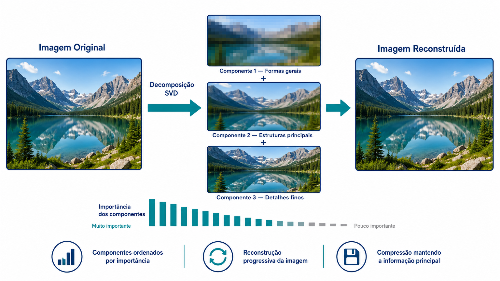{width=100%}


## Ideia intuitiva da SVD

Uma imagem pode ser vista como a **soma de padrões simples**.

Cada componente da SVD representa:

- uma estrutura básica da imagem;
- uma importância associada;
- uma contribuição para a reconstrução.

À medida que novos componentes são adicionados, a imagem torna-se cada vez mais próxima da original.


> **A SVD organiza automaticamente os componentes da imagem do mais importante para o menos importante.**


## A decomposição da imagem


A SVD decompõe a matriz da imagem em três matrizes:

$$
\boldsymbol{A} = \boldsymbol{U}\boldsymbol{D}\boldsymbol{V}^\top
$$

onde

- $\boldsymbol{U}$ contém os padrões das linhas;
- $\boldsymbol{V}$ contém os padrões das colunas;
- $\boldsymbol{D}$ contém a importância de cada componente.


## A decomposição da imagem

Os elementos da diagonal de $\boldsymbol{D}$

$$
\sigma_1 \ge \sigma_2 \ge \cdots \ge \sigma_r
$$

são chamados **valores singulares**.


> **Os valores singulares são ordenados do maior para o menor, indicando quanto cada componente contribui para reconstruir a imagem.**


---


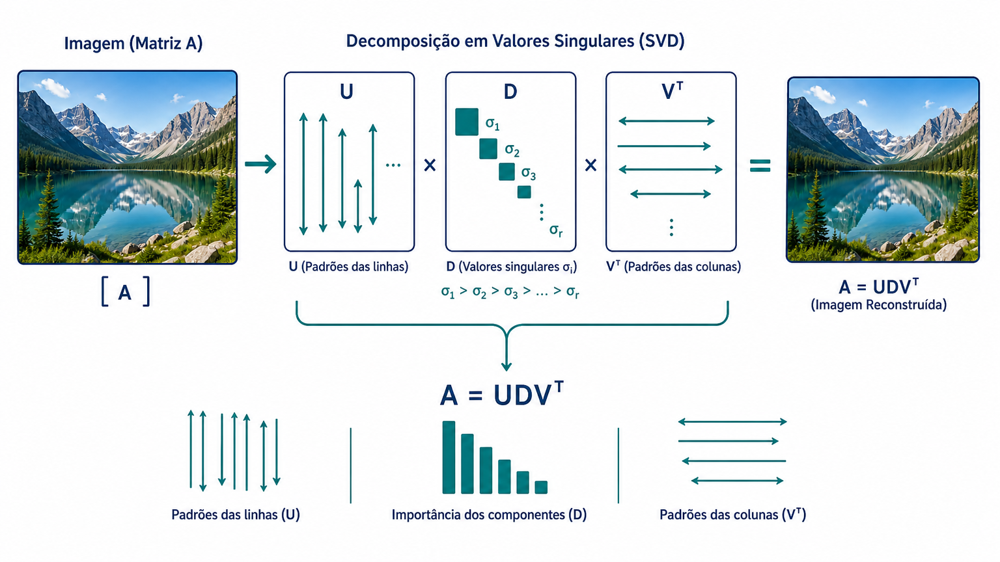{width=100%}


## Nem todos os componentes são igualmente importantes


Os valores singulares estão ordenados $\sigma_1 \ge \sigma_2 \ge \cdots \ge \sigma_r$ e indicam a contribuição de cada componente para reconstruir a imagem.


Consequentemente,

- os primeiros componentes concentram a maior parte da informação;
- os últimos componentes contribuem muito pouco;
- podemos descartá-los com pequena perda visual.


> **A ideia da compressão é manter apenas os componentes mais importantes.**


---


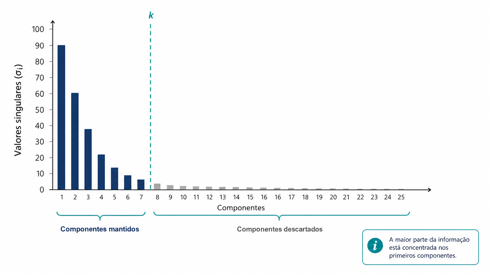{width=100%}


## Reconstrução utilizando apenas $k$ componentes


A imagem comprimida é obtida utilizando apenas os **$k$ maiores valores singulares**.

$$
\boldsymbol{A}_k = \boldsymbol{U}_k \boldsymbol{D}_k \boldsymbol{V}_k^\top
$$

onde

- $\boldsymbol{U}_k$ contém os primeiros vetores singulares à esquerda;
- $\boldsymbol{D}_k$ contém apenas os $k$ maiores valores singulares;
- $\boldsymbol{V}_k$ contém os primeiros vetores singulares à direita.

## Reconstrução utilizando apenas $k$ componentes

Quando

$$
k < r,
$$

obtém-se uma aproximação da imagem original utilizando muito menos informação.


> **Quanto maior o valor de $k$, maior a qualidade da reconstrução e menor a taxa de compressão.**


---


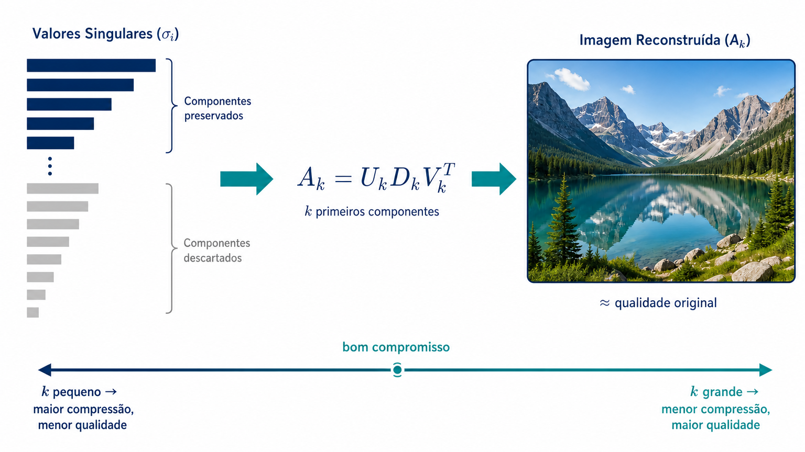{width=100%}


## Efeito do número de componentes na reconstrução


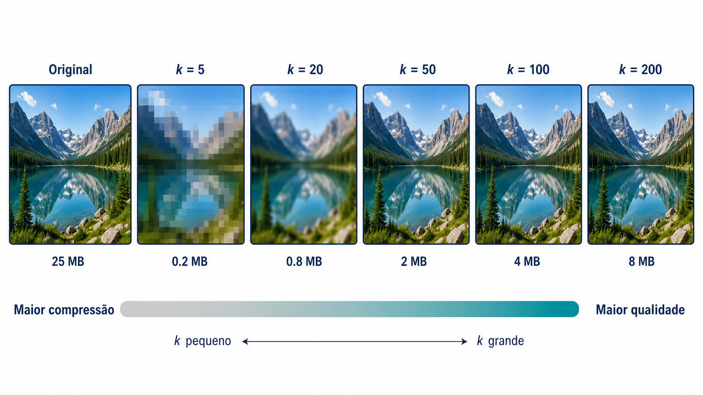{width=100%}

## Efeito do número de componentes na reconstrução

À medida que o número de componentes ($k$) aumenta, a imagem reconstruída torna-se mais próxima da original.<br><br>


::: {.callout-tip}
## Importante
Quanto maior o valor de $k$:

- maior a qualidade da imagem reconstruída;
- maior a quantidade de informação armazenada;
- menor a taxa de compressão.
:::


## Por que poucos componentes são suficientes?

Os valores singulares normalmente decrescem rapidamente.

Assim,

- poucos componentes concentram a maior parte da informação;
- muitos componentes possuem contribuição muito pequena;
- eliminar esses componentes provoca pequena perda visual.


## Por que poucos componentes são suficientes?

$$
\boldsymbol{A}
=
\sum_{i=1}^{r}
\sigma_i
u_i
v_i^\top
$$

Se utilizarmos apenas os primeiros componentes,

$$
\boldsymbol{A}_k
\approx
\sum_{i=1}^{k}
\sigma_i
u_i
v_i^\top,
$$

obtém-se uma excelente aproximação da imagem original.

> A SVD concentra a informação mais importante nos primeiros termos da decomposição.


## R: Compressão de imagens

```{r}
#| eval: true
#| echo: true
#| warning: false
#| message: false
#| fig-width: 14
#| fig-height: 7
#| out-width: 100%
#| output-location: slide


library(png)

# --------------------------------------------------
# 1. Leitura da imagem
# --------------------------------------------------

img <- readPNG("imagem_original.png")

# Remover o canal alfa, caso exista
if (length(dim(img)) == 3 && dim(img)[3] == 4) {
  img <- img[, , 1:3]
}

if (length(dim(img)) != 3 || dim(img)[3] != 3) {
  stop("A imagem deve possuir três canais RGB.")
}

n_linhas  <- dim(img)[1]
n_colunas <- dim(img)[2]

# --------------------------------------------------
# 2. SVD dos canais RGB
# --------------------------------------------------

svd_r <- svd(img[, , 1])
svd_g <- svd(img[, , 2])
svd_b <- svd(img[, , 3])

# --------------------------------------------------
# 3. Reconstrução de um canal
# --------------------------------------------------

reconstruir_canal <- function(svd_obj, k) {

  k <- min(k, length(svd_obj$d))

  U_k <- svd_obj$u[, 1:k, drop = FALSE]
  V_k <- svd_obj$v[, 1:k, drop = FALSE]
  d_k <- svd_obj$d[1:k]

  # U_k %*% diag(d_k) %*% t(V_k)
  sweep(U_k, 2, d_k, FUN = "*") %*% t(V_k)
}

# --------------------------------------------------
# 4. Reconstrução da imagem RGB
# --------------------------------------------------

reconstruir_imagem <- function(k) {

  img_k <- array(
    data = 0,
    dim = c(n_linhas, n_colunas, 3)
  )

  img_k[, , 1] <- reconstruir_canal(svd_r, k)
  img_k[, , 2] <- reconstruir_canal(svd_g, k)
  img_k[, , 3] <- reconstruir_canal(svd_b, k)

  # Garantir intensidades RGB no intervalo [0,1]
  img_k[img_k < 0] <- 0
  img_k[img_k > 1] <- 1

  img_k
}

# --------------------------------------------------
# 5. Razão teórica aproximada de compressão
# --------------------------------------------------

razao_compressao <- function(k) {

  armazenamento_original <- 3 * n_linhas * n_colunas

  armazenamento_svd <- 3 * k * (
    n_linhas + n_colunas + 1
  )

  armazenamento_original / armazenamento_svd
}

# --------------------------------------------------
# 6. Função para desenhar corretamente a imagem
# --------------------------------------------------

mostrar_imagem <- function(imagem, titulo) {

  plot.new()

  # Região gráfica em coordenadas de 0 a 1
  plot.window(
    xlim = c(0, 1),
    ylim = c(0, 1),
    asp = n_colunas / n_linhas
  )

  rasterImage(
    image = as.raster(imagem),
    xleft = 0,
    ybottom = 0,
    xright = 1,
    ytop = 1,
    interpolate = TRUE
  )

  title(
    main = titulo,
    line = 0.5,
    cex.main = 1
  )
}

# --------------------------------------------------
# 7. Comparação visual
# --------------------------------------------------

ks <- c(5, 20, 50, 100, 200)

# Remover valores incompatíveis com o tamanho da imagem
ks <- ks[ks <= min(n_linhas, n_colunas)]

op <- par(
  mfrow = c(2, 3),
  mar = c(0.5, 0.5, 3, 0.5),
  oma = c(0, 0, 0, 0)
)

mostrar_imagem(
  imagem = img,
  titulo = "Original"
)

for (k in ks) {

  img_k <- reconstruir_imagem(k)

  mostrar_imagem(
    imagem = img_k,
    titulo = paste0(
      "k = ", k,
      "\nCompressão ≈ ",
      round(razao_compressao(k), 1),
      "x"
    )
  )
}

par(op)
```


## R: Energia acumulada

```{r}
#| eval: true
#| echo: true
#| warning: false
#| message: false
#| fig-width: 16
#| fig-height: 9
#| output-location: slide

# Energia acumulada em cada canal RGB
energia_r <- cumsum(svd_r$d^2) / sum(svd_r$d^2)
energia_g <- cumsum(svd_g$d^2) / sum(svd_g$d^2)
energia_b <- cumsum(svd_b$d^2) / sum(svd_b$d^2)

# Média da proporção acumulada nos três canais
energia_media <- (
  energia_r +
  energia_g +
  energia_b
) / 3

# Valores mínimos de k para preservar 90%, 95% e 99%
niveis <- c(0.90, 0.95, 0.99)

ks_niveis <- sapply(
  niveis,
  function(nivel) {
    which(energia_media >= nivel)[1]
  }
)

names(ks_niveis) <- c("90%", "95%", "99%")

# Limites do eixo horizontal
k_max_grafico <- length(energia_media)

# Gráfico da informação acumulada
plot(
  x = seq_along(energia_media),
  y = energia_media,
  type = "l",
  lwd = 2.5,
  xlab = "Número de componentes (k)",
  ylab = "Proporção acumulada da informação",
  main = "Informação preservada pela reconstrução SVD",
  ylim = c(
    max(0, min(energia_media) - 0.03),
    1.01
  ),
  xlim = c(1, k_max_grafico)
)

# Linhas horizontais de referência
abline(
  h = niveis,
  lty = 2,
  col = "gray60"
)

# Linhas verticais nos valores de k
abline(
  v = ks_niveis,
  lty = 3,
  col = "gray40"
)

# Pontos destacados
points(
  x = ks_niveis,
  y = niveis,
  pch = 19,
  cex = 1.3
)

# Rótulos dos pontos
offsets <- c(0.012, 0.012, -0.018)

for (i in seq_along(niveis)) {

  posicao <- if (i == length(niveis)) 1 else 3

  text(
    x = ks_niveis[i],
    y = niveis[i] + offsets[i],
    labels = paste0(
      "k = ", ks_niveis[i],
      "  (", niveis[i] * 100, "%)"
    ),
    pos = posicao,
    cex = 0.85,
    font = 2
  )
}

# Legenda
legend(
  "bottomright",
  legend = paste0(
    names(ks_niveis),
    " da informação: k = ",
    ks_niveis
  ),
  pch = 19,
  bty = "n",
  cex = 0.9
)

# Exibir os valores encontrados
ks_niveis
```


---

### Principais conclusões

- A curva cresce rapidamente para pequenos valores de $k$.

- Os primeiros componentes singulares concentram quase toda a informação da imagem.

- Após aproximadamente **20–30 componentes**, mais de **95% da informação** já foi preservada.

- A partir desse ponto, adicionar novos componentes produz ganhos cada vez menores.

- Isso indica que a informação está **fortemente concentrada** em poucas direções principais.


::: {.callout-tip}
## Mensagem principal

A compressão por SVD é eficiente porque **a maior parte da informação visual está concentrada nos primeiros valores singulares**, permitindo reconstruir a imagem com alta qualidade utilizando apenas uma pequena fração dos componentes.
:::


# Kernel PCA (KPCA)


## Quando o PCA não é suficiente?

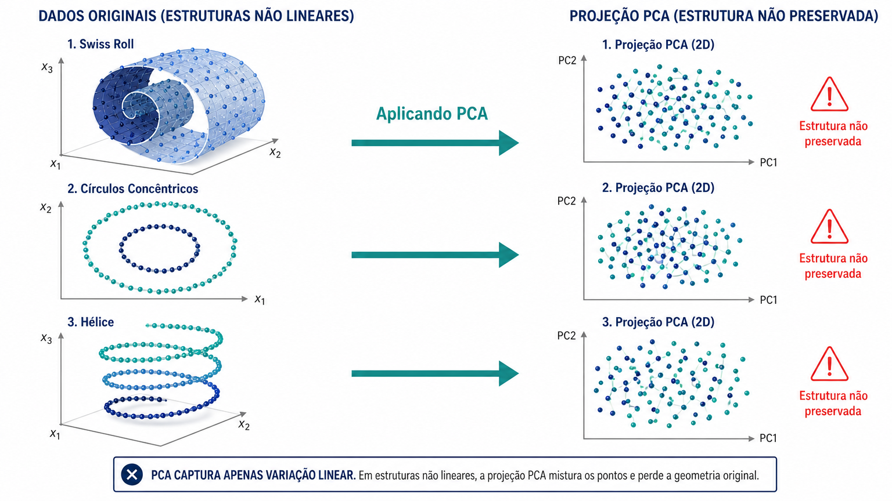{width=100%}

## O PCA é uma transformação linear

- Procura direções de máxima variância.

- As novas variáveis são combinações lineares das variáveis originais.

- Funciona muito bem quando os dados possuem estrutura aproximadamente linear.

- Entretanto, muitos conjuntos de dados apresentam relações **não lineares**.<br><br>


::: {.callout-important}
## Ideia principal

Quando os dados estão distribuídos sobre um **manifold não linear**, nenhuma projeção linear consegue preservar sua estrutura.
:::


## Exemplo: o que acontece com o Swiss Roll?


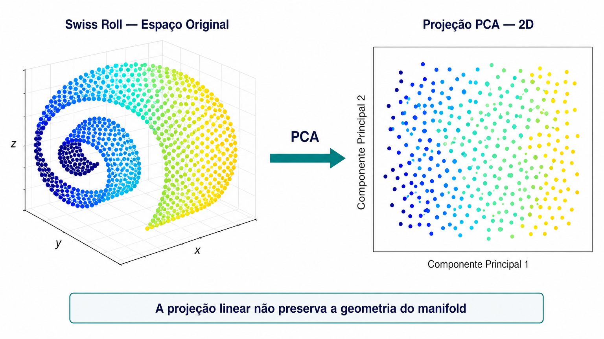{width=100%}


::: {.callout-note}
## Nota
O PCA procura a melhor projeção **linear** dos dados. Entretanto, no Swiss Roll, observações que estão distantes ao longo da superfície tornam-se artificialmente próximas após a projeção.
:::


## A ideia do Kernel PCA

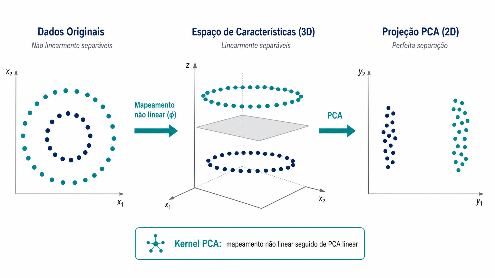{width=100%}

## A ideia do Kernel PCA

Em vez de aplicar o PCA diretamente aos dados originais,

- primeiro transformamos os dados para um espaço de maior dimensão;

- nesse novo espaço, relações não lineares tornam-se aproximadamente lineares;

- somente então aplicamos o PCA.

$$
\mathbf{x}
\longrightarrow
\phi(\mathbf{x})
\longrightarrow
\text{PCA}
$$


<!-- ## O problema da transformação explícita -->


<!-- {width=100%} -->


## O problema da transformação explícita

A ideia do Kernel PCA é transformar os dados

$$
\mathbf{x}
\longrightarrow
\phi(\mathbf{x})
$$

para um espaço de maior dimensão.

Entretanto,

- esse espaço pode possuir milhares ou até infinitas dimensões;
- construir explicitamente essas novas variáveis seria extremamente caro.


::: {.callout-important}
## Pergunta

Como realizar essa transformação sem construir explicitamente o novo espaço de características?
:::


## O Kernel Trick


O truque consiste em **não calcular explicitamente**

$$
\phi(\mathbf{x})
$$

Em vez disso, calcula-se apenas o produto interno entre observações no espaço transformado

$$
\phi(\mathbf{x_i})^\top
\phi(\mathbf{x_j})
$$

Esse produto é obtido diretamente por meio de uma função kernel.


$$
K(\mathbf{x_i},\mathbf{x_j})
=
\phi(\mathbf{x_i})^\top
\phi(\mathbf{x_j})
$$


<!-- --- -->

<!-- 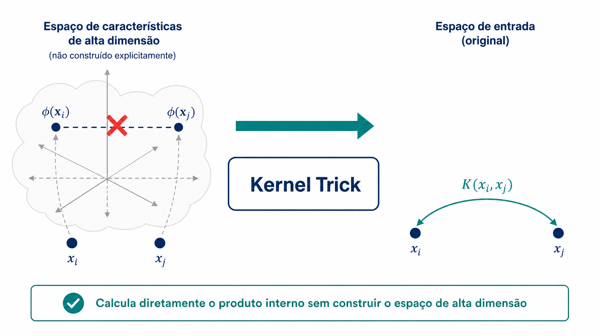{width=100%} -->


<!-- ## A função Kernel -->

<!-- Uma função kernel calcula diretamente o produto interno entre duas observações no espaço transformado. -->

<!-- $$ -->
<!-- K(\mathbf{x_i},\mathbf{x_j}) -->
<!-- = -->
<!-- \phi(\mathbf{x_i})^\top -->
<!-- \phi(\mathbf{x_j}) -->
<!-- $$ -->

<!-- Assim, -->

<!-- - nunca é necessário calcular explicitamente $\phi(\mathbf{x})$; -->
<!-- - todo o algoritmo trabalha apenas com a matriz Kernel. -->

<!-- ::: {.callout-note} -->
<!-- ## Nota -->
<!-- A matriz Kernel substitui a matriz de covariâncias utilizada no PCA tradicional. -->
<!-- ::: -->


## Fluxo do Kernel PCA


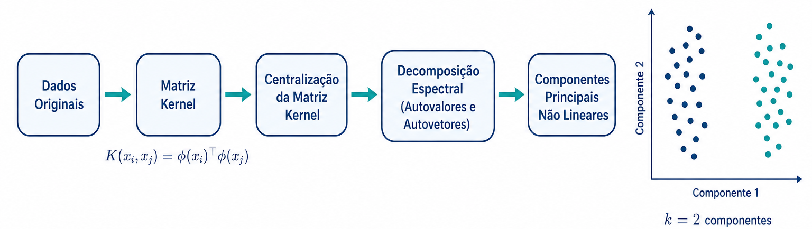{width=100%}

::: {.callout-note}
## Nota
O Kernel PCA realiza o PCA no espaço de características sem construir explicitamente esse espaço.
:::


## Intuição do Kernel Trick

Sem o Kernel Trick:

$$
\mathbf{x}
\rightarrow
\phi(\mathbf{x})
\rightarrow
\text{PCA}
$$

é necessário construir explicitamente todas as novas variáveis.


Com o Kernel Trick:

$$
K(\mathbf{x_i},\mathbf{x_j})
=
\phi(\mathbf{x_i})^\top
\phi(\mathbf{x_j}),
$$

o algoritmo utiliza apenas os produtos internos entre observações.

::: {.callout-important}
## Importante
O Kernel Trick torna viável a aplicação do PCA em espaços de dimensão muito elevada, inclusive infinitos.
:::


## R: PCA × Kernel PCA

```{r}
#| eval: true
#| echo: true
#| warning: false
#| message: false
#| fig-width: 16
#| fig-height: 9
#| output-location: slide

library(kernlab)
library(ggplot2)
library(patchwork)

set.seed(335)
n <- 500
classe <- factor(rep(c('Interno','Externo'), each=n/2), levels=c('Externo','Interno'))
angulo <- runif(n,0,2*pi)
raio <- c(rnorm(n/2,1,.08),rnorm(n/2,2,.10))
dados <- data.frame(x1=raio*cos(angulo),x2=raio*sin(angulo),classe=classe)
X <- scale(dados[,c('x1','x2')])

pca <- prcomp(X,center=FALSE,scale.=FALSE)
pca_coord <- data.frame(PC1=pca$x[,1],PC2=pca$x[,2],classe=classe)

# Kernel PCA não supervisionada: usar mais componentes para identificar
# qual delas representa a separação radial; rótulos apenas para visualização.
kpca_fit <- kpca(as.matrix(X), kernel='rbfdot', kpar=list(sigma=0.35), features=10)
K <- as.matrix(rotated(kpca_fit))

# A diferença padronizada das médias serve APENAS para escolher um eixo didático.
separacao <- vapply(seq_len(ncol(K)), function(j) {
  a <- K[classe=='Interno',j]; b <- K[classe=='Externo',j]
  abs(mean(a)-mean(b))/sqrt((var(a)+var(b))/2)
}, numeric(1))
j <- which.max(separacao)
# Escolher um segundo eixo ortogonal, distinto do primeiro.
j2 <- setdiff(seq_len(ncol(K)),j)[1]
kpca_coord <- data.frame(KPC_radial=K[,j], KPC_aux=K[,j2], classe=classe)

# Orientar o eixo radial para que a classe externa tenha maior escore.
if (mean(kpca_coord$KPC_radial[classe=='Externo']) < mean(kpca_coord$KPC_radial[classe=='Interno'])) {
  kpca_coord$KPC_radial <- -kpca_coord$KPC_radial
}
limiar <- mean(c(mean(kpca_coord$KPC_radial[classe=='Interno']),
                 mean(kpca_coord$KPC_radial[classe=='Externo'])))

cores <- c('Externo'='#E76F66','Interno'='#08AEB9')
tema <- theme_minimal(base_size=14)+theme(
  plot.title=element_text(face='bold',size=17),
  plot.subtitle=element_text(size=11),
  panel.grid.minor=element_blank(),
  legend.position='bottom',
  aspect.ratio=1
)
base <- function(df,x,y) ggplot(df,aes(x={{x}},y={{y}},color=classe))+
  geom_point(alpha=.75,size=1.7)+scale_color_manual(values=cores)+
  labs(color='Classe')+tema

g1 <- base(dados,x1,x2)+coord_equal()+
  labs(title='Dados originais',subtitle='Círculos concêntricos: fronteira radial',x=expression(X[1]),y=expression(X[2]))
g2 <- base(pca_coord,PC1,PC2)+coord_equal()+
  labs(title='PCA linear',subtitle='Projeção linear: círculos permanecem aninhados',x='PC1',y='PC2')
g3 <- base(kpca_coord,KPC_radial,KPC_aux)+
  geom_vline(xintercept=limiar,linetype='dashed',linewidth=.8,color='#172554')+
  labs(title='Kernel PCA (RBF)',subtitle=paste0('Componente ',j,' evidencia a diferença radial'),
       x=paste0('KPC',j,' (radial)'),y=paste0('KPC',j2))

figura <- (g1+g2+g3)+plot_layout(guides='collect') &
    theme(legend.position='bottom')
print(figura)
# ggsave('PCA_vs_KernelPCA_EST335.png',figura,width=16,height=6.2,dpi=220,bg='white')
```


## PCA linear × Kernel PCA: interpretação

**Dados originais:** as duas classes formam círculos concêntricos.
A separação depende da distância ao centro e, portanto,
**não pode ser realizada por uma reta**.

**PCA linear:** transforma as variáveis por combinações lineares,
preservando a estrutura concêntrica. Assim, as classes
continuam sem separação linear.

**Kernel PCA (RBF):** permite representar relações não lineares.
Neste exemplo, a quarta componente (KPC4) evidencia a diferença entre as distâncias das observações ao centro dos círculos, permitindo uma separação **aproximadamente linear** no espaço transformado.

::: {.callout-note appearance="simple"}

**Conclusão:** transformações não lineares podem revelar
estruturas que não são adequadamente representadas por
projeções lineares.

:::


# Projeções Aleatórias

## Será que precisamos encontrar as melhores direções?

Até agora vimos que:

- PCA procura as direções de maior variabilidade;
- Kernel PCA procura componentes não lineares.

Entretanto, para bases com milhares de variáveis, calcular essas direções pode ser computacionalmente caro.

A pergunta é:

> **Será que direções aleatórias já seriam suficientes?**


## Ideia Intuitiva


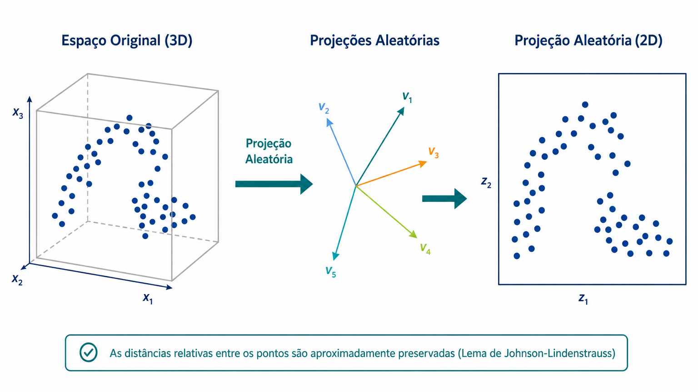{width=100%}


## Ideia intuitiva

Ao contrário do PCA,

- não procuramos a direção que maximiza a variância;
- não calculamos autovalores ou autovetores;
- simplesmente projetamos os dados em direções escolhidas aleatoriamente.

::: {.callout-note}
A ideia central é surpreendente:

Mesmo utilizando direções aleatórias, é possível preservar aproximadamente as distâncias entre as observações quando os dados estão em alta dimensão.
:::


## Definição matemática

Considere uma matriz de dados

$$
\boldsymbol{X}\in\mathbb{R}^{n\times p},
$$

contendo $n$ observações descritas por $p$ variáveis.

O objetivo é obter uma representação reduzida

$$
\boldsymbol{Z}\in\mathbb{R}^{n\times k},
\qquad
k<p
$$


## Definição matemática


A projeção é obtida por

$$
\boxed{
\boldsymbol{Z}
=
\boldsymbol{X}\boldsymbol{R},
}
$$

onde

- $\boldsymbol{X}$ é a matriz de dados original;
- $\boldsymbol{R}\in\mathbb{R}^{p\times k}$ é uma **matriz de projeção aleatória**;
- $\boldsymbol{Z}$ é a representação dos dados em baixa dimensão.


## Como construir a matriz de projeção?


A matriz de projeção

$$
\boldsymbol{R}
=
(r_{ij})
$$

é construída gerando cada elemento aleatoriamente segundo uma distribuição de probabilidade,

$$
r_{ij}
\sim
f(.)
$$


A escolha da distribuição $f$ define o tipo de projeção aleatória utilizada.


## Projeção Aleatória Gaussiana

A construção mais utilizada consiste em gerar cada elemento da matriz de projeção de forma independente segundo uma distribuição Normal.

$$
r_{ij}\overset{\mathrm{iid}}{\sim}
N\left(0,\frac{1}{k}\right)
$$

Equivalentemente,

$$
\boxed{
r_{ij}
=
\frac1{\sqrt{k}}\,z_{ij},
\qquad
z_{ij}\sim N(0,1)
}
$$


<!-- ## Projeção Aleatória Gaussiana -->

<!-- A redução de dimensionalidade é realizada multiplicando -->
<!-- os dados por uma matriz aleatória: -->

<!-- $$ -->
<!-- \boxed{\mathbf Z=\mathbf X\mathbf R} -->
<!-- $$ -->

<!-- em que $\mathbf X$ tem $p$ variáveis e $\mathbf Z$ tem -->
<!-- $k<p$ dimensões. -->


<!-- ::: {.callout-note appearance="simple"} -->

<!-- **Propriedades dos elementos de $\mathbf R$:** -->

<!-- - Média igual a zero; -->
<!-- - Variância igual a $1/k$; -->
<!-- - Independência entre os elementos. -->

<!-- **Consequência:** as distâncias entre observações são -->
<!-- preservadas em média e podem ser aproximadamente -->
<!-- preservadas após a redução dimensional. -->

<!-- ::: -->


---

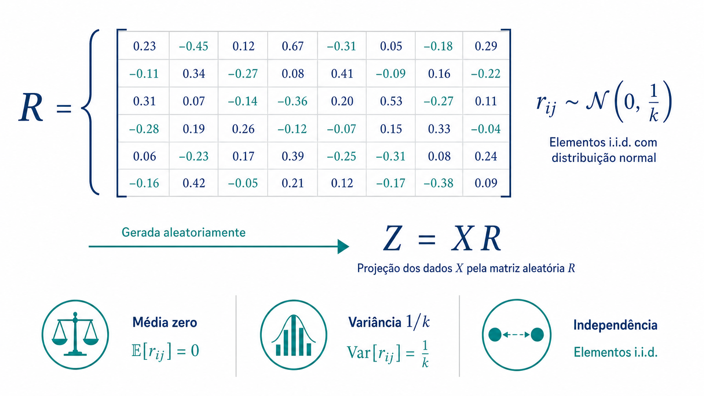{width=100%}


## Por que normalizar por $1/\sqrt{k}$?

Na projeção aleatória gaussiana, cada elemento da matriz
$\mathbf R$ é construído como:

$$
r_{ij}=\frac{z_{ij}}{\sqrt{k}},
\qquad z_{ij}\sim N(0,1)
$$

**Objetivo:** preservar, em média, as distâncias quadráticas
entre observações após a redução de $p$ para $k$ dimensões.

Para duas observações $\mathbf x_i$ e $\mathbf x_j$:

$$
\boxed{
E_{\mathbf R}\left[
\|\mathbf R^\top\mathbf x_i-
\mathbf R^\top\mathbf x_j\|^2
\right]
=
\|\mathbf x_i-\mathbf x_j\|^2
}
$$


## Por que normalizar por $1/\sqrt{k}$?


::: {.callout-note appearance="simple"}

**Por que dividir por $\sqrt{k}$?**

- **Sem normalização:** a distância quadrática projetada
  teria esperança $k$ vezes maior que a original.
- **Com normalização:** o fator $1/k$, resultante do
  quadrado de $1/\sqrt{k}$, compensa a soma das
  $k$ coordenadas projetadas.

**Conclusão:** a normalização preserva as distâncias
quadráticas **em esperança**, não exatamente em cada projeção.

:::


## Projeções Aleatórias Esparsas

Achlioptas (2003) propôs substituir a distribuição Gaussiana por uma distribuição discreta.

$$
\boxed{
r_{ij}
=
\sqrt{\frac3{k}}
\left\{
\begin{array}{rl}
+1,& \text{com probabilidade }\frac16\\
0,&\text{com probabilidade }\frac23\\
-1,&\text{com probabilidade }\frac16
\end{array}
\right.
}
$$


## Projeções Aleatórias Esparsas

Assim,

aproximadamente dois terços dos elementos da matriz são iguais a zero.

::: {.callout-tip}

### Vantagens

- menor consumo de memória;

- multiplicações muito mais rápidas;

- mesma garantia assintótica do Lema de Johnson–Lindenstrauss.

:::


---

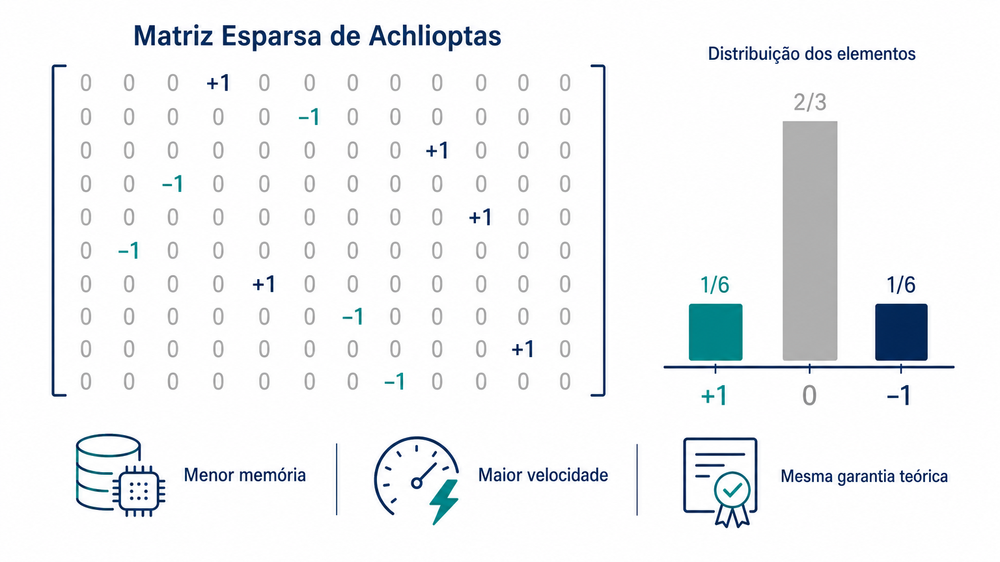{width=100%}


## Interpretação geométrica

Cada componente reduzida é dada por

$$
\boxed{
z_j
=
\boldsymbol r_j^T
\mathbf x,
}
$$

onde $\boldsymbol r_j$ é um vetor aleatório.


## Interpretação geométrica


Assim,

- cada componente corresponde à projeção dos dados sobre uma direção escolhida ao acaso;
- diferentes colunas de $\boldsymbol R$ produzem diferentes projeções;
- o conjunto dessas projeções forma uma nova representação dos dados em baixa dimensão.

::: {.callout-note}
## Nota
Ao contrário do PCA, essas novas componentes **não possuem interpretação física**, mas preservam aproximadamente a geometria do conjunto de dados.

:::


---

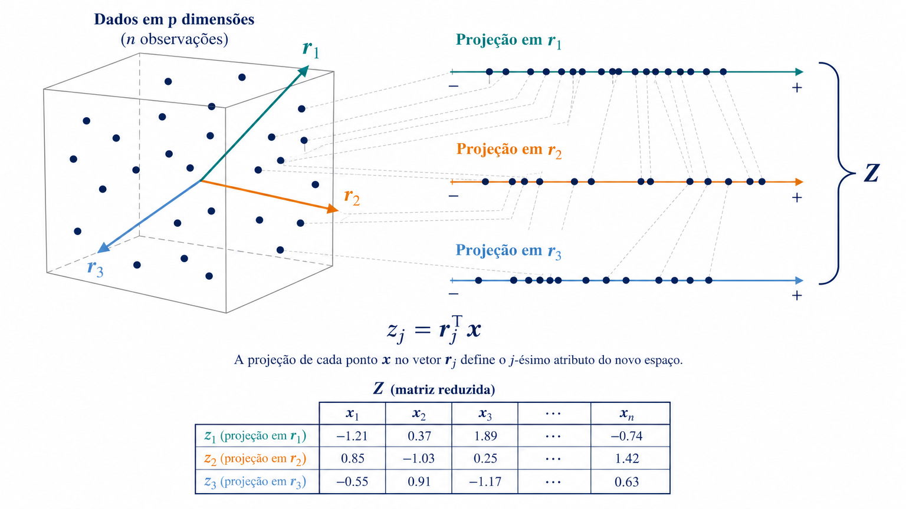{width=100%}


## Por que as Projeções Aleatórias funcionam?

Até aqui vimos que a redução de dimensionalidade é obtida utilizando uma matriz completamente aleatória.

Surge então uma pergunta natural:

::: {.callout-important}

## Como uma projeção aleatória consegue preservar a estrutura dos dados?

:::

A resposta é dada pelo **Lema de Johnson–Lindenstrauss**, um dos resultados mais importantes da Geometria Computacional e da Aprendizagem de Máquina.

> Em alta dimensão, projeções aleatórias preservam, com alta probabilidade, as distâncias entre as observações, desde que a dimensão projetada seja suficientemente grande.


---

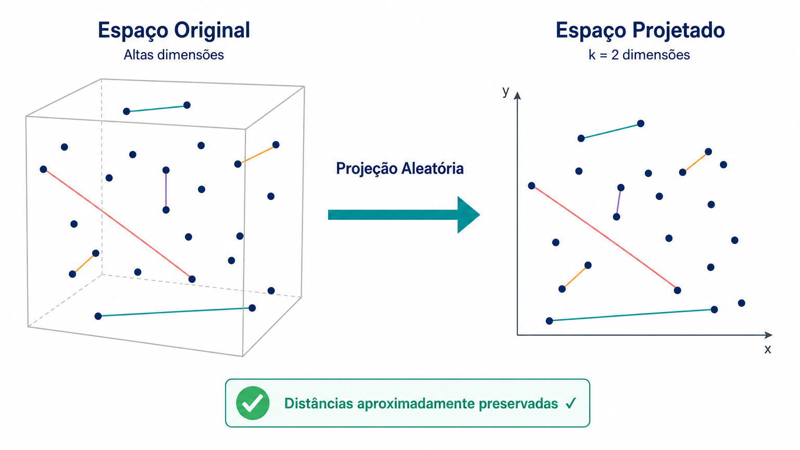{width=100%}


<!-- --- -->

<!-- ## Lema de Johnson–Lindenstrauss -->

<!-- Considere um conjunto contendo $n$ observações em um espaço de alta dimensão. -->

<!-- Existe uma projeção linear -->

<!-- $$ -->
<!-- \boldsymbol R:\mathbb R^p\rightarrow\mathbb R^k, -->
<!-- $$ -->

<!-- tal que -->

<!-- $$ -->
<!-- k= -->
<!-- O\!\left( -->
<!-- \frac{\log n}{\varepsilon^2} -->
<!-- \right), -->
<!-- $$ -->

<!-- ## Lema de Johnson–Lindenstrauss -->


<!-- e, para quaisquer observações $\mathbf x_i$ e $\mathbf x_j$, -->

<!-- $$ -->
<!-- \boxed{ -->
<!-- (1-\varepsilon) -->
<!-- \|\mathbf x_i-\mathbf x_j\|^2 -->
<!-- \le -->
<!-- \| -->
<!-- \boldsymbol R\mathbf x_i- -->
<!-- \boldsymbol R\mathbf x_j -->
<!-- \|^2 -->
<!-- \le -->
<!-- (1+\varepsilon) -->
<!-- \|\mathbf x_i-\mathbf x_j\|^2 -->
<!-- } -->
<!-- $$ -->

<!-- ::: {.callout-note} -->
<!-- ## Nota -->
<!-- As distâncias são preservadas com erro relativo máximo de aproximadamente $\varepsilon$. -->

<!-- ::: -->


<!-- ## Interpretando o resultado -->

<!-- Observe que -->

<!-- $$ -->
<!-- k= -->
<!-- O\!\left( -->
<!-- \frac{\log n}{\varepsilon^2} -->
<!-- \right) -->
<!-- $$ -->

<!-- depende apenas de -->

<!-- - $n$: número de observações; -->

<!-- - $\varepsilon$: erro admissível. -->


<!-- ## Interpretando o resultado -->


<!-- **Não depende da dimensão original $p$.** -->

<!-- ::: {.callout-important} -->
<!-- ## Importante -->
<!-- Mesmo quando -->

<!-- $$ -->
<!-- p=10^5 -->
<!-- \quad\text{ou}\quad -->
<!-- p=10^6, -->
<!-- $$ -->

<!-- é possível reduzir os dados para algumas centenas de componentes preservando aproximadamente todas as distâncias. -->

<!-- ::: -->


<!-- --- -->

<!-- 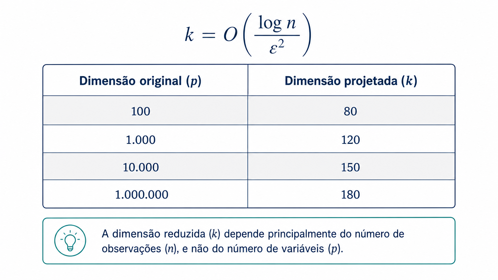{width=100%} -->


## Exemplo: Quantas dimensões são suficientes?

Considere um conjunto contendo

$$
n=10\,000
$$

observações.

Suponha que desejamos preservar as distâncias com erro máximo de

$$
\varepsilon=0,20
$$

## Exemplo: Quantas dimensões são suficientes?

Uma versão quantitativa do Lema de Johnson–Lindenstrauss estabelece que

$$
k
\ge
\frac{4\ln(n)}
{\dfrac{\varepsilon^2}{2}-\dfrac{\varepsilon^3}{3}}
$$

Substituindo os valores,

$$
k
\ge
\frac{4\ln(10\,000)}
{\dfrac{0,20^2}{2}-\dfrac{0,20^3}{3}}
=
\frac{4(9,21)}
{0,02-0,00267}
\approx
2126
$$


## Exemplo: Quantas dimensões são suficientes?
::: {.callout-important}
## Importante
Embora os dados possam possuir milhares ou milhões de variáveis, basta projetá-los em aproximadamente **2.126 dimensões** para preservar as distâncias com erro relativo de até **20%**, com alta probabilidade.

Na prática, frequentemente são utilizadas dimensões ainda menores, obtendo-se excelente desempenho empírico.

:::


## PCA × Projeções Aleatórias

| Característica | PCA | Projeções Aleatórias |
|:----------------|:----|:---------------------|
| Critério | Maximiza a variância | Preserva aproximadamente as distâncias |
| Direções | Autovetores | Aleatórias |
| Depende dos dados | Sim | Não |
| Interpretação | Alta | Baixa |
| Complexidade | Elevada | Muito baixa |
| Escalabilidade | Moderada | Excelente |


## PCA × Projeções Aleatórias

::: {.callout-tip}

### Conclusão

O PCA procura as **melhores direções**.

As Projeções Aleatórias mostram que, em altas dimensões, **direções escolhidas ao acaso já são suficientes para preservar a geometria dos dados com alta probabilidade**.

:::


---

## Quando utilizar Projeções Aleatórias?

As Projeções Aleatórias são particularmente indicadas quando:

- o número de variáveis é muito elevado;

- velocidade é mais importante que interpretabilidade;

- deseja-se um pré-processamento simples e eficiente;

- algoritmos dependem principalmente das distâncias entre observações.


**Exemplos:** KNN, clusterização,  recuperação de informação, processamento de textos, embeddings, busca aproximada por vizinhos mais próximos (ANN)


## R: Projeções Aleatórias


```{r}
#| eval: true
#| echo: true
#| warning: false
#| message: false
#| fig-width: 16
#| fig-height: 7
#| output-location: slide

library(ggplot2)

set.seed(335)

#--------------------------------------------------
# Dados simulados
#--------------------------------------------------

n <- 300      # observações
p <- 500      # dimensão original
k <- 50       # dimensão reduzida

X <- matrix(
  rnorm(n * p),
  nrow = n,
  ncol = p
)

#--------------------------------------------------
# Distâncias originais
#--------------------------------------------------

D_original <- dist(X)

#--------------------------------------------------
# Matriz de projeção gaussiana
#--------------------------------------------------

R <- matrix(
  rnorm(p * k, mean = 0, sd = 1),
  nrow = p,
  ncol = k
)

R <- R / sqrt(k)

#--------------------------------------------------
# Projeção aleatória
#--------------------------------------------------

Z <- X %*% R

#--------------------------------------------------
# Distâncias projetadas
#--------------------------------------------------

D_proj <- dist(Z)

#--------------------------------------------------
# Comparação
#--------------------------------------------------

comparacao <- data.frame(
  original = as.vector(D_original),
  projetada = as.vector(D_proj)
)

ggplot(
  comparacao,
  aes(original, projetada)
) +
  geom_point(
    alpha = 0.20,
    size = 1.3
  ) +
  geom_abline(
    intercept = 0,
    slope = 1,
    colour = "red",
    linewidth = 1
  ) +
  labs(
    title = "Preservação das distâncias após Projeção Aleatória",
    x = "Distância original",
    y = "Distância projetada"
  ) +
  theme_minimal(base_size = 15)
```

---


## R: Projeções Aleatórias


```{r}
#| eval: true
#| echo: true

cor(
  comparacao$original,
  comparacao$projetada
)

rmse <- sqrt(
  mean(
    (comparacao$original -
       comparacao$projetada)^2
  )
)

rmse
```


## R: Projeções Aleatórias

```{r}
#| eval: true
#| echo: true
#| warning: false
#| message: false
#| fig-width: 16
#| fig-height: 7
#| output-location: slide

ks <- c(5,10,20,50,100,200,500)

resultado <- data.frame()

for(k in ks){

  R <- matrix(
    rnorm(p*k),
    p,
    k
  )/sqrt(k)

  Z <- X %*% R

  D_proj <- dist(Z)

  resultado <- rbind(
    resultado,
    data.frame(
      k = k,
      correlacao = cor(
        as.vector(D_original),
        as.vector(D_proj)
      )
    )
  )

}

ggplot(
  resultado,
  aes(k, correlacao)
)+
geom_line(linewidth=1)+
geom_point(size=3)+
ylim(0,1)+
theme_minimal(base_size=15)+
labs(
title="Efeito da dimensão reduzida",
x="Número de componentes",
y="Correlação entre distâncias"
)
```


## Interpretação

- À medida que $k$ aumenta, as distâncias projetadas tornam-se mais próximas das distâncias originais.

- Mesmo utilizando uma matriz completamente aleatória, a geometria dos dados é preservada com boa aproximação.

- Esse comportamento ilustra empiricamente o **Lema de Johnson–Lindenstrauss**, segundo o qual projeções aleatórias preservam aproximadamente as distâncias entre observações.


# Autoencoders


## Autoencoders

Até agora estudamos métodos capazes de reduzir a dimensionalidade dos dados.

- **PCA:** procura as direções de maior variabilidade;
- **Kernel PCA:** captura relações não lineares por meio de funções kernel;
- **Projeções Aleatórias:** preservam aproximadamente as distâncias utilizando projeções aleatórias.

Todos esses métodos transformam os dados para obter uma representação mais compacta.

::: {.callout-important}

## Pergunta

Será que uma **rede neural** consegue aprender automaticamente essa representação sem que precisemos definir explicitamente como ela deve ser construída?

:::


---


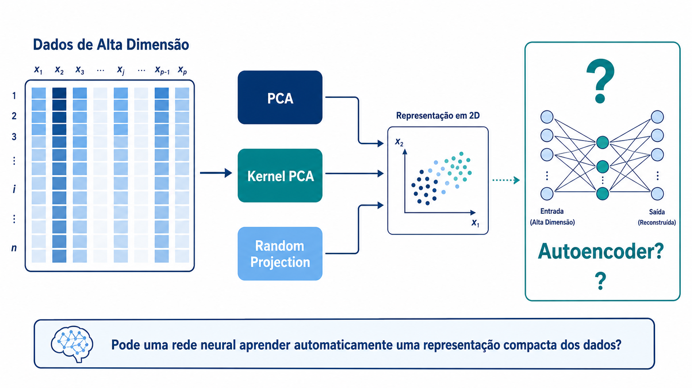{width=100%}


## O papel do gargalo (bottleneck)

Considere uma rede neural cujo objetivo seja reconstruir a própria entrada.

Se a rede possuir capacidade suficiente, ela poderá simplesmente aprender a copiar os dados:

$$
\mathbf{x}
\longrightarrow
\hat{\mathbf{x}}
=
\mathbf{x}
$$

Nesse caso,

- nenhuma informação é comprimida;
- nenhuma representação útil é aprendida;
- a rede apenas memoriza os dados.


## O papel do gargalo (bottleneck)

::: {.callout-important}
## Importante
A solução consiste em obrigar a rede a passar por um **gargalo (bottleneck)**.

Como o número de neurônios é muito menor, a rede precisa aprender quais informações são realmente importantes.

:::


---


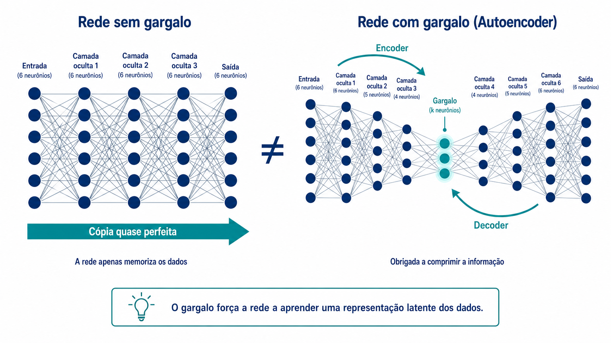{width=100%}


---

## Ideia geral

Um Autoencoder é composto por duas partes:

- **Encoder:** transforma os dados originais em uma representação compacta;
- **Decoder:** utiliza essa representação para reconstruir a entrada.

O espaço intermediário é denominado **espaço latente** (*latent space*).

::: {.callout-note}
## Nota
O treinamento consiste em minimizar o erro entre a entrada original e sua reconstrução.

:::


---


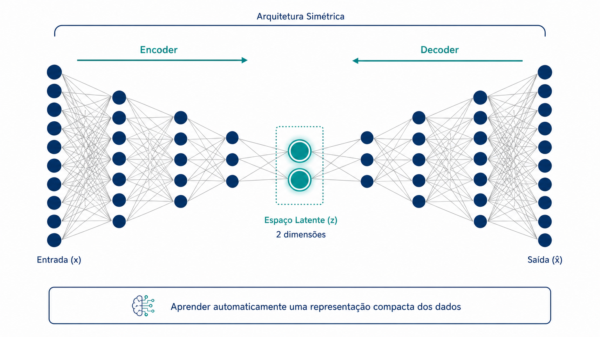{width=100%}


---

## Arquitetura Matemática

A arquitetura pode ser representada por

$$
\boxed{
\mathbf{x}
\longrightarrow
\boldsymbol{z}
\longrightarrow
\hat{\mathbf{x}}
}
$$

onde

- $\mathbf{x}$ representa a entrada;
- $\boldsymbol{z}$ representa o código latente (*latent code*);
- $\hat{\mathbf{x}}$ representa a reconstrução da entrada.


## Arquitetura Matemática


::: {.callout-note}
## Nota
O espaço latente possui dimensão muito menor que a entrada,

$$
\dim(\boldsymbol z)\ll\dim(\mathbf x)
$$

É exatamente essa restrição que força a compressão da informação.

:::


---

## O Encoder

O Encoder transforma os dados originais em uma representação de menor dimensão.

Matematicamente,

$$
\boxed{
\boldsymbol z
=
f_\theta(\mathbf x)
}
$$

onde

- $\mathbf{x}$ é o vetor de entrada;
- $\boldsymbol{z}$ é o código latente;
- $f_\theta(\cdot)$ representa a rede do Encoder;
- $\theta$ corresponde aos parâmetros (pesos e vieses).


## O Encoder


Em uma camada totalmente conectada,

$$
\boxed{
\boldsymbol z
=
\phi
\left(
W_e\mathbf x+b_e
\right)
}
$$

em que

- $W_e$ é a matriz de pesos;
- $b_e$ é o vetor de vieses;
- $\phi(\cdot)$ representa uma função de ativação.

::: {.callout-tip}
## Observação
O Encoder aprende automaticamente quais combinações das variáveis originais são mais úteis para representar os dados.

:::


---

## O Decoder

O Decoder realiza a operação inversa.

Seu objetivo é reconstruir a entrada original utilizando apenas o código latente.

$$
\boxed{
\hat{\mathbf x}
=
g_\gamma(\boldsymbol z)
}
$$

onde

- $\hat{\mathbf{x}}$ representa a reconstrução;
- $g_\gamma(\cdot)$ representa a rede Decoder;
- $\gamma$ corresponde aos parâmetros da reconstrução.


## O Decoder


Para uma camada totalmente conectada,

$$
\boxed{
\hat{\mathbf x}
=
\phi
\left(
W_d\boldsymbol z+b_d
\right)
}
$$

Em geral,

$$
\hat{\mathbf x}
\approx
\mathbf x
$$

A igualdade exata raramente é possível, pois parte da informação é perdida durante a compressão.


---

## Como o Autoencoder aprende?

O objetivo do treinamento é tornar a reconstrução o mais próxima possível da entrada original.

Assim, define-se uma função de perda

$$
\boxed{
L(\mathbf x,\hat{\mathbf x})
=
d(\mathbf x,\hat{\mathbf x})
}
$$

que mede o erro de reconstrução.

A escolha mais comum é o Erro Quadrático Médio (MSE),

$$
\boxed{
L
=
\|
\mathbf x-
\hat{\mathbf x}
\|^2
}
$$


## Como o Autoencoder aprende?


Durante o treinamento, os pesos da rede são ajustados para minimizar essa função.<br><br>

::: {.callout-important}
## Importante
O Autoencoder não utiliza rótulos.

Seu treinamento é totalmente **não supervisionado**, pois a própria entrada funciona como alvo da aprendizagem.

:::


<!-- ## Interpretação Geométrica -->

<!-- O Autoencoder aprende duas transformações sucessivas: -->

<!-- $$ -->
<!-- \boxed{ -->
<!-- \mathbf{x} -->
<!-- \overset{\text{Encoder}}{\longrightarrow} -->
<!-- \boldsymbol{z} -->
<!-- \overset{\text{Decoder}}{\longrightarrow} -->
<!-- \hat{\mathbf{x}} -->
<!-- } -->
<!-- $$ -->

<!-- Durante o treinamento, -->

<!-- - o **Encoder** aprende uma representação compacta dos dados; -->
<!-- - o **Decoder** aprende como reconstruir os dados originais a partir dessa representação. -->

<!-- O espaço intermediário $\boldsymbol z$ é denominado **espaço latente** (*latent space*). -->


<!-- ::: {.callout-important} -->
<!-- ## Importante -->
<!-- O espaço latente procura preservar apenas as características essenciais necessárias para reconstruir os dados. -->
<!-- ::: -->


---


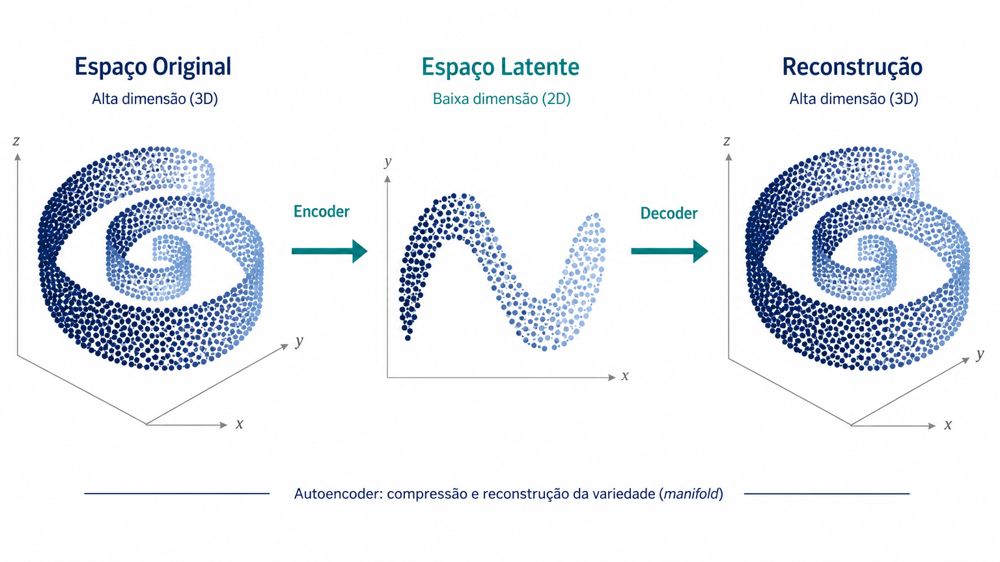{width=100%}


## PCA × Autoencoder

| PCA | Autoencoder |
|:----|:------------|
| Projeção linear | Transformação não linear |
| Baseado em autovetores | Baseado em redes neurais |
| Solução analítica | Otimização por gradiente |
| Componentes principais | Representação latente |
| Muito interpretável | Pouco interpretável |


::: {.callout-important}
## Importante
O PCA procura um **subespaço linear**.

O Autoencoder aprende uma **representação não linear**, capaz de adaptar-se à geometria dos dados.
:::


---


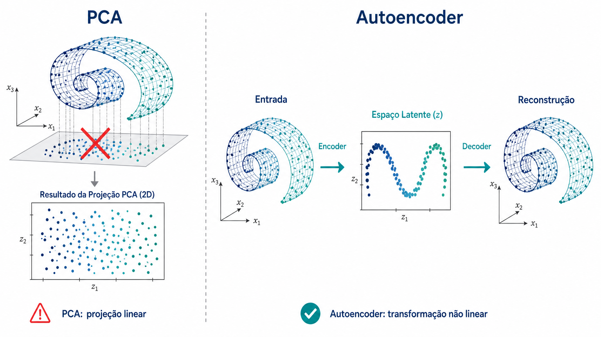{width=100%}


## O que representa o espaço latente?

Cada observação é representada por um novo vetor

$$
\boxed{\boldsymbol z = f_\theta(\mathbf x)}
$$

Essas novas variáveis

- não correspondem às variáveis originais;

- não são componentes principais;

- não possuem interpretação física direta.


## O que representa o espaço latente?

Entretanto,

elas representam uma codificação compacta dos fatores mais importantes presentes nos dados.

::: {.callout-tip}
## Nota
O espaço latente pode ser interpretado como uma representação interna aprendida automaticamente pela rede neural.
:::


---


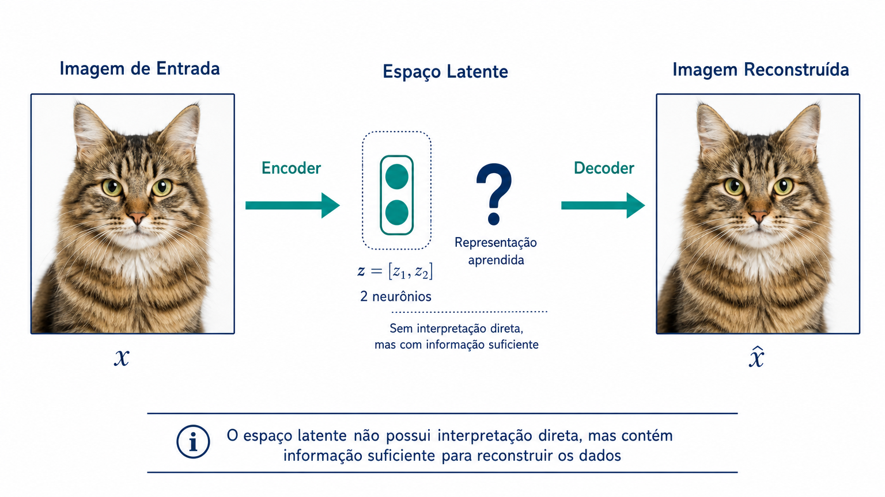{width=100%}


---


## Aprendendo um manifold

Considere dados distribuídos sobre uma variedade não linear (*manifold*). Durante o treinamento, o Encoder aprende uma transformação

$$
\mathbf x
\longrightarrow
\boldsymbol z
$$

capaz de "desenrolar" essa variedade.  O Decoder aprende a transformação inversa,

$$
\boldsymbol z
\longrightarrow
\hat{\mathbf x}
$$

::: {.callout-important}
## Importante
Ao contrário do PCA, o Autoencoder não procura apenas uma projeção.

Ele aprende uma transformação não linear entre dois espaços.

:::


---


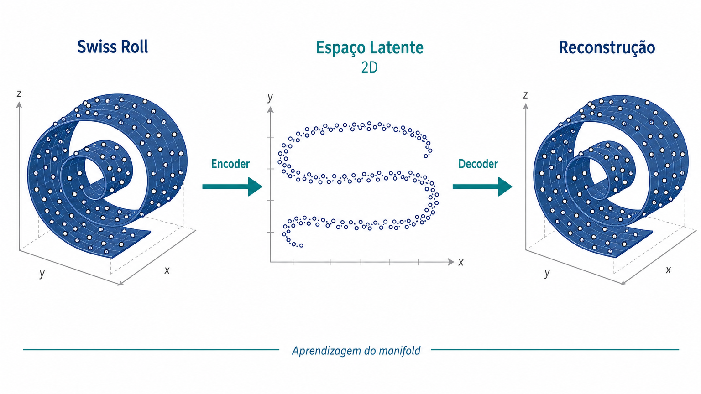{width=100%}


## R: Autoencoders

::: {style="width: 100%; height: 700px;"}

```{r}
#| echo: false
#| warning: false
#| message: false
#| output-location: slide

library(plotly)
library(viridisLite)

set.seed(335)

n <- 1500

t <- 1.5 * pi * (1 + 2 * runif(n))

dados <- data.frame(
  x = t * cos(t),
  y = runif(n, -10, 10),
  z = t * sin(t),
  t = t
)

p <- plot_ly(
  data = dados,
  x = ~x,
  y = ~y,
  z = ~z,
  color = ~t,
  colors = viridisLite::viridis(256),
  type = "scatter3d",
  mode = "markers",
  marker = list(
    size = 2.5,
    opacity = 0.85
  ),
  width = 1450,
  height = 680
) |>
  layout(
    title = NULL,
    autosize = FALSE,
    margin = list(
      l = 0,
      r = 0,
      b = 0,
      t = 0
    ),
    scene = list(
      xaxis = list(title = "X"),
      yaxis = list(title = "Y"),
      zaxis = list(title = "Z"),
      aspectmode = "data",
      domain = list(
        x = c(0, 1),
        y = c(0, 1)
      ),
      camera = list(
        eye = list(
          x = 1.5,
          y = 1.4,
          z = 0.8
        )
      )
    )
  ) |>
  config(
    responsive = TRUE,
    displaylogo = FALSE
  )

p
```

:::


## R: Autoencoders


### PCA

```{r}
#| eval: true
#| echo: true
#| warning: false
#| message: false
#| fig-width: 16
#| fig-height: 8
#| output-location: slide


library(ggplot2)

X <- scale(dados[,1:3])

pca <- prcomp(X)

coord <- data.frame(
PC1=pca$x[,1],
PC2=pca$x[,2],
t=dados$t
)

ggplot(
coord,
aes(
PC1,
PC2,
color=t
)
)+
geom_point(size=2)+
coord_equal()+
scale_color_viridis_c()+
theme_minimal(base_size=18)+
labs(
title="PCA",
subtitle="O Swiss Roll continua enrolado"
)
```


## R: Autoencoders

### Autoencoder


```{r}
#| eval: true
#| echo: true
#| warning: false
#| message: false
#| fig-width: 16
#| fig-height: 8
#| output-location: slide

library(keras)

X <- scale(as.matrix(dados[,1:3]))

entrada <- layer_input(shape=3)

encoder <- entrada |>
layer_dense(32, activation="relu") |>
layer_dense(16, activation="relu") |>
layer_dense(2,activation="linear",name="latent")

decoder <- encoder |>
layer_dense(16, activation="relu") |>
layer_dense(32, activation="relu") |>
layer_dense(3)

modelo <- keras_model(entrada,decoder)
modelo |>
compile(optimizer="adam", loss="mse")

modelo |> fit(X, X, epochs=150, batch_size=64, verbose=0)

encoder_model <- keras_model(inputs=entrada, outputs=get_layer(modelo,
"latent")$output)

latent <- predict( encoder_model, X)

latent <- data.frame(z1=latent[,1], z2=latent[,2], t=dados$t)

ggplot( latent, aes(z1,z2,color=t))+
  geom_point(size=2)+
  coord_equal()+
  scale_color_viridis_c()+
  theme_minimal(base_size=18)+
  labs(title="Espaço Latente Aprendido")
```


## R: Autoencoders

### Reconstrução

::: {style="width: 100%; height: 700px;"}

```{r}
#| eval: true
#| echo: true
#| warning: false
#| message: false
#| fig-width: 16
#| fig-height: 8
#| output-location: slide


library(plotly)
library(viridisLite)

Xrec <- predict(
  modelo,
  X,
  verbose = 0
)

rec <- data.frame(
  x = Xrec[, 1],
  y = Xrec[, 2],
  z = Xrec[, 3],
  t = dados$t
)

plot_ly(
  data = rec,
  x = ~x,
  y = ~y,
  z = ~z,
  color = ~t,
  colors = viridisLite::viridis(256),
  type = "scatter3d",
  mode = "markers",
  marker = list(
    size = 2,
    opacity = 0.8
  )
) |>
  layout(
    title = "Swiss Roll reconstruído pelo Autoencoder",
    scene = list(
      xaxis = list(title = "X"),
      yaxis = list(title = "Y"),
      zaxis = list(title = "Z"),
      aspectmode = "data"
    )
  )
```
:::

## PCA × Autoencoder

<div class="columns">

::: {.column width="50%"}

### PCA

- projeção linear;

- preserva máxima variância;

- não desenrola o Swiss Roll;

- componentes principais.

:::

::: {.column width="50%"}

### Autoencoder

- transformação não linear;

- aprende uma representação latente;

- desenrola o manifold;

- reconstrói os dados.

:::

</div>

::: {.callout-important}
## Importante
No PCA a transformação é fixa (linear).

No Autoencoder a transformação é aprendida pela própria rede neural.

:::


