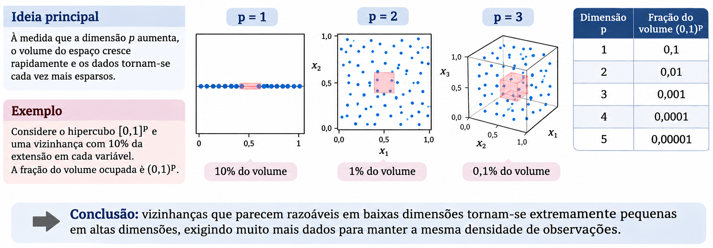

## Onde estamos?

Estudamos diferentes formas de estimar

$$
r(\mathbf x)=\mathbb E(Y\mid\mathbf X=\mathbf x)
$$

- KNN e regressão local utilizam **vizinhanças**.
- Splines utilizam **funções de base**.
- Árvores e ensembles utilizam **partições**.
- Redes neurais aprendem **composições de transformações**.

**Como esses métodos se comportam quando o número de variáveis aumenta?**


## Alta dimensionalidade: qual é o problema?

Queremos aprender a relação

$$
Y=g(\mathbf X)+\varepsilon,\qquad \mathbf X\in\mathbb R^p,
\quad \mathbb E(\varepsilon\mid\mathbf X)=0,
$$

utilizando $n$ observações e $p$ variáveis de entrada.

Com muitas entradas, precisamos de dados suficientes para distinguir o sinal do ruído. A dificuldade pode aparecer mesmo quando $p<n$.

**Pergunta:** como a dimensão afeta a redução do erro, quais estruturas simplificam o problema e quais métodos estudados podem aproveitá-las?


## A maldição da dimensionalidade

Imagine observações uniformes em $[0,1]^p$. Uma região com comprimento $h$ em cada coordenada ocupa a fração $h^p$ do volume.


{width=100%}


## A maldição da dimensionalidade


Para manter $k$ observações **em média** nessa região:

$$
\boxed{nh^p=k\quad\Longrightarrow\quad n=\frac{k}{h^p}}
$$

Por exemplo,


| Com $h=0{,}1$ e $k=20$ | $p=1$ | $p=3$ | $p=5$ |
|---|---:|---:|---:|
| Amostra necessária, em média | 200 | 20.000 | 2.000.000 |


## A maldição da dimensionalidade

Manter vizinhanças pequenas exige muito mais dados. Isso afeta especialmente KNN e regressão local.

**Esta conta ilustra cobertura do espaço sob uniformidade. Não é uma regra geral de tamanho amostral.**


## Taxa de convergência

A **taxa de convergência** descreve a velocidade com que o risco de estimação diminui à medida que aumentamos o tamanho da amostra $n$.

Em regressão, podemos medir esse risco pelo **erro quadrático médio de estimação**:

$$
R_n =
\mathbb{E}\left[
\left(\hat g_n(\mathbf X)-r(\mathbf X)\right)^2
\right]
$$

em que $\hat g_n$ é a função estimada com $n$ observações e $r$ é a verdadeira função de regressão. A esperança considera a amostra de treinamento e uma nova entrada $\mathbf X$.


## Taxa de convergência

Uma forma comum de descrever a taxa de convergência de um estimador, é dada por

$$
\boxed{R_n \approx Cn^{-a}, \qquad C>0,\quad a>0,}
$$

Assim, por exemplo, quadruplicar a amostra multiplica o termo principal do erro por $4^{-a}$.


## Taxa de convergência

| Expoente | Erro relativo | Redução do erro |
|:---:|:---:|:---:|
| $a=1$ | $0{,}25$ | **75%** |
| $a=1/2$ | $0{,}50$ | **50%** |
| $a=1/6$ | $0{,}79$ | **21%** |


**Interpretação:** quanto menor o expoente $a$, mais lentamente o erro diminui com a inclusão de novas observações.


## Taxas de convergência e dimensionalidade

Para classes gerais de funções suaves em $p$ dimensões, uma taxa minimax típica do erro quadrático integrado é

$$
\boxed{R_n^*\asymp n^{-\frac{2\alpha}{2\alpha+p}}}
$$

- $\alpha$: suavidade da função. Valores maiores impõem maior regularidade.
- $R_n^*$: melhor risco possível no pior caso da classe considerada.
- $\asymp$: mesma ordem, desconsiderando constantes multiplicativas.

**Aumentar $p$ reduz o expoente e torna a aprendizagem mais lenta.**

A taxa exige condições sobre a classe de funções, o desenho e o ruído. Mede estimação de $g$, sem incluir o ruído irredutível de uma nova resposta.

::: {.notes}
Formalmente, R_n^*=inf_{estimadores} sup_{f em F_alpha}
E[(f_estimado(X)-f(X))²], com esperança sobre treinamento e nova entrada.
Taxa minimax usual sob condições de regularidade, dimensão fixa e classe suave.
Fonte: Wasserman, Nonparametric Regression.
:::

## Quanto ganhamos aumentando a amostra?

Fixando suavidade $\alpha=2$, a taxa é $n^{-4/(4+p)}$.

| Dimensão $p$ | Taxa | Fator do termo principal com $4n$ |
|---:|---:|---:|
| 1 | $n^{-4/5}$ | $0{,}33$ |
| 4 | $n^{-1/2}$ | $0{,}50$ |
| 10 | $n^{-2/7}$ | $0{,}67$ |
| 20 | $n^{-1/6}$ | $0{,}79$ |

Em uma dimensão, o termo cai para cerca de 33% do valor anterior. Em 20 dimensões, permanece em cerca de 79%.

**Para reduzir esse termo à metade em $p=20$, seria necessário multiplicar $n$ por $2^6=64$.** 


## A redução do erro fica mais lenta

```{r}
#| fig-height: 4.0
#| fig-alt: "Curvas teóricas normalizadas: o erro diminui menos com o aumento da amostra quando p é maior."
mult <- seq(1, 20, length.out = 250)
dims <- c(1, 4, 20)
cores <- c("#003287", "#646464", "#C83E3A")
curvas <- sapply(dims, function(p) mult^(-4 / (4 + p)))
par(mar = c(4, 4.2, 1, 1), mgp = c(2.7, 0.8, 0), las = 1, cex = 1.15)
matplot(mult, curvas, type = "l", lty = 1, lwd = 3, col = cores,
        xlab = "Fator de aumento da amostra (n / n inicial)",
        ylab = "Termo de erro relativo", ylim = c(0, 1))
legend("topright", legend = paste("p =", dims), col = cores,
       lty = 1, lwd = 3, bty = "n")
```

Todas as curvas começam em 1 para comparar **velocidades de redução**, não níveis absolutos de erro. São curvas teóricas com $\alpha=2$, sem resultados de ajuste a dados.

## Como tornar o problema mais simples?

A taxa anterior considera uma classe ampla de funções em $p$ dimensões.

Podemos explorar hipóteses que reduzam a complexidade relevante:

| Hipótese | Ideia | O que procuramos |
|---|---|---|
| Esparsidade | Poucas entradas são necessárias à função de predição | Selecionar efeitos relevantes |
| Redundância | Muitas entradas carregam informação compartilhada | Combinar ou representar informação comum |

**Ter muitas variáveis observadas não implica que a resposta dependa de todas de forma independente e complexa.**

## Esparsidade: poucos efeitos ativos

Suponha $p=1.000$, mas

$$
Y=3X_2-2X_{17}+1{,}5X_{204}+\varepsilon
$$

A função de regressão utiliza apenas $s=3$ entradas: $s\ll p$.

Se soubéssemos quais são, o ajuste seria muito mais simples. Como não sabemos, precisamos encontrá-las entre as 1.000 candidatas.

**Lasso pode explorar esparsidade dos coeficientes.** 


## Redundância: muitas medições do mesmo fenômeno

Imagine 100 sensores que medem uma condição térmica comum:

$$
X_j=a_jZ+\eta_j,\qquad j=1,\ldots,100.
$$

$Z$ é a condição compartilhada, $a_j$ é a sensibilidade do sensor e $\eta_j$ é o ruído específico da medição.

As entradas podem ser fortemente correlacionadas. Se $Y$ depende principalmente de $Z$, a informação preditiva está associada a uma estrutura simples.

**Ridge pode estabilizar o uso conjunto dessas medições.** 


# Métodos mais adequados à alta dimensionalidade

## Ridge: estabilidade com muitas entradas

Ridge minimiza o erro de ajuste acrescido de uma penalização quadrática:

$$
\sum_{i=1}^{n}(y_i-\beta_0-\mathbf x_i^\top\boldsymbol\beta)^2
+\lambda\sum_{j=1}^{p}\beta_j^2
$$

**Quando considerar:** entradas correlacionadas ou sinal distribuído por muitos efeitos pequenos.

Para $\lambda>0$, o critério produz coeficientes únicos mesmo com $p>n$, no ajuste com intercepto separado.

A penalização estabiliza o ajuste, mas geralmente mantém todos os coeficientes. Uma solução única não garante boa predição: $\lambda$ precisa ser escolhido por validação.

## Lasso: regularização com seleção

Lasso substitui a penalização quadrática pela soma dos valores absolutos:

$$
\sum_{i=1}^{n}(y_i-\beta_0-\mathbf x_i^\top\boldsymbol\beta)^2
+\lambda\sum_{j=1}^{p}|\beta_j|
$$

**Quando considerar:** poucos efeitos aproximadamente lineares na representação utilizada.

O critério favorece coeficientes exatamente iguais a zero, podendo reduzir o conjunto de entradas utilizadas.

Com entradas fortemente correlacionadas, a escolha de variáveis pode mudar entre amostras. **Selecionar uma variável não prova que ela seja a única portadora do sinal.**

## SVM linear: classificação com regularização

A SVM linear utiliza uma função de decisão

$$
g(\mathbf x)=\mathbf w^\top\mathbf x+b
$$

com controle da magnitude de $\mathbf w$ e penalização das violações da margem.

**Quando considerar:** classificação com muitas entradas e uma fronteira linear plausível, inclusive em problemas com $p>n$.

Um kernel não linear pode ampliar a flexibilidade, mas distâncias pouco informativas não passam a ser úteis apenas pelo uso do kernel.

## RNA: possibilidade de aprender representações

Uma camada oculta calcula

$$
\mathbf a^{(1)}=\phi(W^{(1)}\mathbf x+\mathbf b^{(1)}).
$$

Ela pode combinar entradas redundantes e representar relações não lineares.

**Quando considerar:** estrutura não linear que possa ser aprendida com os dados disponíveis, arquitetura adequada e regularização.

- Com $H$ neurônios, a primeira camada já possui $H(p+1)$ parâmetros.
- Weight decay penaliza pesos. Early stopping controla a duração do ajuste pela validação.

**Uma RNA não é automaticamente uma boa escolha para $p\gg n$.** Com amostra pequena, ridge e lasso são referências importantes para comparação.

## Qual método considerar primeiro?

| Situação | Método estudado a considerar |
|---|---|
| Muitas entradas correlacionadas ou muitos efeitos pequenos | Ridge |
| Poucos efeitos lineares relevantes | Lasso |
| Classificação com fronteira aproximadamente linear | SVM linear regularizada |
| Relações não lineares e dados suficientes para aprendê-las | RNA regularizada |

A tabela orienta comparações, sem definir um vencedor universal.

**Procedimento essencial:** estimar padronização, seleção e hiperparâmetros dentro do treinamento/validação. Reservar o teste para a avaliação final.

