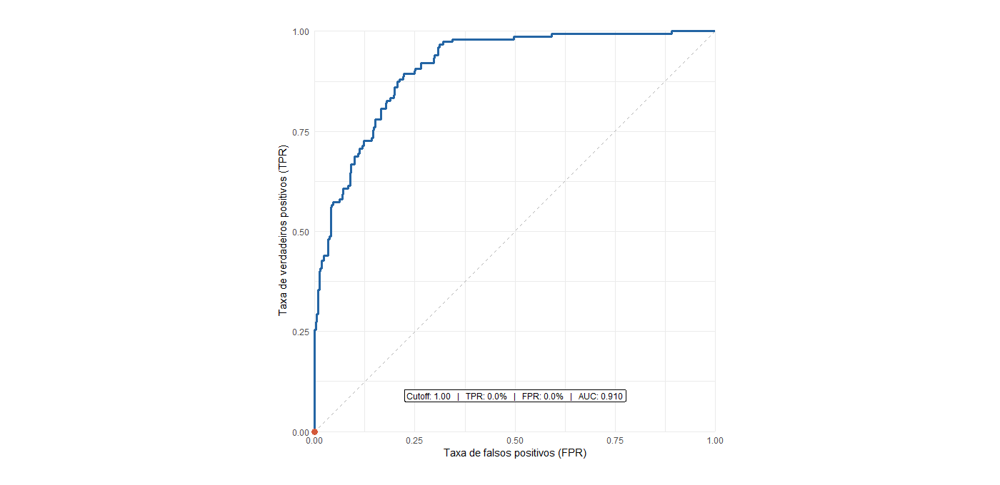
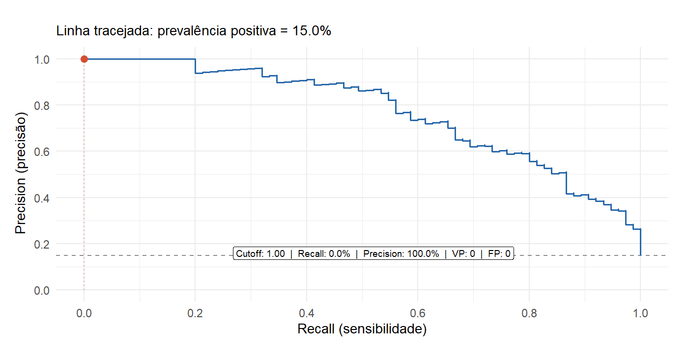
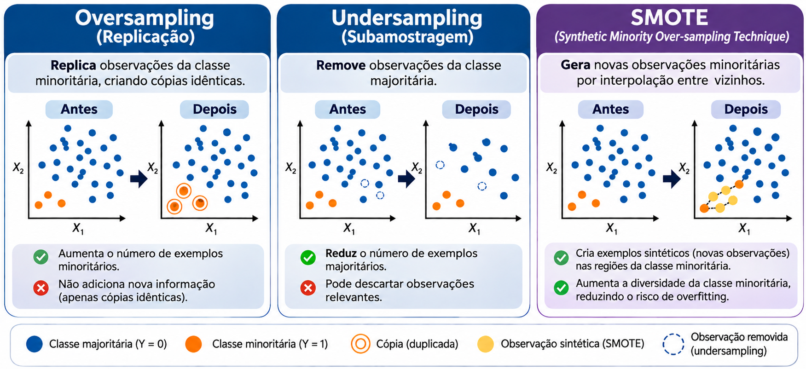

## Da predição à decisão

Em **classificação**, o modelo pode fornecer uma classe, um escore ou uma probabilidade estimada. Uma decisão prática exige um passo adicional: escolher **qual ação tomar** diante dessa informação.

- **Predição:** o que o modelo estima sobre a observação?
- **Decisão:** qual ação minimiza a perda ou atende às restrições?
- **Avaliação:** quais erros e consequências são relevantes?
- **Interpretação:** como o modelo chegou às suas previsões?

$$\boxed{\text{Predizer}\;\longrightarrow\;\text{Decidir}\;\longrightarrow\;\text{Avaliar}\;\longrightarrow\;\text{Interpretar}}$$

<!-- **Exemplo ilustrativo:** prever 30% de probabilidade de falha não determina, sozinho, se uma inspeção deve ser realizada. -->

## Notação para classificação binária

Considere $Y\in\{0,1\}$ e um vetor de características $\mathbf X$.

- **Classe positiva:** $Y=1$; **classe negativa:** $Y=0$.
- **Probabilidade verdadeira:** $\eta(\mathbf x)=P(Y=1\mid\mathbf X=\mathbf x)$.
- **Probabilidade estimada:** $\widehat\eta(\mathbf x)$, produzida pelo modelo ajustado.
- **Escore:** número produzido pelo classificador para ordenar observações; nem todo escore é uma probabilidade calibrada.

A regra $\widehat g_c(\mathbf x)=I\{\widehat\eta(\mathbf x)\ge c\}$ converte a probabilidade estimada em uma **classe prevista**.

<!-- **Exemplo:** na manutenção preditiva, podemos definir $Y=1$ para falha e $Y=0$ para ausência de falha. A interpretação matemática, porém, vale para qualquer classificação binária. -->

## Por que o cutoff de 50% aparece?

Se os dois tipos de erro têm a mesma perda (perda **0-1**), os riscos condicionais de prever cada classe são:

$$R(1\mid\mathbf x)=1-\eta(\mathbf x),\qquad R(0\mid\mathbf x)=\eta(\mathbf x)$$

A **regra de Bayes** prevê a classe de menor risco:

$$R(1\mid\mathbf x)<R(0\mid\mathbf x)\quad\Longleftrightarrow\quad\boxed{\eta(\mathbf x)>0{,}5}$$

**Interpretação:** com custos simétricos, a classe positiva é escolhida quando é mais provável que a negativa.

<!-- **Limite:** essa regra se refere à classificação. Uma **ação operacional** pode exigir outra matriz de perdas, custos de intervenção e restrições adicionais. -->

## Mesmo a melhor regra pode cometer erros

Quando as classes se sobrepõem, pode haver incerteza mesmo conhecendo a probabilidade verdadeira $\eta(\mathbf x)$.

Sob perda 0–1, o menor erro condicional possível é $\min\{\eta(\mathbf x),1-\eta(\mathbf x)\}$. O **erro de Bayes** é:

$$\boxed{R^*=\mathbb E\!\left[\min\{\eta(\mathbf X),1-\eta(\mathbf X)\}\right]}$$

**Exemplo:** se $\eta(\mathbf x)=0{,}30$, prever classe 0 implica probabilidade de erro de 30%; prever classe 1 implica 70%. O menor erro possível nesse perfil é 30%.

**Observação:** nem um classificador ideal elimina toda a incerteza quando há sobreposição entre as classes.

## Perdas assimétricas: erros com consequências diferentes

Em muitos problemas, **falso positivo (FP)** e **falso negativo (FN)** têm custos distintos. A escolha do cutoff deve refletir essas perdas.

| Classe verdadeira | Prever 0 | Prever 1 |
|:---|---:|---:|
| $Y=0$ | $0$ | $C_{FP}$ |
| $Y=1$ | $C_{FN}$ | $0$ |

Aqui consideramos, por simplicidade, **perda zero para decisões corretas** e custos positivos constantes para os dois tipos de erro.


## Perdas assimétricas: erros com consequências diferentes


**Exemplo:** em manutenção preditiva, um alarme falso pode gerar inspeção desnecessária ($C_{FP}=\text{R\$ }200$), enquanto deixar de detectar uma falha pode custar R\$ 2.000 ($C_{FN}$).

**Pergunta:** por que o cutoff de 50% pode ser inadequado quando $C_{FN}\ne C_{FP}$?


## Regra de decisão com perdas assimétricas

Para probabilidades condicionais verdadeiras e a matriz de perdas anterior:

$$R(1\mid\mathbf x)=C_{FP} \times [1-\eta(\mathbf x)],\qquad R(0\mid\mathbf x)=C_{FN} \times \eta(\mathbf x)$$

Escolhemos a classe 1 quando $R(1\mid\mathbf x)<R(0\mid\mathbf x)$:

$$\boxed{\eta(\mathbf x)>c^*=\frac{C_{FP}}{C_{FP}+C_{FN}}}$$

**Interpretação:** quanto maior o custo do falso negativo em relação ao falso positivo, menor o cutoff teórico.

**Hipóteses:** custos constantes, decisões corretas sem perda, duas ações possíveis e probabilidades bem calibradas. Com outras perdas ou restrições, a regra muda.

## Aplicação: custos e decisão de inspeção

Considere $C_{FP}=\text{R\$ }200$ e $C_{FN}=\text{R\$ }2.000$. O cutoff teórico é:

$$c^*=\frac{200}{200+2000}\approx0{,}091$$

Para um equipamento com probabilidade estimada de falha $\widehat\eta=0{,}30$:

| Decisão | Custo esperado estimado |
|:---|---:|
| Prever positivo / inspecionar | $200\times0{,}70=\text{R\$ }140$ |
| Prever negativo / não inspecionar | $2000\times0{,}30=\text{R\$ }600$ |

**Resultado:** sob essas hipóteses e com essa correspondência entre classe e ação, inspecionar tem menor custo esperado.

<!-- *Exemplo didático: em situações reais, custos de intervenção e resultados corretos podem exigir uma matriz de perdas mais completa.* -->

## O cutoff é uma escolha operacional

Um classificador fornece uma pontuação ou probabilidade. O cutoff transforma essa informação em uma classe:

$$\widehat g_c(\mathbf x)=I\{\widehat\eta(\mathbf x)\geq c\}$$

- **Reduzir $c$:** mais casos são classificados como positivos; tende a aumentar a sensibilidade e também os falsos alarmes.
- **Aumentar $c$:** menos casos são positivos; tende a reduzir os falsos alarmes, mas pode deixar passar eventos relevantes.

**Distinção:** mudar $c$ não exige necessariamente treinar novamente o modelo. A escolha do cutoff deve refletir os custos, as restrições operacionais e o desempenho estimado em validação.


## Matriz de confusão: definição geral

Depois de escolher o cutoff, comparamos a classe prevista $\widehat Y$ com a classe verdadeira $Y$.

| Classe verdadeira | $\widehat Y=1$ | $\widehat Y=0$ |
|:---|:---:|:---:|
| $Y=1$ | Verdadeiro positivo (VP) | Falso negativo (FN) |
| $Y=0$ | Falso positivo (FP) | Verdadeiro negativo (VN) |

- **VP e VN:** decisões de classificação corretas.
- **FP e FN:** dois tipos diferentes de erro.


## Matriz de confusão: exemplo

**Exemplo:** considere um conjunto de avaliação com 1.000 observações, das quais 100 pertencem à classe positiva e 900 à classe negativa. Um classificador identifica corretamente 80 observações positivas e 810 negativas, produzindo 20 falsos negativos e 90 falsos positivos.<br><br>


| Classe verdadeira | Previsto: $\hat Y=1$ | Previsto: $\hat Y=0$ | Total |
|:------------------|--------------------:|--------------------:|------:|
| $Y=1$ (positiva)  | **80 (VP)**         | 20 (FN)             | 100   |
| $Y=0$ (negativa)  | 90 (FP)             | **810 (VN)**        | 900   |
| **Total**         | **170**             | **830**             | **1.000** |


## Sensibilidade, especificidade e precisão

Cada métrica responde a uma pergunta distinta, **independentemente da aplicação**.


::: {style="font-size: 0.75em;"}

| Métrica | Definição | Pergunta |
|:---|:---:|:---|
| Sensibilidade (*Recall*, TPR) | $\dfrac{VP}{VP+FN}$ | Entre os positivos reais, quantos foram identificados? |
| Especificidade (TNR) | $\dfrac{VN}{VN+FP}$ | Entre os negativos reais, quantos foram identificados? |
| Precisão (*Precision*, PPV) | $\dfrac{VP}{VP+FP}$ | Entre os previstos como positivos, quantos eram positivos? |

:::


**Exemplo:** com VP = 80, FN = 20, FP = 90 e VN = 810, obtemos sensibilidade de 80%, especificidade de 90% e precisão de aproximadamente 47%.


## Acurácia e F1: o que cada resumo esconde? 

No mesmo exemplo:

$$\text{Acurácia}=\frac{VP+VN}{n}=\frac{80+810}{1000}=89\%$$

$$F_1=\frac{2\cdot\text{Precisão}\cdot\text{Recall}}{\text{Precisão}+\text{Recall}}\approx59{,}3\%$$


## Acurácia e F1: interpretação e limitações

- **Acurácia** considera a proporção total de acertos; pode ser dominada pela classe majoritária.
- **F1** combina precisão e recall, mas não incorpora explicitamente verdadeiros negativos nem custos monetários.

**Conclusão:** escolha métricas em função da decisão que será tomada, e não apenas porque são usuais.


## Desbalanceamento: 98% de acurácia pode ser inútil

Imagine 10.000 equipamentos, dos quais apenas **200 falharão** (2%).

Um classificador que **sempre responde “não falhará”** acerta 9.800 casos:

$$\text{Acurácia}=\frac{9800}{10000}=\boxed{98\%}$$

Entretanto, ele não identifica **nenhuma** das 200 falhas:

$$\text{Sensibilidade}=0\%$$


## Desbalanceamento: além da acurácia

A **balanced accuracy** atribui peso igual às duas classes:

$$\text{Balanced Accuracy}=\frac{\text{Sensibilidade}+\text{Especificidade}}{2}=50\%$$

**Observação:** uma acurácia elevada pode simplesmente refletir a prevalência da classe majoritária.


A **acurácia balanceada** mede o desempenho médio do classificador nas duas classes, evitando que a classe majoritária domine a avaliação.

Entretanto, ela não substitui todas as outras métricas. Em problemas com custos assimétricos, ainda precisamos analisar sensibilidade, especificidade, precisão e as consequências dos diferentes tipos de erro.


## ROC: avaliar todos os cutoffs

A curva ROC descreve como o classificador troca **detecção de positivos** por **falsos alarmes** quando variamos o cutoff.

- Eixo horizontal: $FPR=1-\text{Especificidade}$.
- Eixo vertical: $TPR=\text{Sensibilidade}$.

Cada ponto da curva corresponde a um cutoff. Um bom classificador tende a produzir valores altos de TPR com valores baixos de FPR.

**Atenção:** ROC avalia a capacidade de discriminação ao longo dos cutoffs, mas não determina qual deles minimiza o custo da decisão.


## Como o cutoff altera a classificação?

```{r}
#| include: false

set.seed(335)
y <- c(rep(0,900),rep(1,100))
score <- c(rbeta(900,2.2,5),rbeta(100,4.8,2.5))
cortes <- seq(1,0,length.out=250)
roc <- do.call(rbind,lapply(cortes,function(c){
  p <- as.integer(score>=c)
  data.frame(fpr=mean(p[y==0]),tpr=mean(p[y==1]))
}))
plot(roc$fpr,roc$tpr,type="l",lwd=3,col="#2C7FB8",
     xlab="Taxa de falsos positivos (1 - especificidade)",
     ylab="Sensibilidade",xlim=c(0,1),ylim=c(0,1))
abline(0,1,lty=2,col="gray50")
```


{width="150%" fig-align="center"}

## Como interpretar o movimento na ROC?

**Interpretação:**

- **Cutoff alto:** menos observações classificadas como positivas.
- **Cutoff baixo:** aumentam a sensibilidade e a taxa de falsos positivos.
- **AUC constante:** o poder de discriminação do modelo não muda.

**Conclusão:** escolher o cutoff significa selecionar um ponto
operacional da curva ROC, considerando os custos dos erros.


## AUC: uma medida de ordenação

A **área sob a curva ROC (AUC)** resume a capacidade do
classificador de atribuir escores maiores às observações
positivas do que às negativas, considerando todos os cutoffs.

Uma interpretação probabilística é:

$$
\boxed{
\mathrm{AUC}
=
P(S_1>S_0)+\frac{1}{2}P(S_1=S_0)
}
$$

em que:

- $S_1$: escore de uma observação da classe positiva ($Y=1$)
- $S_0$: escore de uma observação da classe negativa ($Y=0$)


## AUC: interpretação probabilística

Os escores devem ser orientados de modo que valores maiores
indiquem maior evidência da classe positiva.

::: {.callout-note appearance="simple"}

**Exemplo:** AUC = $0{,}91$ significa que, ao selecionar
aleatoriamente uma observação positiva e outra negativa,
o classificador apresenta **91% de concordância na ordenação**,
contando empates com peso de 50%.

:::

**Atenção:** AUC = $0{,}91$ não significa 91% de acertos
nas classificações. A AUC mede a qualidade da ordenação produzida pelo classificador; a acurácia mede a qualidade das classificações após a escolha de um cutoff.

Por isso, a AUC é útil para avaliar a capacidade discriminatória do modelo, enquanto a escolha do cutoff deve considerar também os custos dos erros, a prevalência das classes e os objetivos da decisão.


## Precision–Recall: duas medidas complementares

Em classificação binária, **Recall** e **Precision** avaliam aspectos diferentes do desempenho em relação à classe positiva ($Y=1$):

$$\boxed{\text{Recall}=\frac{VP}{VP+FN}}\qquad\boxed{\text{Precision}=\frac{VP}{VP+FP}}$$

- **Recall:** qual fração dos positivos reais foi identificada?
- **Precision:** qual fração das previsões positivas está correta?


## Precision–Recall: duas medidas complementares


A curva **Precision–Recall (PR)** representa a precisão (eixo vertical) em função do recall (eixo horizontal) para diferentes cutoffs.

Ao reduzir o cutoff, o recall **não diminui**, mas a precisão pode aumentar ou diminuir conforme os casos incorporados.

**Aplicação:** quando a classe positiva é rara, a precisão explicita a proporção de alertas que correspondem a eventos reais. A referência de um ranqueamento aleatório depende da prevalência positiva.


## Como o cutoff altera a curva Precision–Recall?

{width="100%" fig-align="center"}

## Como o cutoff altera a curva Precision–Recall?

**Interpretação:**

- Ao diminuir o cutoff, o Recall não diminui.
- A Precision pode aumentar ou diminuir.
- A linha tracejada representa a prevalência positiva (15%).

**Conclusão:** a escolha do cutoff determina o compromisso
entre identificar positivos e manter a precisão das previsões.


## ROC ou Precision–Recall?

| Questão | ROC | Precision–Recall |
|:---|:---|:---|
| O que enfatiza? | Sensibilidade versus taxa de falsos positivos | Recall versus precisão das previsões positivas |
| Em eventos raros | Pode parecer favorável mesmo com muitos FP em números absolutos | Expõe diretamente a baixa precisão das previsões positivas |
| Escolhe o cutoff? | Não | Não |

**Exemplo:** se 1% dos casos são positivos, uma taxa de falsos positivos de apenas 5% pode gerar muitos alarmes falsos em relação aos verdadeiros positivos.

**Prática recomendada:** observar ambas as curvas, a matriz de confusão no cutoff escolhido e, quando possível, o custo esperado da decisão.


## Três formas de lidar com classes desbalanceadas

O desbalanceamento pode ser tratado em etapas diferentes do processo:<br><br>

| Intervenção | O que muda? | Exemplo |
|:---|:---|:---|
| **Dados** | Composição do treinamento | Oversampling, undersampling, SMOTE |
| **Aprendizado** | Peso atribuído aos erros | Penalizar mais os falsos negativos |
| **Decisão** | Regra aplicada à saída | Reduzir o cutoff |

**Observação:** Essas intervenções **não são equivalentes**. Reamostrar pode alterar as probabilidades produzidas pelo modelo; mudar o cutoff não altera a pontuação original.


## Três formas de lidar com classes desbalanceadas


{width="100%" fig-align="center"}


**Cuidado:** oversampling ou SMOTE devem ocorrer **apenas nos dados de treinamento de cada fold**. Aplicá-los antes da validação cruzada provoca vazamento de informação.


## Probabilidades e custos: um cuidado adicional {.smaller}

A regra 

$$c^*= \dfrac{C_{FP}}{C_{FP}+C_{FN}}$$ 

é derivada para probabilidades condicionais verdadeiras.

Na prática, o modelo pode produzir escores que **não são probabilidades bem calibradas**. Por exemplo, entre máquinas com previsão de 80% de falha, a frequência observada pode ser muito menor.

- Verifique discriminação e calibração em dados não utilizados para ajustar o modelo.
- Se usar reamostragem, não presuma que as probabilidades continuam refletindo a prevalência operacional.
- Escolha o cutoff com base em custos e desempenho em validação; avalie uma única vez no teste final.

**Discriminar bem, calibrar bem e decidir bem são objetivos relacionados, mas distintos.**


## Por que combinar classificadores?

Uma **combinação de classificadores** (*ensemble*) utiliza previsões de diferentes modelos para construir uma previsão final.

**Motivação:** modelos distintos podem capturar padrões complementares; a combinação pode reduzir a variabilidade ou compensar parte dos erros individuais.

- **Hard voting:** combina classes previstas.
- **Soft voting:** combina escores ou, mais comumente, probabilidades estimadas comparáveis.


## Por que combinar classificadores?

**Exemplo:** três classificadores estimam probabilidades 0,72, 0,64 e 0,40 para a classe positiva de uma mesma observação.

**Limite:** combinar modelos não garante melhora; erros muito semelhantes podem permanecer.

## Hard voting: maioria de votos

Cada classificador produz diretamente uma classe. Com cutoff de 0,5, as previsões do exemplo são:

| Modelo | Probabilidade | Classe |
|:---|---:|:---:|
| Logística | 0,72 | 1 |
| Random Forest | 0,64 | 1 |
| SVM calibrada | 0,40 | 0 |

A **votação majoritária** produz classe 1 (dois votos entre três).

$$\widehat g_{\mathrm{hard}}(\mathbf x)=\operatorname{moda}\{g_1(\mathbf x),\ldots,g_M(\mathbf x)\}$$

**Limitação:** o método ignora o grau de confiança. Uma previsão de 0,51 conta como um voto tão forte quanto 0,99.


## Soft voting: média das probabilidades

Em vez de combinar classes, combinamos probabilidades estimadas:

$$\overline p_1(\mathbf x)=\frac{0{,}72+0{,}64+0{,}40}{3}\approx\boxed{0{,}587}$$

Se aplicarmos cutoff 0,5 à média, a decisão será classe 1.

**Vantagem:** preserva parte da intensidade das previsões.

**Cuidados:** as probabilidades devem estar em escalas comparáveis e, idealmente, calibradas; pesos e hiperparâmetros da combinação devem ser escolhidos com dados de treinamento/validação, não com o teste.


## Quando a combinação não ajuda?

Imagine três classificadores que cometem exatamente os mesmos erros. A votação não corrige nenhum deles.

Por outro lado, se os modelos capturam aspectos diferentes do fenômeno, seus erros podem se compensar.

**Para avaliar uma combinação:**

1. Compare com o melhor modelo individual em validação.
2. Examine o desempenho no cutoff operacional e o custo esperado.
3. Evite escolher pesos ou modelos olhando os resultados do conjunto de teste.

**Ideia central:** diversidade útil e validação adequada importam mais do que simplesmente aumentar o número de classificadores.


## Interpretabilidade: que pergunta queremos responder?

Em regressão, o modelo produz uma predição numérica $\widehat f(\mathbf x)$. Mesmo com baixo erro de teste, podemos querer entender **como as entradas influenciam as previsões do modelo**.

- **Explicação global:** como o modelo se comporta, em média, ao variar uma variável?
- **Heterogeneidade individual:** esse comportamento é semelhante para todas as observações?
- **Explicação local:** como aproximar a predição de uma observação específica?


## Interpretabilidade: que pergunta queremos responder?


**Ferramentas:** PDP (efeito parcial médio), ICE (curvas individuais) e LIME (aproximação interpretável local).

**Exemplo:** em um modelo de consumo de energia, podemos investigar a influência preditiva da temperatura, diferenças entre máquinas e uma previsão específica de 120 kWh.

## Interpretabilidade não é causalidade

Suponha que o consumo previsto aumente quando elevamos a temperatura no modelo.

Isso **não prova** que elevar a temperatura causaria aumento de consumo no mundo real. Temperatura, carga e condições operacionais podem estar associadas entre si.

$$\boxed{\text{Comportamento do modelo}\neq\text{efeito causal}}$$

PDP, ICE e LIME descrevem como **o modelo ajustado** responde a alterações nas entradas. A interpretação causal exigiria hipóteses e estratégias adicionais.


## Uma função de regressão para acompanhar os exemplos

Vamos imaginar que um modelo aprendeu uma relação entre temperatura $T$, carga $L$ e consumo previsto:

$$\widehat g(T,L)=40+0{,}6T+12L+0{,}08TL.$$

- O termo $0{,}6T$ representa uma contribuição associada à temperatura.
- O termo $12L$ representa uma contribuição associada à carga.
- O termo $0{,}08TL$ cria uma **interação**: o efeito de variar $T$ depende de $L$.

Temos que $\widehat g$ poderia ser uma Random Forest, uma rede neural ou outro modelo ajustado.


## PDP: comportamento médio do modelo

O **Partial Dependence Plot (PDP)** resume como a predição média do modelo varia quando alteramos uma variável $X_j$ e mantemos os demais atributos de cada observação como registrados.

Escrevendo $\mathbf x=(x_j,\mathbf x_{-j})$, estimamos:

$$\boxed{\widehat{PD}_j(t)=\frac1n\sum_{i=1}^{n}\widehat g(t,\mathbf x_{i,-j})}$$


## PDP: comportamento médio do modelo


**Como construir:** para cada valor $t$, substituímos $X_j$ por $t$ em todas as observações, obtemos as previsões e calculamos sua média.


**Interpretação:** é uma descrição **global e média do modelo ajustado**, não um efeito causal nem a trajetória de um indivíduo.

**Aplicação:** fixar a temperatura em diferentes valores e calcular o consumo médio previsto de máquinas com outras características distintas.


## PDP: exemplo numérico

Considere três máquinas com cargas $L=1$, $2$ e $3$ e a função

$$\widehat g(T,L)=40+0{,}6T+12L+0{,}08TL$$

Se fixarmos $T=20$, as previsões serão:

| Carga | Predição (kWh) |
|:---:|---:|
| 1 | 65,6 |
| 2 | 79,2 |
| 3 | 92,8 |


## PDP: exemplo numérico


O PDP em $T=20$ é a média: $(65{,}6+79{,}2+92{,}8)/3=\boxed{79{,}2\text{ kWh}}$

Repetimos o procedimento para vários valores de temperatura e construímos a curva.


## PDP e ICE: duas visões da mesma função

```{r}
#| fig-height: 4.9
T <- seq(10,40,length.out=120)
loads <- c(1,2,3)
cons <- function(t,l) 40+0.6*t+12*l+0.08*t*l
mat <- sapply(loads,function(l)cons(T,l))
matplot(T,mat,type="l",lwd=2,col=c("#9CB3D3","#70A5C9","#437EAB"),
        lty=1,xlab="Temperatura (°C)",ylab="Consumo previsto (kWh)")
lines(T,rowMeans(mat),lwd=4,col="#C13D3D",lty=2)
legend("topleft",legend=c("ICE: carga 1","ICE: carga 2","ICE: carga 3","PDP (média)"),
       col=c("#9CB3D3","#70A5C9","#437EAB","#C13D3D"),lty=c(1,1,1,2),
       lwd=c(2,2,2,4),bty="n")
```

**Linhas azuis:** previsões de máquinas individuais (ICE). **Linha vermelha:** média dessas curvas (PDP). A inclinação muda com a carga por causa da interação $TL$.


## ICE: respostas individuais do modelo

O **Individual Conditional Expectation (ICE)** mostra, para cada observação $i$, como sua predição varia quando alteramos $X_j$, mantendo seus outros atributos fixos:

$$\boxed{\widehat{ICE}_{j,i}(t)=\widehat g(t,\mathbf x_{i,-j})}$$

- Curvas quase paralelas sugerem respostas modeladas semelhantes.
- Curvas com inclinações ou formas diferentes sugerem heterogeneidade, possivelmente associada a interações.
- O **PDP é a média das curvas ICE** calculadas na mesma grade de valores.


## ICE: respostas individuais do modelo


**Exemplo ilustrativo:** máquinas com cargas distintas podem apresentar diferentes inclinações da curva de consumo previsto versus temperatura.

**Cuidado:** ICE mostra o comportamento do modelo ao modificar entradas, não o efeito causal dessas alterações.

## Um cuidado importante: variáveis correlacionadas

Imagine que, nos dados reais, temperaturas muito altas só ocorram quando a carga é elevada.

O PDP pode perguntar ao modelo o que aconteceria com **temperatura alta e carga muito baixa**, uma combinação praticamente inexistente no treinamento.

A predição é calculável, mas pode ser **extrapolação para uma região de baixo suporte dos dados**.

**Consequência:** a curva pode descrever mais o comportamento do modelo fora da região observada do que um padrão sustentado por exemplos reais.

**Boa prática:** examinar a distribuição conjunta das variáveis e interpretar PDP/ICE com cautela quando houver dependência forte.


## LIME: explicação local de uma predição {.smaller}

O **LIME (Local Interpretable Model-agnostic Explanations)** explica uma previsão individual por meio de um **modelo simples que aproxima localmente** as previsões de um modelo mais complexo.

**Pergunta:** quais características ajudam a descrever o comportamento do modelo **nas proximidades de uma observação específica** $\mathbf x^*$?

- O modelo original continua sendo o responsável pela previsão.
- O LIME ajusta uma explicação aproximada e local, não uma nova regra global.
- As contribuições dependem da representação das variáveis, das perturbações e da vizinhança escolhida.

**Exemplo ilustrativo:** explicar por que o modelo estimou 120 kWh para uma máquina específica, em vez de explicar o consumo médio de todas as máquinas.

## LIME passo a passo

Para explicar uma máquina $\mathbf x^*$:

1. **Selecionar o caso:** a máquina com previsão de 120 kWh.
2. **Gerar perturbações:** criar observações semelhantes, modificando entradas próximas.
3. **Consultar o modelo:** calcular $\widehat g(\mathbf z_b)$ para cada perturbação.
4. **Atribuir pesos:** dar maior importância a observações mais próximas de $\mathbf x^*$.
5. **Ajustar um modelo simples:** por exemplo, regressão linear local ponderada.
6. **Interpretar contribuições:** identificar quais características mais influenciam a aproximação naquela vizinhança.

**A explicação é local:** pode mudar quando escolhemos outra máquina.


## LIME: a ideia matemática por trás

O LIME busca uma explicação simples $q$ que reproduza bem as previsões do modelo complexo **perto de $\mathbf x^*$**:

$$\boxed{q^*=\arg\min_{q\in\mathcal G}\left\{\mathcal L(\widehat g,q,\pi_{\mathbf x^*})+\Omega(q)\right\}}$$

- $\mathcal L$: mede quanto a explicação difere do modelo original nas perturbações.
- $\pi_{\mathbf x^*}$: atribui pesos maiores a pontos próximos do caso explicado.
- $\Omega(q)$: penaliza explicações muito complexas.

**Compromisso:** uma explicação mais simples é mais fácil de comunicar, mas pode perder fidelidade ao modelo original.


## Exemplo ilustrativo de uma explicação LIME

Imagine que uma aproximação local ao redor de uma máquina produza as seguintes contribuições para o consumo previsto:

| Componente local | Contribuição estimada |
|:---|---:|
| Valor de referência da explicação | 90 kWh |
| Temperatura elevada | +18 kWh |
| Carga elevada | +15 kWh |
| Equipamento mais novo | −3 kWh |
| **Predição aproximada** | **120 kWh** |


**Leitura:** naquela vizinhança, temperatura e carga estão associadas ao aumento da predição, enquanto a característica “equipamento mais novo” atua em sentido contrário.


## Por que duas explicações LIME podem diferir?

LIME depende de escolhas metodológicas:

- Como as perturbações são geradas.
- Como a proximidade é medida e ponderada.
- Qual é a complexidade do modelo interpretável.
- Qual é a aleatoriedade utilizada no procedimento.

Se as variáveis são fortemente correlacionadas, perturbações independentes podem produzir combinações pouco plausíveis, problema semelhante ao discutido para PDP.

**Boa prática:** verificar estabilidade e fidelidade local; uma explicação convincente visualmente não é, por si só, uma explicação confiável.


## PDP, ICE e LIME: qual pergunta cada um responde?

<br><br>

::: {style="font-size: 0.75em;"}

| Ferramenta | Escopo | Pergunta principal | Limitação típica |
|:---|:---|:---|:---|
| **PDP** | Global | Como a predição média muda ao variar $X_j$? | A média pode ocultar heterogeneidade |
| **ICE** | Individual (várias curvas) | O efeito modelado varia entre observações? | Muitas curvas podem dificultar a leitura |
| **LIME** | Local | Como aproximar a previsão de um caso específico? | Sensível às perturbações e à vizinhança |

:::

**Nenhuma das três ferramentas estabelece causalidade por si só.** Elas descrevem o comportamento de um modelo ajustado.


## Como comunicar uma interpretação responsável?

Ao apresentar um PDP, ICE ou LIME em um relatório, informe:

1. **O que foi previsto:** consumo em kWh, risco, preço etc.
2. **Qual modelo foi explicado:** versão e conjunto de dados utilizados.
3. **Qual pergunta foi respondida:** global ou local.
4. **Qual região dos dados foi examinada:** evitar extrapolações inadvertidas.
5. **Quais limitações permanecem:** dependência entre variáveis, estabilidade e ausência de interpretação causal.

**Formulação adequada:** “O modelo prevê maior consumo quando a temperatura aumenta, em média.”

**Formulação inadequada sem evidência causal:** “Aumentar a temperatura causa maior consumo.”


<!-- ## Exercício de compreensão: classificação -->

<!-- Uma empresa utiliza um classificador calibrado para detectar falhas. O custo de um falso positivo é R$ 300; o de um falso negativo é R$ 1.200. -->

<!-- **Responda e justifique:** -->

<!-- 1. Qual é o cutoff teórico que minimiza o custo esperado, sob as hipóteses discutidas? -->
<!-- 2. Uma máquina recebeu probabilidade de falha de 0,35. Deve ser inspecionada? -->
<!-- 3. Se apenas 1% das máquinas falham, por que a acurácia não deve ser a única métrica? -->
<!-- 4. Aumentar a AUC garante reduzir o custo operacional? Explique. -->

<!-- ::: {.notes} -->
<!-- Gabarito: c*=300/(300+1200)=0,2; inspecionar pois 0,35>0,2. Acurácia pode refletir a classe majoritária; AUC não escolhe cutoff nem incorpora custos. -->
<!-- ::: -->


<!-- ## Exercício de compreensão: interpretabilidade -->

<!-- Um modelo prevê o consumo de energia a partir de temperatura, carga e idade. O PDP da temperatura é crescente, mas as curvas ICE apresentam inclinações muito diferentes. -->

<!-- **Responda e justifique:** -->

<!-- 1. O que o PDP crescente permite concluir sobre o modelo? -->
<!-- 2. O que as diferentes inclinações ICE sugerem? -->
<!-- 3. Se temperatura e carga são altamente correlacionadas, qual cuidado é necessário? -->
<!-- 4. Para explicar uma máquina específica, por que LIME pode ser mais apropriado que apenas o PDP? -->

<!-- ::: {.notes} -->
<!-- Gabarito: predição média aumenta; heterogeneidade/interações no modelo; combinações fora do suporte; LIME produz aproximação local de uma previsão específica. Não inferir causalidade. -->
<!-- ::: -->


<!-- ## Síntese: do modelo à utilização responsável -->

<!-- **Classificação:** um bom modelo não é apenas aquele que ordena corretamente os casos. A decisão depende de **custos, cutoff, prevalência e restrições operacionais**. -->

<!-- **Combinação:** vários classificadores podem melhorar resultados quando oferecem informação complementar, mas a melhoria deve ser demonstrada fora do treinamento. -->

<!-- **Regressão:** explicar um modelo significa investigar seu comportamento. **PDP** resume tendências médias, **ICE** mostra diferenças individuais e **LIME** aproxima uma previsão específica. -->

<!-- $$\boxed{\text{Desempenho preditivo}\; +\;\text{decisão adequada}\; +\;\text{interpretação crítica}}$$ -->

<!-- **Mensagem final:** não confundir uma boa predição com uma boa decisão — nem uma explicação do modelo com uma relação causal. -->


<!-- ## Referências para aprofundamento -->

<!-- - James, Witten, Hastie e Tibshirani. *An Introduction to Statistical Learning*, 2ª ed. Capítulos sobre classificação, reamostragem e métodos de aprendizado. -->
<!-- - Hastie, Tibshirani e Friedman. *The Elements of Statistical Learning*. Discussão de classificação, perdas e ensembles. -->
<!-- - Molnar, C. *Interpretable Machine Learning*. Capítulos sobre PDP, ICE e LIME: https://christophm.github.io/interpretable-ml-book/ -->
<!-- - Ribeiro, Singh e Guestrin (2016). “Why Should I Trust You?”: Explaining the Predictions of Any Classifier. KDD. -->

<!-- **Observação:** exemplos de custos e de consumo desta aula são didáticos e não representam resultados empíricos. -->


<!-- <!-- Auditoria editorial: conceitos gerais antes dos exemplos; corrigida dependência de chunk R; removida imagem ROC com largura de 150%; taxa de precisão não monotônica explicitada; definições gerais de PDP/ICE. --> -->
