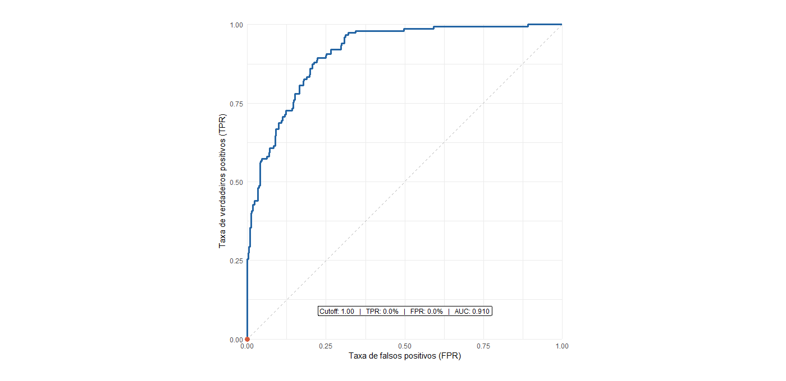

## Da predição à decisão

Um modelo de classificação pode estimar que uma máquina tenha **30% de probabilidade de falhar** na próxima semana. Mas o gestor precisa decidir: deve interromper a produção para realizar uma inspeção?

A probabilidade, isoladamente, não responde. Precisamos considerar **o custo de inspecionar sem necessidade** e **o custo de deixar uma falha acontecer**.

$$\boxed{\text{Predizer}\;\longrightarrow\;\text{Decidir}\;\longrightarrow\;\text{Avaliar}\;\longrightarrow\;\text{Interpretar}}$$

**Pergunta:** como transformar predições em ações, comparar classificadores de forma adequada e compreender modelos de regressão complexos?


## Um problema que acompanhará a aula

Uma empresa utiliza dados de vibração, temperatura e histórico de manutenção para estimar a probabilidade de **falha de um equipamento**.

- Classe $Y=1$: o equipamento falhará.
- Classe $Y=0$: o equipamento não falhará.
- Saída do modelo: $\widehat\eta(\mathbf x)=P(Y=1\mid\mathbf X=\mathbf x)$ estimada.

**Exemplo:** para uma máquina, o modelo retorna $\widehat\eta=0{,}30$.

Se a regra fosse “inspecionar quando a probabilidade exceder 50%”, não haveria inspeção. **Mas 50% é necessariamente o cutoff correto?**


## Por que o cutoff de 50% aparece?

Sob **perda 0–1 simétrica**, errar uma falha e gerar um alarme falso têm o mesmo custo.

Se a probabilidade verdadeira de falha é $\eta(\mathbf x)$, os riscos de escolher as duas classes são:

$$R(1\mid\mathbf x)=1-\eta(\mathbf x),\qquad R(0\mid\mathbf x)=\eta(\mathbf x)$$

Escolhemos a classe 1 quando seu risco é menor:

$$1-\eta(\mathbf x)<\eta(\mathbf x)\quad\Longleftrightarrow\quad\boxed{\eta(\mathbf x)>0{,}5}$$

Essa é a **regra de Bayes** para classificação binária com custos simétricos. Na prática, substituímos $\eta$ pela probabilidade estimada $\widehat\eta$.


## Mesmo a melhor regra pode cometer erros

Suponha que, para um perfil de máquina, a probabilidade verdadeira de falha seja $\eta(\mathbf x)=0{,}30$.

- Decidir **não inspecionar** erra em 30% dos casos desse perfil.
- Decidir **inspecionar** erra em 70% dos casos desse perfil, sob perda 0–1.

O menor erro possível nesse perfil é $\min\{0{,}30,0{,}70\}=0{,}30$.

Em geral, o **erro de Bayes** é:

$$\boxed{R^*=\mathbb E\big[\min\{\eta(\mathbf X),1-\eta(\mathbf X)\}\big]}$$

**Interpretação:** parte da incerteza pode ser inerente ao problema. Nem um classificador ideal consegue eliminar erros quando as classes se sobrepõem.


## Perdas assimétricas: dois erros, consequências diferentes

Uma inspeção desnecessária custa **R$ 200**. Deixar de inspecionar uma máquina que falhará custa **R$ 2.000**.


| Realidade | Não inspecionar (decidir 0) | Inspecionar (decidir 1) |
|:---|---:|---:|
| Não falhará ($Y=0$) | R\$ 0 | R\$ 200 - falso positivo |
| Falhará ($Y=1$) | R\$ 2.000 - falso negativo | R\$ 0 |


Chamamos $C_{FP}=200$ e $C_{FN}=2000$.

**Pergunta:** se uma falha é dez vezes mais custosa que um alarme falso, ainda faz sentido exigir probabilidade superior a 50%?


## Decisão ótima: comparar custos esperados

Para uma máquina com probabilidade de falha $\eta(\mathbf x)$:

- **Inspecionar:** o custo ocorre se não houver falha: $R(1\mid\mathbf x)=C_{FP} \times [1-\eta(\mathbf x)]$
- **Não inspecionar:** o custo ocorre se houver falha: $R(0\mid\mathbf x)=C_{FN} \times \eta(\mathbf x)$

Inspecionamos quando o primeiro risco é menor que o segundo:

$$C_{FP} \times(1-\eta)<C_{FN} \times \eta\quad\Longleftrightarrow\quad\boxed{\eta>c^*=\frac{C_{FP}}{C_{FP}+C_{FN}}}$$

**Importante:** a fórmula pressupõe custos corretos, constantes para os casos considerados e probabilidades bem calibradas.


## Exemplo resolvido: a máquina com risco de 30% 

Com $C_{FP}=200$ e $C_{FN}=2000$:

$$c^*=\frac{200}{200+2000}\approx\boxed{0{,}091}$$


## Exemplo resolvido: a máquina com risco de 30% 

Para a máquina com $\widehat\eta=0{,}30$:

| Ação | Custo esperado estimado |
|:---|---:|
| Inspecionar | $200\times0{,}70=\text{R\$ }140$ |
| Não inspecionar | $2000\times0{,}30=\text{R\$ }600$ |

**Decisão:** inspecionar, pois R$ 140 é menor que R$ 600.

A regra de 50% deixaria essa máquina sem inspeção. A diferença não está na probabilidade prevista, mas **no custo atribuído a cada erro**.


## O cutoff é uma escolha operacional

Um classificador fornece uma pontuação ou probabilidade. O cutoff transforma essa informação em uma classe:

$$\widehat g_c(\mathbf x)=I\{\widehat\eta(\mathbf x)\geq c\}$$

- **Reduzir $c$:** mais casos são classificados como positivos; tende a aumentar a sensibilidade e também os falsos alarmes.
- **Aumentar $c$:** menos casos são positivos; tende a reduzir os falsos alarmes, mas pode deixar passar eventos relevantes.

**Distinção:** mudar $c$ não exige necessariamente treinar novamente o modelo. A escolha do cutoff deve refletir os custos, as restrições operacionais e o desempenho estimado em validação.


## Matriz de confusão: o que realmente aconteceu?

Suponha que avaliamos 1.000 máquinas: 100 falharam e 900 não falharam.

| Resultado | Predição: falha | Predição: não falha |
|:---|---:|---:|
| **Falhou** | 80 verdadeiros positivos (VP) | 20 falsos negativos (FN) |
| **Não falhou** | 90 falsos positivos (FP) | 810 verdadeiros negativos (VN) |

**Leitura:** identificamos 80 das 100 falhas, mas inspecionamos desnecessariamente 90 máquinas.

A matriz de confusão é a base das métricas de classificação. Cada métrica responde a uma pergunta distinta.


## Sensibilidade, especificidade e precisão {.smaller}

Usando a matriz anterior:

| Métrica | Pergunta | Cálculo | Resultado |
|:---|:---|:---:|---:|
| Sensibilidade (*recall*) | Das falhas reais, quantas detectamos? | $VP/(VP+FN)$ | **80%** |
| Especificidade | Das máquinas sem falha, quantas liberamos corretamente? | $VN/(VN+FP)$ | **90%** |
| Precisão (*precision*) | Dos alertas emitidos, quantos eram falhas reais? | $VP/(VP+FP)$ | **47,1%** |

**Interpretação:** um modelo pode detectar boa parte das falhas e, ainda assim, emitir muitos alarmes falsos. Por isso, uma única métrica raramente resume o problema.


## Acurácia e F1: o que cada resumo esconde? 

No mesmo exemplo:

$$\text{Acurácia}=\frac{VP+VN}{n}=\frac{80+810}{1000}=89\%.$$

$$F_1=\frac{2\cdot\text{Precisão}\cdot\text{Recall}}{\text{Precisão}+\text{Recall}}\approx59{,}3\%.$$


## Acurácia e F1: o que cada resumo esconde? 


- **Acurácia** considera a proporção total de acertos; pode ser dominada pela classe majoritária.
- **F1** combina precisão e recall, mas não incorpora explicitamente verdadeiros negativos nem custos monetários.

**Conclusão:** escolha métricas em função da decisão que será tomada, e não apenas porque são usuais.


## Desbalanceamento: 98% de acurácia pode ser inútil

Imagine 10.000 equipamentos, dos quais apenas **200 falharão** (2%).

Um classificador que sempre responde “não falhará” acerta 9.800 casos:

$$\text{Acurácia}=\frac{9800}{10000}=\boxed{98\%}$$

Entretanto, ele não identifica **nenhuma** das 200 falhas:

$$\text{Sensibilidade}=0\%$$


## Desbalanceamento: 98% de acurácia pode ser inútil


A **balanced accuracy** atribui peso igual às duas classes:

$$\text{Balanced Accuracy}=\frac{\text{Sensibilidade}+\text{Especificidade}}{2}=50\%$$

**Observação:** uma acurácia elevada pode simplesmente refletir a prevalência da classe majoritária.


## ROC: avaliar todos os cutoffs

A curva ROC descreve como o classificador troca **detecção de positivos** por **falsos alarmes** quando variamos o cutoff.

- Eixo horizontal: $FPR=1-\text{Especificidade}$.
- Eixo vertical: $TPR=\text{Sensibilidade}$.

Cada ponto da curva corresponde a um cutoff. Um bom classificador tende a produzir valores altos de TPR com valores baixos de FPR.

**Atenção:** ROC avalia a capacidade de discriminação ao longo dos cutoffs, mas não determina qual deles minimiza o custo da decisão.


## Como o cutoff altera a classificação?

```{r eval=FALSE}
#| fig-width: 14
#| fig-height: 7

set.seed(335)
y <- c(rep(0,900),rep(1,100))
score <- c(rbeta(900,2.2,5),rbeta(100,4.8,2.5))
cortes <- seq(1,0,length.out=250)
roc <- do.call(rbind,lapply(cortes,function(c){
  p <- as.integer(score>=c)
  data.frame(fpr=mean(p[y==0]),tpr=mean(p[y==1]))
}))
plot(roc$fpr,roc$tpr,type="l",lwd=3,col="#2C7FB8",
     xlab="Taxa de falsos positivos (1 - especificidade)",
     ylab="Sensibilidade",xlim=c(0,1),ylim=c(0,1))
abline(0,1,lty=2,col="gray50")
```


{width="150%" fig-align="center"}


## Como o cutoff altera a classificação?


**Interpretação:**

- Cutoff alto: menos observações classificadas como positivas.
- Cutoff baixo: aumentam a sensibilidade e a taxa de falsos positivos.
- AUC constante: o poder de discriminação do modelo não muda.

**Conclusão:** escolher o cutoff significa selecionar um ponto
operacional da curva ROC, considerando os custos dos erros.


## AUC: uma medida de ordenação

A **área sob a curva ROC (AUC)** resume a capacidade do
classificador de atribuir escores maiores às observações
positivas do que às negativas, considerando todos os cutoffs.

Uma interpretação probabilística é:

$$
\boxed{
\mathrm{AUC}
=
P(S_1>S_0)+\frac{1}{2}P(S_1=S_0)
}
$$

em que:

- $S_1$: escore de uma observação da classe positiva ($Y=1$)
- $S_0$: escore de uma observação da classe negativa ($Y=0$)


## AUC: uma medida de ordenação


Os escores devem ser orientados de modo que valores maiores
indiquem maior evidência da classe positiva.

::: {.callout-note appearance="simple"}

**Exemplo:** AUC = $0{,}91$ significa que, ao selecionar
aleatoriamente uma observação positiva e outra negativa,
o classificador apresenta **91% de concordância na ordenação**,
contando empates com peso de 50%.

:::

**Atenção:** AUC = $0{,}91$ não significa 91% de acertos
nas classificações. A AUC avalia a **capacidade de ordenação**,
não a acurácia para um cutoff específico.


## Precision–Recall: foco na classe positiva

Quando a falha é rara, queremos saber não apenas quantas falhas detectamos, mas **quantos alertas são confiáveis**.

A curva Precision–Recall mostra, para diferentes cutoffs:

$$\text{Recall}=\frac{VP}{VP+FN},\qquad\text{Precisão}=\frac{VP}{VP+FP}.$$

Ao reduzir o cutoff, normalmente detectamos mais falhas, mas também geramos mais alarmes falsos.

**Por que é útil?** Em eventos raros, a precisão evidencia o efeito dos falsos positivos sobre a utilidade prática dos alertas. Seu nível de referência depende da prevalência da classe positiva.


## Curva Precision–Recall em dados simulados

```{r}
#| fig-height: 4.7
pr <- do.call(rbind,lapply(cortes,function(c){
  p <- as.integer(score>=c)
  vp <- sum(p==1 & y==1); fp <- sum(p==1 & y==0)
  data.frame(recall=vp/sum(y==1),precision=if(vp+fp>0)vp/(vp+fp) else NA_real_)
}))
pr <- pr[is.finite(pr$precision),]
plot(pr$recall,pr$precision,type="l",lwd=3,col="#2C7FB8",
     xlab="Recall (sensibilidade)",ylab="Precisão",xlim=c(0,1),ylim=c(0,1))
abline(h=mean(y),lty=2,col="gray50")
legend("topright",legend=c("Curva PR","Prevalência = 10%"),
       col=c("#2C7FB8","gray50"),lty=c(1,2),bty="n")
```

*A linha pontilhada representa a prevalência positiva da amostra simulada, referência para um ranqueamento aleatório.*


## ROC ou Precision–Recall?

| Questão | ROC | Precision–Recall |
|:---|:---|:---|
| O que enfatiza? | Sensibilidade versus taxa de falsos positivos | Recall versus confiabilidade dos alertas |
| Em eventos raros | Pode parecer favorável mesmo com muitos FP em números absolutos | Expõe diretamente a baixa precisão dos alertas |
| Escolhe o cutoff? | Não | Não |

**Exemplo:** se 1% dos casos são positivos, uma taxa de falsos positivos de apenas 5% pode gerar muitos alarmes falsos em relação aos verdadeiros positivos.

**Prática recomendada:** observar ambas as curvas, a matriz de confusão no cutoff escolhido e, quando possível, o custo esperado da decisão.


## Três formas de lidar com classes desbalanceadas

O desbalanceamento pode ser tratado em etapas diferentes do processo:

| Intervenção | O que muda? | Exemplo |
|:---|:---|:---|
| **Dados** | Composição do treinamento | Oversampling, undersampling, SMOTE |
| **Aprendizado** | Peso atribuído aos erros | Penalizar mais os falsos negativos |
| **Decisão** | Regra aplicada à saída | Reduzir o cutoff |

Essas intervenções **não são equivalentes**. Reamostrar pode alterar as probabilidades produzidas pelo modelo; mudar o cutoff não altera a pontuação original.

**Cuidado:** oversampling ou SMOTE devem ocorrer **apenas nos dados de treinamento de cada fold**. Aplicá-los antes da validação cruzada provoca vazamento de informação.


## Probabilidades e custos: um cuidado adicional

A regra $c^*=C_{FP}/(C_{FP}+C_{FN})$ é derivada para probabilidades condicionais verdadeiras.

Na prática, o modelo pode produzir escores que **não são probabilidades bem calibradas**. Por exemplo, entre máquinas com previsão de 80% de falha, a frequência observada pode ser muito menor.

- Verifique discriminação e calibração em dados não utilizados para ajustar o modelo.
- Se usar reamostragem, não presuma que as probabilidades continuam refletindo a prevalência operacional.
- Escolha o cutoff com base em custos e desempenho em validação; avalie uma única vez no teste final.

**Discriminar bem, calibrar bem e decidir bem são objetivos relacionados, mas distintos.**


## Por que combinar classificadores?

Suponha que três modelos avaliem a mesma máquina:

- Regressão logística: probabilidade de falha **0,72**.
- Random Forest: probabilidade **0,64**.
- SVM calibrada: probabilidade **0,40**.

Cada modelo aprende padrões de forma diferente. Uma combinação pode reduzir a dependência de um único ajuste, **desde que os erros não sejam perfeitamente coincidentes**.

Entretanto, combinar modelos não garante melhora: modelos ruins ou altamente correlacionados podem acrescentar pouca informação.


## Hard voting: maioria de votos

Cada classificador produz diretamente uma classe. Com cutoff de 0,5, as previsões do exemplo são:

| Modelo | Probabilidade | Classe |
|:---|---:|:---:|
| Logística | 0,72 | 1 |
| Random Forest | 0,64 | 1 |
| SVM calibrada | 0,40 | 0 |

A **votação majoritária** produz classe 1 (dois votos entre três).

$$\widehat g_{\mathrm{hard}}(\mathbf x)=\operatorname{moda}\{g_1(\mathbf x),\ldots,g_M(\mathbf x)\}.$$

**Limitação:** o método ignora o grau de confiança. Uma previsão de 0,51 conta como um voto tão forte quanto 0,99.


## Soft voting: média das probabilidades

Em vez de combinar classes, combinamos probabilidades estimadas:

$$\overline p_1(\mathbf x)=\frac{0{,}72+0{,}64+0{,}40}{3}\approx\boxed{0{,}587}.$$

Se aplicarmos cutoff 0,5 à média, a decisão será classe 1.

**Vantagem:** preserva parte da intensidade das previsões.

**Cuidados:** as probabilidades devem estar em escalas comparáveis e, idealmente, calibradas; pesos e hiperparâmetros da combinação devem ser escolhidos com dados de treinamento/validação, não com o teste.


## Quando a combinação não ajuda?

Imagine três classificadores que cometem exatamente os mesmos erros. A votação não corrige nenhum deles.

Por outro lado, se os modelos capturam aspectos diferentes do fenômeno, seus erros podem se compensar.

**Para avaliar uma combinação:**

1. Compare com o melhor modelo individual em validação.
2. Examine o desempenho no cutoff operacional e o custo esperado.
3. Evite escolher pesos ou modelos olhando os resultados do conjunto de teste.

**Ideia central:** diversidade útil e validação adequada importam mais do que simplesmente aumentar o número de classificadores.


## Síntese do Encontro 1

Retomando a manutenção preditiva:

- **Predição:** a máquina recebeu probabilidade estimada de falha de 30%.
- **Decisão:** com custos assimétricos, o cutoff ótimo teórico pode ser próximo de 9,1%, não 50%.
- **Avaliação:** matriz de confusão, sensibilidade, precisão e custos revelam consequências distintas.
- **Desbalanceamento:** acurácia isolada pode ser enganosa.
- **Combinação:** votação pode ajudar, mas exige validação.

**Pergunta para reflexão:** um modelo com AUC maior é necessariamente o melhor para uma empresa com orçamento limitado para inspeções? **Não:** é preciso avaliar as decisões e restrições concretas.


## Da qualidade preditiva à interpretabilidade

Agora considere um modelo de **regressão** que prevê o consumo de energia de uma máquina, em kWh, a partir de temperatura, carga, idade e vibração.

O modelo apresenta bom erro de teste, mas um engenheiro pergunta:

- Como o consumo previsto muda quando a temperatura aumenta?
- Essa relação é igual para todas as máquinas?
- Por que esta máquina recebeu previsão de **120 kWh**?

São perguntas diferentes. Precisamos distinguir **explicações globais** do comportamento médio e **explicações locais** de previsões individuais.


## Interpretabilidade não é causalidade

Suponha que o consumo previsto aumente quando elevamos a temperatura no modelo.

Isso **não prova** que elevar a temperatura causaria aumento de consumo no mundo real. Temperatura, carga e condições operacionais podem estar associadas entre si.

$$\boxed{\text{Comportamento do modelo}\neq\text{efeito causal}}$$

PDP, ICE e LIME descrevem como **o modelo ajustado** responde a alterações nas entradas. A interpretação causal exigiria hipóteses e estratégias adicionais.


## Uma função de regressão para acompanhar os exemplos

Vamos imaginar que um modelo aprendeu uma relação entre temperatura $T$, carga $L$ e consumo previsto:

$$\widehat f(T,L)=40+0{,}6T+12L+0{,}08TL.$$

- O termo $0{,}6T$ representa uma contribuição associada à temperatura.
- O termo $12L$ representa uma contribuição associada à carga.
- O termo $0{,}08TL$ cria uma **interação**: o efeito de variar $T$ depende de $L$.

A função é **didática e conhecida**, para podermos verificar o que as ferramentas de interpretação mostram. Em uma aplicação real, $\widehat f$ poderia ser uma Random Forest, uma rede neural ou outro modelo ajustado.


## PDP: qual é a resposta média do modelo?

O **Partial Dependence Plot (PDP)** pergunta:

> Em média, como a predição mudaria se fixássemos a temperatura em um valor $t$, mantendo as demais características de cada observação?

Para cada $t$, substituímos a temperatura de todas as máquinas por $t$, calculamos as previsões e fazemos a média:

$$\boxed{\widehat h_T(t)=\frac1n\sum_{i=1}^{n}\widehat f(t,L_i)}.$$

**Interpretação:** o PDP descreve uma tendência **global e média** do modelo. Ele não representa necessariamente a resposta de uma máquina específica.


## PDP: exemplo numérico

Considere três máquinas com cargas $L=1$, $2$ e $3$ e a função didática

$$\widehat f(T,L)=40+0{,}6T+12L+0{,}08TL.$$

Se fixarmos $T=20$, as previsões serão:

| Carga | Predição (kWh) |
|:---:|---:|
| 1 | 65,6 |
| 2 | 79,2 |
| 3 | 92,8 |

O PDP em $T=20$ é a média: $(65{,}6+79{,}2+92{,}8)/3=\boxed{79{,}2\text{ kWh}}$.

Repetimos o procedimento para vários valores de temperatura e construímos a curva.


## PDP e ICE: duas visões da mesma função

```{r}
#| fig-height: 4.9
T <- seq(10,40,length.out=120)
loads <- c(1,2,3)
cons <- function(t,l) 40+0.6*t+12*l+0.08*t*l
mat <- sapply(loads,function(l)cons(T,l))
matplot(T,mat,type="l",lwd=2,col=c("#9CB3D3","#70A5C9","#437EAB"),
        lty=1,xlab="Temperatura (°C)",ylab="Consumo previsto (kWh)")
lines(T,rowMeans(mat),lwd=4,col="#C13D3D",lty=2)
legend("topleft",legend=c("ICE: carga 1","ICE: carga 2","ICE: carga 3","PDP (média)"),
       col=c("#9CB3D3","#70A5C9","#437EAB","#C13D3D"),lty=c(1,1,1,2),
       lwd=c(2,2,2,4),bty="n")
```

**Linhas azuis:** previsões de máquinas individuais (ICE). **Linha vermelha:** média dessas curvas (PDP). A inclinação muda com a carga por causa da interação $TL$.


## ICE: a média pode esconder diferenças

O **Individual Conditional Expectation (ICE)** mantém as demais características de **uma máquina** fixas e varia apenas a temperatura:

$$\boxed{\widehat h_{T,i}(t)=\widehat f(t,L_i)}.$$

No exemplo, máquinas com cargas diferentes apresentam inclinações diferentes. O PDP, por ser uma média, não mostra toda essa heterogeneidade.

- Curvas ICE quase paralelas: resposta semelhante à temperatura entre máquinas.
- Curvas com inclinações ou formatos diferentes: evidência de heterogeneidade no **comportamento do modelo**, possivelmente associada a interações.

**Relação:** o PDP é a média das curvas ICE para a mesma grade de valores.


## Um cuidado importante: variáveis correlacionadas

Imagine que, nos dados reais, temperaturas muito altas só ocorram quando a carga é elevada.

O PDP pode perguntar ao modelo o que aconteceria com **temperatura alta e carga muito baixa**, uma combinação praticamente inexistente no treinamento.

A predição é calculável, mas pode ser **extrapolação para uma região de baixo suporte dos dados**.

**Consequência:** a curva pode descrever mais o comportamento do modelo fora da região observada do que um padrão sustentado por exemplos reais.

**Boa prática:** examinar a distribuição conjunta das variáveis e interpretar PDP/ICE com cautela quando houver dependência forte.


## LIME: por que esta previsão específica?

Suponha que o modelo previu **120 kWh** para uma máquina. O engenheiro quer entender os fatores que contribuíram para essa previsão, sem analisar todas as máquinas.

O **LIME (Local Interpretable Model-agnostic Explanations)** procura construir um **modelo simples nas proximidades da observação de interesse**.

Ele não substitui o modelo original: cria uma aproximação local para explicar seu comportamento ao redor de um ponto específico.


## LIME passo a passo

Para explicar uma máquina $\mathbf x^*$:

1. **Selecionar o caso:** a máquina com previsão de 120 kWh.
2. **Gerar perturbações:** criar observações semelhantes, modificando entradas próximas.
3. **Consultar o modelo:** calcular $\widehat f(\mathbf z_b)$ para cada perturbação.
4. **Atribuir pesos:** dar maior importância a observações mais próximas de $\mathbf x^*$.
5. **Ajustar um modelo simples:** por exemplo, regressão linear local ponderada.
6. **Interpretar contribuições:** identificar quais características mais influenciam a aproximação naquela vizinhança.

**A explicação é local:** pode mudar quando escolhemos outra máquina.


## LIME: a ideia matemática por trás

O LIME busca uma explicação simples $q$ que reproduza bem as previsões do modelo complexo **perto de $\mathbf x^*$**:

$$\boxed{q^*=\arg\min_{q\in\mathcal G}\left\{\mathcal L(\widehat f,q,\pi_{\mathbf x^*})+\Omega(q)\right\}}.$$

- $\mathcal L$: mede quanto a explicação difere do modelo original nas perturbações.
- $\pi_{\mathbf x^*}$: atribui pesos maiores a pontos próximos do caso explicado.
- $\Omega(q)$: penaliza explicações muito complexas.

**Compromisso:** uma explicação mais simples é mais fácil de comunicar, mas pode perder fidelidade ao modelo original.


## Exemplo ilustrativo de uma explicação LIME

Imagine que uma aproximação local ao redor de uma máquina produza as seguintes contribuições para o consumo previsto:

| Componente local | Contribuição estimada |
|:---|---:|
| Valor de referência da explicação | 90 kWh |
| Temperatura elevada | +18 kWh |
| Carga elevada | +15 kWh |
| Equipamento mais novo | −3 kWh |
| **Predição aproximada** | **120 kWh** |

**Leitura:** naquela vizinhança, temperatura e carga estão associadas ao aumento da predição, enquanto a característica “equipamento mais novo” atua em sentido contrário.

*Valores fictícios para explicar o mecanismo; uma saída real depende das perturbações, da codificação das variáveis e do ajuste local.*


## Por que duas explicações LIME podem diferir?

LIME depende de escolhas metodológicas:

- Como as perturbações são geradas.
- Como a proximidade é medida e ponderada.
- Qual é a complexidade do modelo interpretável.
- Qual é a aleatoriedade utilizada no procedimento.

Se as variáveis são fortemente correlacionadas, perturbações independentes podem produzir combinações pouco plausíveis, problema semelhante ao discutido para PDP.

**Boa prática:** verificar estabilidade e fidelidade local; uma explicação convincente visualmente não é, por si só, uma explicação confiável.


## PDP, ICE e LIME: qual pergunta cada um responde?

| Ferramenta | Escopo | Pergunta principal | Limitação típica |
|:---|:---|:---|:---|
| **PDP** | Global | Como a predição média muda ao variar $X_j$? | A média pode ocultar heterogeneidade |
| **ICE** | Individual (várias curvas) | O efeito modelado varia entre observações? | Muitas curvas podem dificultar a leitura |
| **LIME** | Local | Como aproximar a previsão de um caso específico? | Sensível às perturbações e à vizinhança |

**Nenhuma das três ferramentas estabelece causalidade por si só.** Elas descrevem o comportamento de um modelo ajustado.


## Como comunicar uma interpretação responsável?

Ao apresentar um PDP, ICE ou LIME em um relatório, informe:

1. **O que foi previsto:** consumo em kWh, risco, preço etc.
2. **Qual modelo foi explicado:** versão e conjunto de dados utilizados.
3. **Qual pergunta foi respondida:** global ou local.
4. **Qual região dos dados foi examinada:** evitar extrapolações inadvertidas.
5. **Quais limitações permanecem:** dependência entre variáveis, estabilidade e ausência de interpretação causal.

**Formulação adequada:** “O modelo prevê maior consumo quando a temperatura aumenta, em média.”

**Formulação inadequada sem evidência causal:** “Aumentar a temperatura causa maior consumo.”


## Exercício de compreensão: classificação

Uma empresa utiliza um classificador calibrado para detectar falhas. O custo de um falso positivo é R$ 300; o de um falso negativo é R$ 1.200.

**Responda e justifique:**

1. Qual é o cutoff teórico que minimiza o custo esperado, sob as hipóteses discutidas?
2. Uma máquina recebeu probabilidade de falha de 0,35. Deve ser inspecionada?
3. Se apenas 1% das máquinas falham, por que a acurácia não deve ser a única métrica?
4. Aumentar a AUC garante reduzir o custo operacional? Explique.

::: {.notes}
Gabarito: c*=300/(300+1200)=0,2; inspecionar pois 0,35>0,2. Acurácia pode refletir a classe majoritária; AUC não escolhe cutoff nem incorpora custos.
:::


## Exercício de compreensão: interpretabilidade

Um modelo prevê o consumo de energia a partir de temperatura, carga e idade. O PDP da temperatura é crescente, mas as curvas ICE apresentam inclinações muito diferentes.

**Responda e justifique:**

1. O que o PDP crescente permite concluir sobre o modelo?
2. O que as diferentes inclinações ICE sugerem?
3. Se temperatura e carga são altamente correlacionadas, qual cuidado é necessário?
4. Para explicar uma máquina específica, por que LIME pode ser mais apropriado que apenas o PDP?

::: {.notes}
Gabarito: predição média aumenta; heterogeneidade/interações no modelo; combinações fora do suporte; LIME produz aproximação local de uma previsão específica. Não inferir causalidade.
:::


## Síntese: do modelo à utilização responsável

**Classificação:** um bom modelo não é apenas aquele que ordena corretamente os casos. A decisão depende de **custos, cutoff, prevalência e restrições operacionais**.

**Combinação:** vários classificadores podem melhorar resultados quando oferecem informação complementar, mas a melhoria deve ser demonstrada fora do treinamento.

**Regressão:** explicar um modelo significa investigar seu comportamento. **PDP** resume tendências médias, **ICE** mostra diferenças individuais e **LIME** aproxima uma previsão específica.

$$\boxed{\text{Desempenho preditivo}\; +\;\text{decisão adequada}\; +\;\text{interpretação crítica}}$$

**Mensagem final:** não confundir uma boa predição com uma boa decisão — nem uma explicação do modelo com uma relação causal.


## Referências para aprofundamento

- James, Witten, Hastie e Tibshirani. *An Introduction to Statistical Learning*, 2ª ed. Capítulos sobre classificação, reamostragem e métodos de aprendizado.
- Hastie, Tibshirani e Friedman. *The Elements of Statistical Learning*. Discussão de classificação, perdas e ensembles.
- Molnar, C. *Interpretable Machine Learning*. Capítulos sobre PDP, ICE e LIME: https://christophm.github.io/interpretable-ml-book/
- Ribeiro, Singh e Guestrin (2016). “Why Should I Trust You?”: Explaining the Predictions of Any Classifier. KDD.

**Observação:** exemplos de custos e de consumo desta aula são didáticos e não representam resultados empíricos.

