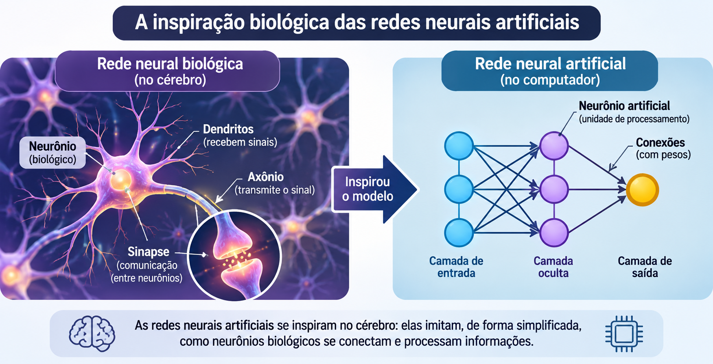
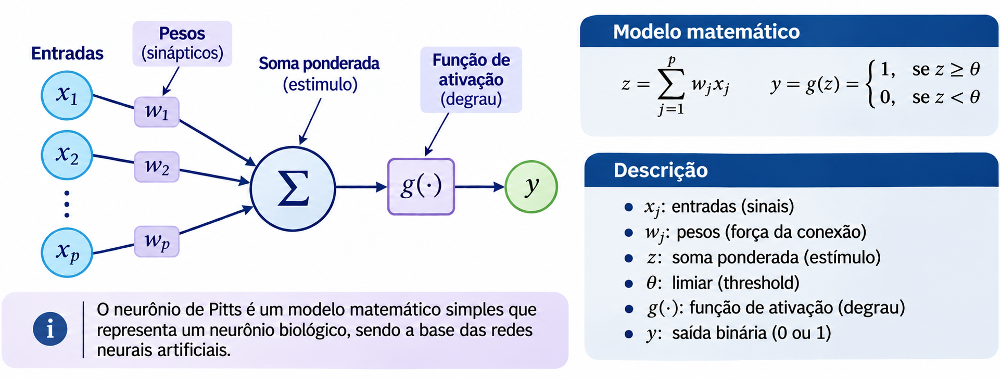
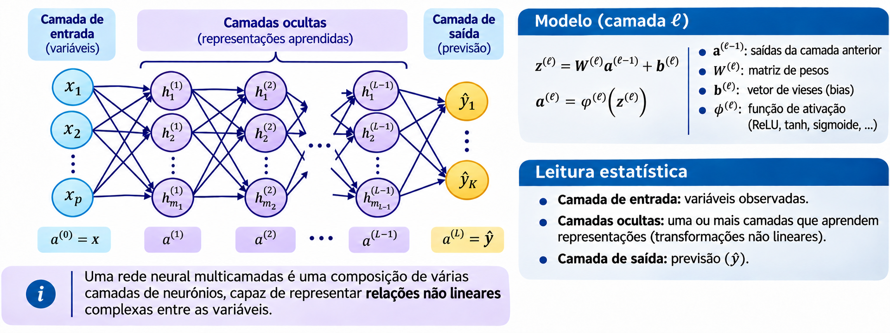
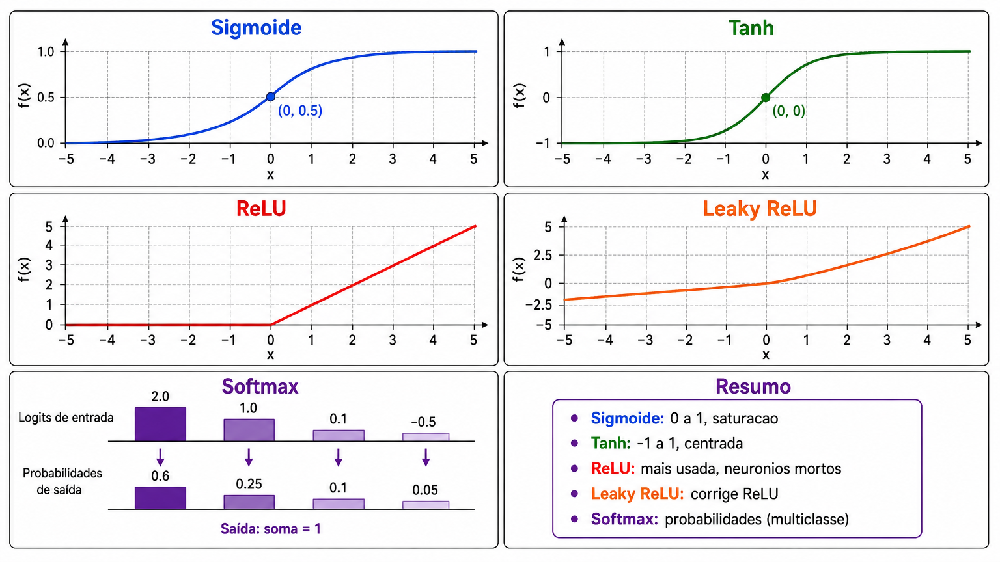
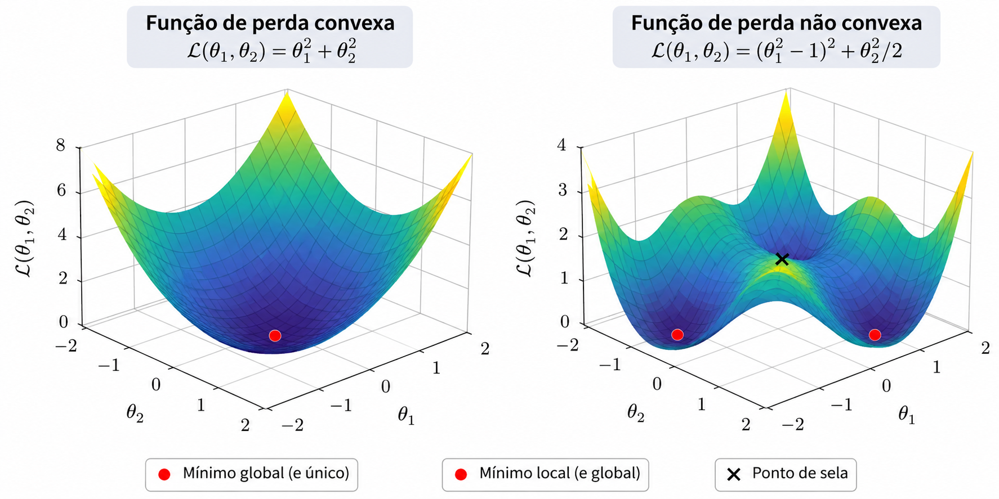
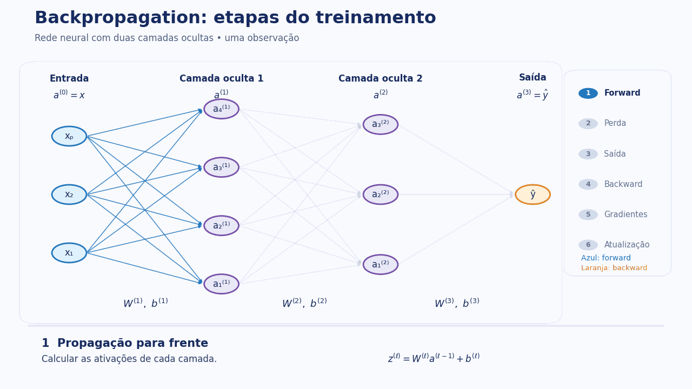
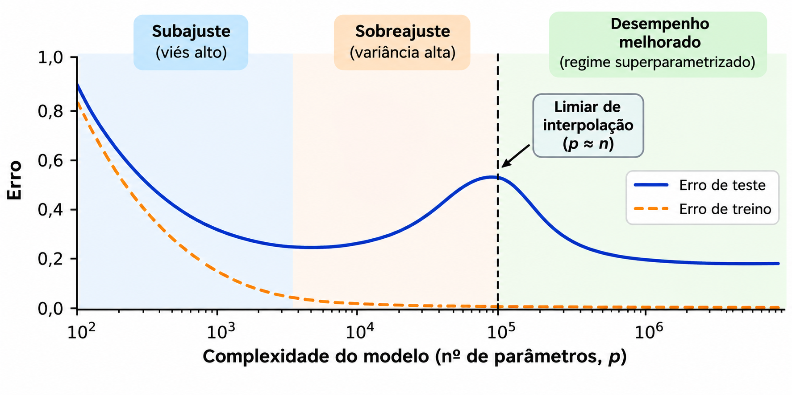

# Redes Neurais Artificiais


## Questão motivadora

Como unidades de processamento relativamente simples, quando conectadas, conseguem representar relações complexas entre variáveis?

- Modelos lineares combinam preditores diretamente.
- RNAs compõem **transformações lineares e não lineares**.
- Os parâmetros são estimados a partir dos dados.


## Motivação: da biologia à modelagem

{width=92%}


## O primeiro modelo: McCulloch–Pitts (1943)


{width="100%"}


## Como funciona uma unidade de limiar?

Considere duas entradas binárias, com $w_1=w_2=1$ e $\theta=2$:

$$
y=\mathbb{I}(x_1+x_2\geq 2).
$$

| $x_1$ | $x_2$ | $z=x_1+x_2$ | $y$ |
|:---:|:---:|:---:|:---:|
| 0 | 0 | 0 | 0 |
| 0 | 1 | 1 | 0 |
| 1 | 0 | 1 | 0 |
| 1 | 1 | 2 | 1 |

**Interpretação:** esta unidade implementa a operação lógica **E (AND)**.

::: {.notes}
Peça que a turma sugira um limiar para representar a operação OU (OR): com os mesmos pesos, theta=1.
:::

## O que o modelo de McCulloch–Pitts não fazia?

- **Não aprendia pesos a partir de exemplos**: as conexões eram especificadas previamente.
- Produzia decisões discretas por meio de um limiar.
- Não oferecia, por si só, um procedimento de treinamento supervisionado.

**Pergunta:** e se pudéssemos **estimar os pesos** usando observações $(\mathbf{x}_i,y_i)$?


## Perceptron de Rosenblatt (1958)

O perceptron introduz uma regra de atualização para os pesos de uma unidade classificadora:

$$
\widehat y=\mathbb{I}(\mathbf{w}^{\mathsf T}\mathbf{x}+b\geq 0)
$$

Para $y\in\{0,1\}$, uma forma da atualização é:

$$
\mathbf{w}\leftarrow\mathbf{w}+\eta(y-\widehat y)\mathbf{x},\qquad
b\leftarrow b+\eta(y-\widehat y)
$$

- $\eta>0$: taxa de aprendizagem.
- A atualização depende do **erro de classificação**.
- Um único perceptron produz uma **fronteira linear**.


## Por que precisamos de funções de ativação?

::: columns
::: {.column width="55%"}

Um neurônio moderno calcula:

$$
z=\mathbf{w}^{\mathsf T}\mathbf{x}+b,
\qquad a=\phi(z)
$$

Exemplos:

$$
\sigma(z)=\frac{1}{1+e^{-z}},\qquad
\operatorname{ReLU}(z)=\max(0,z)
$$

:::
::: {.column width="45%"}

**Diferenças importantes**

- Pesos e viés **ajustáveis**.
- Ativações não lineares.
- Saídas não necessariamente binárias.
- Treinamento via otimização.

:::
:::


## De um neurônio a uma rede multicamadas


**Uma camada oculta:**

$$
\mathbf{h}=\phi(W_1\mathbf{x}+\mathbf{b}_1)
$$

$$
\widehat y=\psi(W_2\mathbf{h}+b_2)
$$

A composição permite representar **relações não lineares**.


**Atenção:** os nós da camada de entrada geralmente representam variáveis, e não neurônios de processamento.


## De um neurônio a uma rede multicamadas

{width="100%"}


## Conexão com modelos estatísticos

| Modelo | Expressão típica | O que é estimado? |
|---|---|---|
| Regressão linear | $\widehat y=\mathbf{w}^{\mathsf T}\mathbf{x}+b$ | Coeficientes |
| Regressão logística | $\widehat p=\sigma(\mathbf{w}^{\mathsf T}\mathbf{x}+b)$ | Coeficientes |
| RNA com camada oculta | $\widehat y=\psi(W_2\phi(W_1\mathbf{x}+\mathbf{b}_1)+b_2)$ | Pesos e vieses de todas as camadas |

**Próxima pergunta:** como estimar todos esses parâmetros minimizando uma função de perda?

$$
\widehat{\boldsymbol\theta}=\arg\min_{\boldsymbol\theta}
\frac1n\sum_{i=1}^{n}L(y_i,g_{\boldsymbol\theta}(\mathbf{x}_i))
$$


## Pergunta orientadora

> Como a composição de transformações simples pode representar relações complexas entre preditores e resposta?

**Ideia-chave:** estimar uma função $g_\theta(\mathbf{x})$ flexível, cujos parâmetros $\theta$ são aprendidos a partir de dados.

## O que uma RNA aprende?

Em aprendizagem supervisionada, observamos $(\mathbf{x}_i,y_i)$, $i=1,\ldots,n$.

$$
\widehat g = \arg\min_{g\in\mathcal G_{RNA}} \frac1n\sum_{i=1}^n L\big(y_i,g(\mathbf{x}_i)\big)
$$

- **Arquitetura:** define a classe de funções $\mathcal G_{RNA}$.
- **Pesos e vieses:** determinam uma função específica.
- **Função de perda:** traduz o objetivo estatístico.
- **Otimizador:** procura parâmetros com baixa perda.

## Revisão: regressão logística

Para classificação binária:

$$
P(Y=1\mid\mathbf{x})=\sigma(\beta_0+\boldsymbol\beta^\top\mathbf{x}),\qquad
\sigma(z)=\frac{1}{1+e^{-z}}
$$

A combinação dos preditores é **linear no logito**.

**Questão:** e se a fronteira de decisão não puder ser descrita por um hiperplano?

## Neurônio artificial

$$
\underbrace{z}_{\text{pré-ativação}}=\sum_{j=1}^p w_jx_j+b,
\qquad
\underbrace{a}_{\text{ativação}}=\phi(z)
$$

- $x_j$: entradas; $w_j$: pesos; $b$: viés (*bias*).
- $\phi$: função de ativação, geralmente não linear.
- Uma unidade com ativação sigmoide lembra a regressão logística; **a composição de camadas** amplia a representação.

## Funções de ativação {.smaller}

| Função | Definição | Observação |
|---|---|---|
| Identidade | $\phi(z)=z$ | Saída para regressão |
| Sigmoide | $\phi(z)=\dfrac{1}{1+e^{-z}}$ | Saída binária probabilística |
| Tanh | $\phi(z)=\tanh(z)$ | Valores em $(-1,1)$ |
| ReLU | $\phi(z)=\max(0,z)$ | Frequente em camadas ocultas |
| Leaky ReLU | $\phi(z)=\max(\alpha z,z)$ | Mantém gradiente para $z<0$, com $0<\alpha<1$ |
| Softmax | $\phi_k(\mathbf{z})=\dfrac{e^{z_k}}{\sum_{j=1}^{K}e^{z_j}}$ | Probabilidades para $K$ classes |


**Observações:**

- **Leaky ReLU:** reduz o problema dos neurônios mortos (*dying ReLU*).
- **Softmax:** atua sobre um vetor e produz probabilidades cuja soma é igual a 1.
- **Não linearidade:** sem funções de ativação não lineares entre as camadas, a composição de transformações afins continua **afim**.


## Visualizando ativações


<!-- ```{r} -->
<!-- #| echo: false -->
<!-- #| fig-width: 9 -->
<!-- #| fig-height: 4.5 -->
<!-- z <- seq(-5, 5, length.out = 300) -->
<!-- matplot(z, cbind(1/(1+exp(-z)), tanh(z), pmax(0,z)), type="l", -->
<!--         lty=1, lwd=2, xlab="z", ylab="Ativação", col=c("#2266aa","#b53b3b","#19865a")) -->
<!-- abline(h=0, col="gray80") -->
<!-- legend("topleft", c("Sigmoide", "Tanh", "ReLU"), lty=1, lwd=2, -->
<!--        col=c("#2266aa","#b53b3b","#19865a"), bty="n") -->
<!-- ``` -->


{width="100%"}


## Rede com uma camada oculta

$$
\mathbf{h}=\phi\left(W^{(1)}\mathbf{x}+\mathbf{b}^{(1)}\right),
\qquad
\widehat y=\psi\left(W^{(2)}\mathbf{h}+\mathbf{b}^{(2)}\right)
$$

- $W^{(1)}\in\mathbb R^{H\times p}$; $\mathbf b^{(1)}\in\mathbb R^H$
- $W^{(2)}\in\mathbb R^{1\times H}$; $b^{(2)}\in\mathbb R$
- $\psi$ depende da tarefa: identidade ou sigmoide, por exemplo.

## Quantos parâmetros?

Para $p$ entradas, $H$ neurônios ocultos e **uma saída**:

$$
\#\theta=\underbrace{pH+H}_{\text{camada oculta}}+
\underbrace{H+1}_{\text{saída}}=H(p+2)+1
$$

**Exemplo:** $p=10$ e $H=20$ implicam **241 parâmetros**.

Aumentar $H$ aumenta a capacidade de representação e também o custo de estimação.

## O papel da profundidade

Com $L$ camadas ocultas:

$$
\mathbf h^{(\ell)}=\phi_\ell\left(W^{(\ell)}\mathbf h^{(\ell-1)}+\mathbf b^{(\ell)}\right),
\quad \mathbf h^{(0)}=\mathbf x
$$

A rede constrói **representações sucessivas** dos dados.

Uma rede larga com uma camada oculta pode aproximar uma ampla classe de funções contínuas em conjuntos compactos, sob condições adequadas. Isso **não garante** aprendizagem, eficiência ou generalização com amostras finitas.

## Regressão e classificação: o que muda?

| Elemento | Regressão | Classificação binária |
|---|---|---|
| Saída | $\hat y\in\mathbb R$ | $\hat p\in(0,1)$ |
| Ativação final | Identidade | Sigmoide |
| Perda comum | MSE | Log-loss (entropia cruzada) |
| Métricas | RMSE, MAE, $R^2$ | AUC, acurácia, F1, log-loss |

**Importante:**

- A mesma função pode ser utilizada como **perda de treinamento**
  e **métrica de avaliação**.
- Na classificação binária, a log-loss equivale à
  entropia cruzada binária.
- Uma probabilidade estimada não é automaticamente
  bem calibrada.

## Funções de perda

**Erro quadrático médio:**

$$L_{MSE}(\theta)=\frac1n\sum_{i=1}^n (y_i-\widehat y_i)^2$$

**Log-Loss:**

$$L_{LL}(\theta)=-\frac1n\sum_{i=1}^n\left[y_i\log\widehat p_i+(1-y_i)\log(1-\widehat p_i)\right]$$

A escolha da perda deve refletir a tarefa e as propriedades desejadas da predição.

## Risco empírico e regularização

$$
\widehat\theta=\arg\min_\theta\left\{
\frac1n\sum_{i=1}^n L\big(y_i,f_\theta(\mathbf x_i)\big)
+\lambda\Omega(\theta)\right\}
$$

Para penalização $L_2$:

$$\Omega(\theta)=\sum_{w\in\mathcal W}w^2$$

A penalização é usualmente aplicada aos **pesos**, não necessariamente aos vieses. A convenção de escala de $\lambda$ varia entre implementações.

## Conexão com ridge e splines

- **Ridge:** penaliza coeficientes de um modelo linear.
- **Smoothing spline:** penaliza a rugosidade da função estimada.
- **RNA com weight decay:** penaliza a magnitude dos pesos.

Em todos os casos há um compromisso entre **ajuste aos dados** e **complexidade efetiva**.

As penalizações não são equivalentes: atuam em objetos e espaços funcionais diferentes.

## Como a rede aprende?

Atualização por gradiente descendente:

$$
\theta^{(t+1)}=\theta^{(t)}-\eta\nabla_\theta L(\theta^{(t)})
$$

- $\eta$: taxa de aprendizagem (*learning rate*).
<!-- - Em SGD/minibatches, o gradiente é estimado com subconjuntos dos dados. -->
- A superfície de perda de RNAs geralmente é **não convexa**.

---

{width="100%"}


## Exemplo: derivada de uma unidade sigmoide

Considere $\widehat p=\sigma(wx+b)$ e a perda para uma observação:

$$\ell=-y\log\widehat p-(1-y)\log(1-\widehat p)$$

Usando a regra da cadeia:

$$
\frac{\partial\ell}{\partial w}=(\widehat p-y)x,
\qquad
\frac{\partial\ell}{\partial b}=\widehat p-y
$$

**Interpretação:** o erro de predição é propagado para ajustar os parâmetros.

## Backpropagation: ideia central

Para uma camada oculta:

$$
\delta^{(2)}=\frac{\partial\ell}{\partial z^{(2)}},\qquad
\delta^{(1)}=\big[(W^{(2)})^\top\delta^{(2)}\big]\odot\phi'(z^{(1)})
$$

$$
\frac{\partial\ell}{\partial W^{(\ell)}}=\delta^{(\ell)}(h^{(\ell-1)})^\top
$$

O *backpropagation* calcula gradientes eficientemente; **não é, por si só, o algoritmo de atualização** dos pesos.

## Passos do treinamento

1. Inicializar pesos e vieses.
2. Fazer a passagem para frente (*forward pass*).
3. Calcular a função de perda.
4. Calcular gradientes por *backpropagation*.
5. Atualizar parâmetros pelo otimizador.
6. Repetir até um critério de parada.

Inicializações, taxa de aprendizagem e sementes podem afetar o resultado.


--- 

{width="90%" fig-align="center"}


## Viés, variância e generalização

:::: {.columns}

::: {.column width="43%"}

- **Pouca capacidade:** risco de **subajuste** (*underfitting*).

- **Muita capacidade sem controle:** risco de
  **sobreajuste** (*overfitting*).

- **Mais parâmetros não implicam necessariamente
  maior erro de teste.**

- A generalização depende dos dados, da arquitetura,
  do treinamento e da regularização.

:::

::: {.column width="57%"}

{width="100%" fig-align="center"}

::: {.callout-note appearance="simple"}
**Descida dupla (*double descent*):** em alguns problemas,
o erro de teste diminui, aumenta próximo ao limiar de
interpolação e volta a diminuir em regimes
superparametrizados.
:::

:::

::::


## Descida dupla: mais neurônios significam mais sobreajuste?

**Motivação:** na abordagem clássica do compromisso viés-variância, esperamos que modelos excessivamente complexos apresentem maior erro de generalização.

**Mas será que isso sempre acontece em redes neurais?**


## Descida dupla: mais neurônios significam mais sobreajuste? {.smaller}


Considere uma rede com uma camada oculta:

$$
\hat g_H(\mathbf{x}) =
\beta_0 +
\sum_{j=1}^{H}
\beta_j \tanh(\mathbf{w}_j^\top\mathbf{x}+b_j)
$$

No experimento:

- **Largura da rede:** variamos o número de neurônios ocultos $H$.
- **Camada oculta:** pesos e vieses gerados aleatoriamente e mantidos fixos.
- **Camada de saída:** coeficientes estimados por mínimos quadrados de norma mínima.
- **Avaliação:** comparamos o RMSE de treinamento e teste.

::: {.callout-note appearance="simple"}
**Questão central:** uma rede com mais parâmetros treináveis
do que observações pode apresentar **menor erro de teste**
do que uma rede menor?
:::


---


## Descida dupla: experimento com redes neurais

Variamos o número de neurônios ocultos $H$ e comparamos
o **RMSE de treinamento e teste**.

```{r}
#| echo: false
#| warning: false
#| message: false
#| fig-width: 10
#| fig-height: 5.2
#| fig-align: center

library(ggplot2)
library(tidyr)

set.seed(335)

n <- 100
p <- 15
n_test <- 1000

X <- matrix(rnorm(n * p), n, p)
Xt <- matrix(rnorm(n_test * p), n_test, p)

f <- function(X) {
  sin(2 * X[, 1]) + 0.7 * X[, 2]^2 +
    0.5 * X[, 3] * X[, 4]
}

y <- f(X) + rnorm(n, sd = 0.3)
yt <- f(Xt) + rnorm(n_test, sd = 0.3)

H_grid <- c(5, 10, 20, 40, 60, 80, 95,
            99, 100, 101, 105, 120,
            150, 200, 300, 500)

# Mesmas características aleatórias para todas as larguras
W <- matrix(rnorm(p * max(H_grid)), p, max(H_grid))
b <- rnorm(max(H_grid))

Z <- tanh(sweep(X %*% W, 2, b, "+"))
Zt <- tanh(sweep(Xt %*% W, 2, b, "+"))

# Solução de mínimos quadrados de norma mínima
ajustar <- function(A, y) {
  s <- svd(A, nu = min(dim(A)), nv = min(dim(A)))
  tol <- max(dim(A)) * max(s$d) * .Machine$double.eps
  inv <- ifelse(s$d > tol, 1 / s$d, 0)
  as.vector(s$v %*% (inv * crossprod(s$u, y)))
}

resultados <- lapply(H_grid, function(H) {
  A <- cbind(1, Z[, 1:H, drop = FALSE])
  At <- cbind(1, Zt[, 1:H, drop = FALSE])

  beta <- ajustar(A, y)

  data.frame(
    H = H,
    Treinamento = sqrt(mean((y - A %*% beta)^2)),
    Teste = sqrt(mean((yt - At %*% beta)^2))
  )
})

resultados <- do.call(rbind, resultados)

dados_grafico <- pivot_longer(
  resultados, -H,
  names_to = "Conjunto",
  values_to = "RMSE"
)

ggplot(dados_grafico,
       aes(H, RMSE, color = Conjunto)) +
  geom_line(linewidth = 1.1) +
  geom_point(size = 1.7) +
  geom_vline(
    xintercept = n - 1,
    linetype = "dashed",
    color = "gray45"
  ) +
  scale_x_log10() +
  scale_color_manual(
    values = c(
      "Treinamento" = "#E69F00",
      "Teste" = "#2166AC"
    )
  ) +
  labs(
    x = "Número de neurônios ocultos (H)",
    y = "RMSE",
    color = NULL
  ) +
  theme_minimal(base_size = 15) +
  theme(legend.position = "bottom")
```

**Discussão:** o erro de teste necessariamente aumenta quando
a rede passa a ter mais parâmetros do que observações?


## Estratégias de controle e generalização

| Estratégia | Objetivo principal |
|---|---|
| **Weight decay ($L_2$)** | Penalizar a magnitude dos pesos |
| **Early stopping** | Limitar o treinamento usando validação |
| **Dropout** | Regularizar por desativação aleatória de ativações |
| **Arquitetura** | Controlar largura e profundidade |
| **Padronização** | Melhorar a estabilidade da otimização |
| **Validação cruzada** | Selecionar hiperparâmetros |


## Estratégias de controle e generalização


**Conexão com a aprendizagem estatística:**

- *Weight decay* é relacionado à **regressão ridge**.
- *Early stopping* atua como **regularização implícita**.
- A validação cruzada permite comparar diferentes
  níveis de complexidade e regularização.

**Importante:** controlar a generalização não significa
necessariamente reduzir o número de parâmetros.


## Protocolo de avaliação sem vazamento

**Treino / validação / teste**

- **Treino:** estimar pesos e parâmetros de pré-processamento.
- **Validação ou CV:** escolher arquitetura e penalização.
- **Teste:** estimar desempenho final **uma única vez**, após a seleção.

Em CV, a padronização precisa ser recalculada **dentro de cada partição de treinamento**.

## Estudo de caso: classificação não linear

Simularemos duas classes cuja fronteira depende da distância à origem:

$$
P(Y=1\mid x_1,x_2)=\sigma\left(2.5(x_1^2+x_2^2-1.3)\right)
$$

O objetivo é comparar:

- Regressão logística linear em $x_1,x_2$.
- Regressão logística com termos quadráticos.
- RNA com uma camada oculta.

## Simulação dos dados

```{r echo=TRUE}
set.seed(335)
n <- 800
x1 <- runif(n, -2, 2)
x2 <- runif(n, -2, 2)
prob <- plogis(2.5 * (x1^2 + x2^2 - 1.3))
y <- rbinom(n, 1, prob)
dados <- data.frame(x1, x2, y)
idx_treino <- sample(seq_len(n), size = floor(.75*n))
treino <- dados[idx_treino, ]
teste <- dados[-idx_treino, ]
```

## Visualização do problema

```{r}
#| echo: false
#| fig-width: 9
#| fig-height: 5
plot(dados$x1, dados$x2, col=ifelse(dados$y==1, "#b53b3b", "#2266aa"),
     pch=19, cex=.55, xlab="x1", ylab="x2", asp=1,
     main="Classes observadas (com sobreposição probabilística)")
legend("topright", c("Y=0", "Y=1"), pch=19,
       col=c("#2266aa", "#b53b3b"), bty="n")
```

## Modelos de referência

```{r echo=TRUE}
mod_linear <- glm(y ~ x1 + x2, data=treino, family=binomial())
mod_quad <- glm(y ~ x1 + x2 + I(x1^2) + I(x2^2) + I(x1*x2),
                data=treino, family=binomial())
```

**Discussão:** uma regressão logística com engenharia de atributos pode representar uma fronteira não linear no espaço original.

## RNA no R: pacote `nnet`

```{r echo=TRUE}
# install.packages("nnet")  # executar apenas se necessário
library(nnet)
set.seed(335)
mod_rna_demo <- nnet(y ~ x1 + x2, data=treino,
                     size=8, decay=.01,
                     entropy=TRUE, linout=FALSE,
                     maxit=500, trace=FALSE)
```

- `size`: número de neurônios na camada oculta.
- `decay`: penalização dos pesos (escala própria do `nnet`).
- `entropy=TRUE`: entropia cruzada para saída logística binária.
- `maxit`: limite de iterações do otimizador.

## Preparação correta para validação cruzada

Padronização é estimada em **cada treino interno**:

```{r echo=TRUE}
padronizar <- function(dtreino, dvalid) {
  vars <- c("x1", "x2")
  mu <- sapply(dtreino[vars], mean)
  sdv <- sapply(dtreino[vars], sd)
  sdv[sdv == 0] <- 1
  for (v in vars) {
    dtreino[[v]] <- (dtreino[[v]] - mu[v])/sdv[v]
    dvalid[[v]] <- (dvalid[[v]] - mu[v])/sdv[v]
  }
  list(treino=dtreino, valid=dvalid)
}
```

## Validação cruzada: grade de hiperparâmetros

```{r echo=TRUE}
#| eval: true
set.seed(335)
K <- 5
fold <- sample(rep(seq_len(K), length.out=nrow(treino)))
grade <- expand.grid(size=c(2, 5, 10), decay=c(0, .001, .05))
logloss <- function(y, p) {
  p <- pmin(pmax(as.numeric(p), 1e-8), 1-1e-8)
  -mean(y*log(p)+(1-y)*log1p(-p))
}
```

**A escolha dos hiperparâmetros será feita apenas com o conjunto de treinamento.**

## Validação cruzada: execução

```{r echo=TRUE}
#| cache: true
resultado <- numeric(nrow(grade))
for (j in seq_len(nrow(grade))) {
  perdas <- numeric(K)
  for (k in seq_len(K)) {
    pp <- padronizar(treino[fold != k, ], treino[fold == k, ])
    set.seed(1000 + 100*j + k)
    ajuste <- nnet(y ~ x1 + x2, data=pp$treino,
                   size=grade$size[j], decay=grade$decay[j],
                   entropy=TRUE, maxit=400, trace=FALSE,
                   MaxNWts=1000)
    p <- predict(ajuste, newdata=pp$valid, type="raw")
    perdas[k] <- logloss(pp$valid$y, p)
  }
  resultado[j] <- mean(perdas)
}
grade$logloss_cv <- resultado
grade <- grade[order(grade$logloss_cv), ]
head(grade, 6)
```

## Visualização da seleção

```{r}
#| echo: true
#| fig-width: 14
#| fig-height: 7
#| output-location: slide
cores <- c("#2266aa", "#b53b3b", "#19865a")
plot(range(grade$size)+c(-1,1), range(grade$logloss_cv), type="n",
     xlab="Neurônios ocultos", ylab="Log-loss média na CV")
for (j in seq_along(sort(unique(grade$decay)))) {
  d <- sort(unique(grade$decay))[j]
  sub <- grade[grade$decay==d, ]
  sub <- sub[order(sub$size), ]
  lines(sub$size, sub$logloss_cv, type="b", pch=19, col=cores[j], lwd=2)
}
legend("topright", paste("decay =", sort(unique(grade$decay))),
       col=cores, lty=1, pch=19, bty="n")
```

## Ajuste final e avaliação no teste

```{r echo=TRUE}
melhor <- grade[1, ]
pp <- padronizar(treino, teste)
set.seed(335)
mod_rna <- nnet(y ~ x1 + x2, data=pp$treino,
                size=melhor$size, decay=melhor$decay,
                entropy=TRUE, maxit=500, trace=FALSE)
p_rna <- as.numeric(predict(mod_rna, pp$valid, type="raw"))
p_lin <- predict(mod_linear, teste, type="response")
p_quad <- predict(mod_quad, teste, type="response")
comparacao <- data.frame(
  Modelo=c("Logística linear", "Logística quadrática", "RNA"),
  LogLoss=c(logloss(teste$y,p_lin), logloss(teste$y,p_quad),
            logloss(teste$y,p_rna)),
  Acuracia=c(mean((p_lin>=.5)==teste$y),
             mean((p_quad>=.5)==teste$y),
             mean((p_rna>=.5)==teste$y)))
comparacao
```

## Como interpretar a comparação?

- A **log-loss** avalia a qualidade das probabilidades previstas.
- A acurácia depende do limiar de classificação escolhido.
- O modelo quadrático possui estrutura correta para este gerador de dados.
- A RNA aprende uma fronteira flexível sem fornecer explicitamente $x_1^2$ e $x_2^2$.

**Não se espera que a RNA sempre supere um modelo estatístico bem especificado.**

## Fronteiras de decisão estimadas

```{r}
#| echo: true
#| fig-width: 15
#| fig-height: 7.5
#| output-location: slide
grid <- expand.grid(x1=seq(-2,2,length.out=100),
                    x2=seq(-2,2,length.out=100))
p1 <- predict(mod_linear, grid, type="response")
p2 <- predict(mod_quad, grid, type="response")
p3 <- as.numeric(predict(mod_rna, padronizar(treino,grid)$valid,
                         type="raw"))
par(mfrow=c(1,3), mar=c(3,3,3,1))
for (i in 1:3) {
  ppred <- list(p1,p2,p3)[[i]]
  image(sort(unique(grid$x1)), sort(unique(grid$x2)),
        matrix(ppred,100,100), col=hcl.colors(25,"Blues"),
        xlab="x1", ylab="x2", main=c("Logística linear", "Quadrática", "RNA")[i],
        zlim=c(0,1))
  contour(sort(unique(grid$x1)), sort(unique(grid$x2)),
          matrix(ppred,100,100), levels=.5, add=TRUE, drawlabels=FALSE,
          lwd=2, col="#b53b3b")
}
par(mfrow=c(1,1))
```

## Discussão: fronteiras de decisão

- A logística linear produz uma fronteira reta.
- A logística quadrática pode produzir uma fronteira curva.
- A RNA constrói uma aproximação não linear a partir de unidades ocultas.

**Pergunta:** a maior flexibilidade da RNA representa uma vantagem em qualquer cenário?


Não! A flexibilidade é vantajosa quando a estrutura da relação entre as variáveis é suficientemente complexa para justificar um modelo mais expressivo.


## Interpretação estatística

A RNA define uma função $g_\theta$, mas seus pesos individuais **não possuem, em geral, interpretação marginal direta** como os coeficientes de uma regressão linear.

**Possíveis ferramentas:** curvas de dependência parcial, efeitos locais, análise de sensibilidade e explicações globais e locais. Sempre considerando dependência entre variáveis e limites de causalidade.


